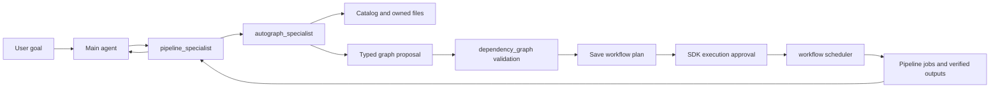
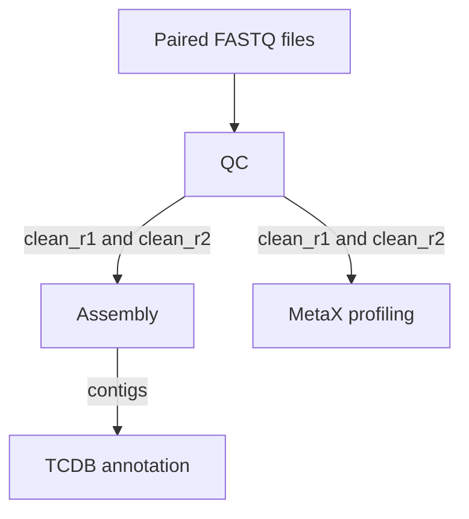

# Autograph: planning connected pipeline runs

Autograph turns a scientific request that needs multiple pipelines into a saved
dependency graph. Its central rule is that a downstream pipeline is submitted
only after its required upstream steps succeed and their declared outputs are
available. Independent steps may run concurrently.

## Responsibilities

| Component | Responsibility |
| --- | --- |
| Main agent | Understand the user's goal and delegate pipeline work to `pipeline_specialist`; present the result. |
| `pipeline_specialist` | Coordinate discovery, call `autograph_specialist` for a new combined analysis, save a ready proposal with `pipeline_shell`, and request execution approval. |
| `autograph_specialist` | Read installed pipeline contracts and owned file metadata; select pipelines and propose explicit links, parameters, reasons, and missing requirements. It cannot submit jobs. |
| `dependency_graph.py` | Deterministically check the proposed steps, input bindings, resources, and dependency order. |
| `workflow.py` | Persist the graph, schedule ready steps after approval, hand off verified outputs, and reconcile status after disconnects or restarts. |
| Pipeline engine | Plan and run each individual pipeline job through its configured local or isolated backend. |



The main agent does not need to construct `agent-pipeline` commands. The
`pipeline_specialist` owns `pipeline_shell` and passes the graph to the workflow
engine. Autograph designs the graph; the scheduler controls execution.

## How the graph is designed

1. `autograph_specialist` reads the full relevant pipeline contracts through
   `autograph_catalog`, using catalog pages or named lookup when needed. These
   contracts describe input slots, output names, formats, cardinality,
   parameters, limits, use cases, and limitations.
2. It reads files belonging to the active session through `autograph_files`.
   Registered remote results are marked unavailable locally until imported.
3. It selects the fewest suitable pipelines for the goal. It must reason about
   sample identity, paired reads, artifact meaning, and format compatibility;
   a matching filename extension alone is insufficient evidence.
4. It returns a typed `GraphProposal` with `status: ready` or
   `status: needs_input`. Every proposed step has an ID, pipeline name, input
   bindings, optional parameters and resource settings, and a reason. Every
   input slot also has a reason. `needs_input` names the missing files or
   decisions instead of inventing them.

An input source is either an existing workspace path or a declared output from
an earlier step. The latter is written as `{"step":"qc","output":"clean_r1"}`.
An output reference creates a dependency automatically. `depends_on` adds a
completion prerequisite when no output file is passed between steps.

This simplified graph shows the connections used in the [live four-pipeline
test](test_reports/combination_pipeline_2026-11-20.md):



The assembly step binds its `read1` and `read2` slots to the QC step's
`clean_r1` and `clean_r2` outputs. TCDB binds its `genome_fasta` slot to the
assembly step's `contigs` output. MetaX can run alongside assembly after QC;
TCDB must wait for assembly.

In the saved workflow protocol, the assembly handoff looks like this (other
step fields are omitted here):

```json
{
  "id": "assembly",
  "pipeline": "metagenomic_de_novo_assembly",
  "inputs": {
    "read1": {"step": "qc", "output": "clean_r1"},
    "read2": {"step": "qc", "output": "clean_r2"}
  }
}
```

The planner's typed proposal expresses each slot as sources plus a reason;
Autograph converts it to this input mapping before returning the proposal to
`pipeline_specialist`.

## Validation, approval, and execution

For a `ready` proposal, Autograph converts the typed steps to the workflow
protocol and calls `dependency_graph.build()` before returning them. The graph
validator checks installed definitions, required and unknown inputs, file
existence and confinement, input cardinality, required parameters, resource
limits, referenced output names, unknown steps, duplicate IDs, and cycles. It
orders the graph topologically and fingerprints existing workspace inputs.
Autograph can propose one step, but a saved multi-step workflow requires two to
16 steps; a one-step task uses the ordinary pipeline plan and run commands.

`pipeline_specialist` saves a ready multi-step graph with the allowlisted
`agent-pipeline workflow-plan --steps ...` operation. The saved workflow is
owned by the active session and records the execution backend, input
fingerprints, pipeline definition hashes, reasons, and input explanations.
Planning does not start jobs. The specialist then calls
`agent-pipeline workflow-run --workflow-id ...`, which opens the SDK approval
review. Execution begins only after approval.

The scheduler in `workflow.py` starts a waiting step only when every prerequisite
has succeeded. It currently allows at most **two active steps** at once. Before
launching a dependent job, it resolves the referenced upstream output, imports
a remote artifact into the session workspace when needed, and verifies input
hashes and the pipeline definition against the saved plan. A missing output
blocks the dependent; a failed prerequisite blocks downstream steps before they
are submitted. Cancellation stops active jobs and cancels waiting steps. A
background reconciler advances approved workflows after browser disconnects
and server restarts. Failed jobs are not automatically retried.

## What the checks establish

Graph validation establishes that a proposal is structurally executable under
the installed contracts. It does not prove the biological interpretation or
scientific suitability of the selected methods. The planner's reasons and the
SDK approval review make those decisions visible before execution.

The [combined pipeline validation report](test_reports/combination_pipeline_2026-11-20.md)
records a real QC → assembly/MetaX → TCDB run, verified output handoffs,
dependency ordering, parallel independent steps, blocked downstream work after
an upstream failure, cancellation, and a later live Autograph planning check.

## Implementation map

- [Pipeline coordinator and tools](../tools/agent_tools/specialist/pipeline/__init__.py)
- [Autograph agent and read-only discovery](../tools/agent_tools/specialist/pipeline/autograph.py)
- [Typed proposal contract](../tools/agent_tools/specialist/pipeline/graph_contracts.py)
- [Graph validator](../tools/infrastructure/pipeline_engine/dependency_graph.py)
- [Persistent scheduler](../tools/infrastructure/pipeline_engine/workflow.py)
- [Pipeline shell and SDK approval](../tools/agent_tools/specialist/pipeline/pipeline_shell.py)
- [Pipeline manifest contract](pipeline_definitions.md) and [agent-facing tool guide](tool_definitions.md)
