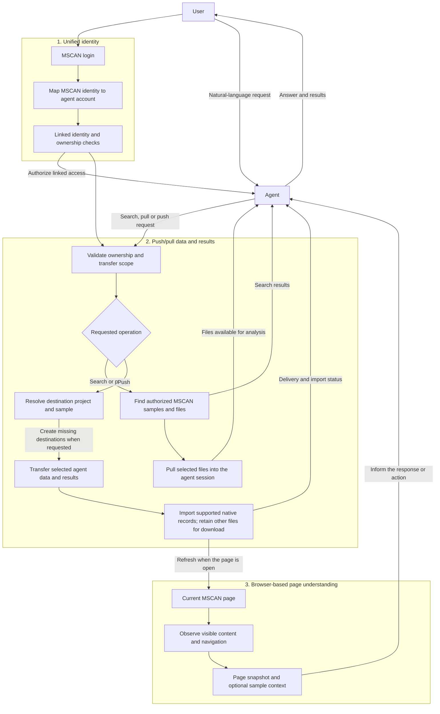

# MSCAN web bridge

Use natural-language requests in the agent to find samples, pull data from MSCAN,
and push data and analysis results back to MSCAN.

<a id="main-functions"></a>

## Overview

| Function | Purpose |
| --- | --- |
| **Unified identity** | Reuse the authenticated MSCAN SSO user ID in the agent and enforce access to the user's own data. |
| **Push/pull data and results** | Find and pull authorized files into an agent session; push selected data and results back to MSCAN, creating named projects or samples when requested. |
| **Browser-based page understanding** | Observe the current page, follow navigation and read visible content so the agent understands what the user is viewing. |

Browser understanding combines observation of the rendered page in the connected
MSCAN tab with optional structured context, such as the selected sample and
analysis tab. Data transfers use the backend connection and can continue when
the page is closed.

Already configured? Go to [Everyday startup](#everyday-startup). For a new
installation, complete the setup below first.

<a id="install-the-web-bridge-in-mscan"></a>

## First-time setup

The integration code is maintained directly in the sibling `mscan` and
`mscan-app` repositories. There is no adapter installation command and MSCAN
does not import configuration files from the BioAgent checkout. The integration
adds adapter-owned files, changes two frontend host files and adds a `bioagent`
section to the backend's local `application-druid.yml` profile. It does not
require a database migration.
The [technical reference](#technical-reference) lists the exact changes and checks.

### 1. Prepare the applications

The development workspace uses three independent sibling repositories:

```text
mscan_projects/
├── BioAgent/       # Agent server and generic web bridge
├── mscan/          # MSCAN Vue frontend
└── mscan-app/      # MSCAN Java backend
```

Have the agent's Python dependencies, Java 17, Maven, Node.js and pnpm available.
Install each frontend's dependencies using its package configuration. MSCAN's
normal database, Redis, object storage and login configuration must already work;
the bridge integration does not provision those services.

In this development environment, activate `openaisdk` first:

```bash
conda activate openaisdk
```

If the frontend reports `packages field missing or empty`, ensure its
`pnpm-workspace.yaml` retains `packages: ['.']`. This package-manager setting is
separate from the web bridge.

### 2. Verify the direct integration

The frontend adapter must exist under `mscan/src/integrations/bioagent/`, with
mount/context hooks in `src/App.vue` and
`src/views/sampleProgramResults/index.vue`. The backend adapter must exist under
`mscan-app/mscan-admin/src/main/java/com/mscan/web/controller/common/`.
These are ordinary tracked source files in their respective repositories.

No BioAgent-side MSCAN installer or duplicate host source is retained. When the
bridge contract changes, apply the required source changes directly to `mscan`
and `mscan-app`, preserving host-specific changes.

### 3. Configure the connection

Replace `YOUR_SERVER_IP` with the IP address of the server running MSCAN, as
accessed from your browser. For example, if that server is reachable at
`http://192.168.75.56`, use `192.168.75.56` in the command below. With the MSCAN
development frontend on port 8848, the complete browser origin is
`http://192.168.75.56:8848`.

```bash
python web_bridge/adapters/mscan/run.py init \
  --origins http://localhost:8848,http://127.0.0.1:8848,http://YOUR_SERVER_IP:8848
```

This configures BioAgent's private
`runtime/website-integration/clients.json`, including the service/signing
credentials, exact allowed MSCAN origins and shared-SSO identity mode.

Configure the matching backend values directly in
`mscan-app/mscan-admin/src/main/resources/application-druid.yml`:

```yaml
bioagent:
  enabled: true
  url: http://127.0.0.1:8000
  public-url: ""
  site-id: mscan
  secret: "MATCH_THE_MSCAN_SECRET_IN_CLIENTS_JSON"
  origins: "http://localhost:8848,http://127.0.0.1:8848,http://YOUR_SERVER_IP:8848"
  results-root: ./data/agent-results
  transfer-workers: 3
  transfer-poll-ms: 2000
  delivery-poll-ms: 5000
```

`url` is used by Java. `public-url` is used by browsers; when empty, MSCAN uses
the current browser hostname on port 8000. The `secret`, site ID and origins must
match BioAgent's client entry, but MSCAN keeps its own configuration and has no
runtime file dependency on BioAgent. Treat the YAML as sensitive after placing
the service secret in it. Restart both services after changing either side.

### 4. Install dependencies and build

From the BioAgent repository root:

```bash
npm --prefix frontend ci
pnpm --dir ../mscan install --frozen-lockfile
npm --prefix frontend run build
mvn -f ../mscan-app/pom.xml clean package -DskipTests
```

If the agent uses Docker workers, build its worker image as described in
[user isolation](user_isolation.md):

```bash
docker build -f isolation/deploy/Dockerfile -t bioagent-worker:local .
```

For a production MSCAN frontend deployment, also build its static files and
deploy the generated output through your existing hosting setup:

```bash
pnpm --dir ../mscan run build:pro
```

The development frontend uses Vite and does not require that production build.

## Everyday startup

After [first-time setup](#install-the-web-bridge-in-mscan), use your normal Python,
Java and pnpm commands in three separate terminals. The examples use this
workspace under `/media/data/fuhaoyi/codes/`, with `BioAgent`, `mscan` and
`mscan-app` as siblings. Replace the paths, browser address and credential
placeholders for your deployment. Stop an existing instance before starting
another on the same port.

### Terminal 1 — agent

```bash
conda activate openaisdk
cd /media/data/fuhaoyi/codes/BioAgent

export OPENROUTER_API_KEY="YOUR_OPENROUTER_API_KEY"

export CROMWELL_URL=http://192.168.164.46:39000
export CROMWELL_INPUT_STORAGE_ENDPOINT=http://192.168.164.46:7070
export CROMWELL_INPUT_STORAGE_URI=s3://cncb-web-server-mic/files
export CROMWELL_INPUT_STORAGE_REGION=us-east-1
export CROMWELL_INPUT_STORAGE_MOUNT_PREFIX=/data/versitygw/data/s3
export CROMWELL_INPUT_STORAGE_ACCESS_KEY="YOUR_STORAGE_ACCESS_KEY"
export CROMWELL_INPUT_STORAGE_SECRET_KEY="YOUR_STORAGE_SECRET_KEY"
export CROMWELL_OUTPUT_STORAGE_URI=s3://cncb-web-server-mic/cromwell/outputs
export CROMWELL_OUTPUT_STORAGE_MOUNT_PREFIX=/data/versitygw/data/s3/cncb-web-server-mic/cromwell/outputs
export CROMWELL_OUTPUT_STORAGE_EXECUTION_PATH_PREFIXES=/data/zhaomh/cromwell-workspace/cromwell-executions,/cromwell-share/cloud_cromwell/cromwell-executions

export AGENT_PROXY=socks5h://127.0.0.1:10801

unset AGENT_WEBSITE_CLIENTS
export AGENT_WEBSITE_CLIENTS_FILE="$PWD/runtime/website-integration/clients.json"

python -B -m interfaces.web --host 0.0.0.0 --port 8000
```

### Terminal 2 — MSCAN backend

```bash
conda activate openaisdk
cd /media/data/fuhaoyi/codes/mscan-app

mvn clean package -DskipTests &&
java -jar mscan-admin/target/mscan-admin.jar \
  --spring.profiles.active=druid
```

### Terminal 3 — MSCAN frontend

```bash
conda activate openaisdk
cd /media/data/fuhaoyi/codes/mscan

pnpm install --frozen-lockfile &&
pnpm dev
```

Open `http://YOUR_SERVER_IP:8000` for the standalone agent or
`http://YOUR_SERVER_IP:8848` for MSCAN. Sign in using your configured MSCAN login,
select a sample and open **Ask assistant**. Local MSCAN access can use
`http://localhost:8848`. Its browser origin must be allowed in both
MSCAN's `bioagent.origins` and the agent's private client configuration.

From the BioAgent root, the agent automatically discovers
`runtime/website-integration/clients.json` when neither client environment
variable is set. The explicit export above also prevents ambiguity when a
different working directory is used. MSCAN reads only its own
`application-druid.yml`; it does not read BioAgent's runtime files. Keep the two
sides' site ID, service secret and allowed origins consistent.

You do **not** need Maven or `pnpm install` for every restart. Rebuild the backend
after code changes; install dependencies after their declarations or lockfiles
change. Keep real API and storage keys in your private environment, outside Git.

## Unified identity and login

The service credential identifies **MSCAN's backend** to the agent. MSCAN's
user login identifies **the person**. `run.py init` generates the service and
signing secrets; it does not know or store a user's login password.

For the MSCAN adapter, `run.py init` enables shared SSO user IDs. The authenticated
Java backend sends the verified MSCAN user ID and username together with the
authenticated subject; browser-supplied identities are not accepted. The agent
validates that the two user IDs match, then creates or reuses the account with
that same user ID. The same verified SSO ID can therefore resolve to the same
agent account across sites configured for this mode. No manual account-link
command is required. Existing external mappings take precedence so upgrades do
not orphan prior conversations or artifacts.

The development login bypass supplies a configured development user without a
login screen. Restore real MSCAN login for distinct users; the adapter reads the
verified user from MSCAN's backend authentication. Production CAS sign-in still
needs acceptance testing with real accounts; development bypass checks do not
establish production user separation.

MSCAN logout revokes that site's agent logins and bridge bindings while retaining
completed artifacts, standalone agent logins and the persistent identity mapping.
Logout is not permanent unlinking; there is currently no public unlink endpoint
or unlink CLI. See [identity and production login](../web_bridge/adapters/mscan/README.md#user-identity-and-production-login)
for the adapter's ownership rules and logout behavior.

<a id="example-requests"></a>

## Usage examples

> “Find my samples in MSCAN project A.”

> “Pull the FASTQ files for sample B and run QC.”

> “Push these results to sample B in MSCAN.”

> “Create project C, add this sample, and upload its data and results.”

Search, pull and push use natural language in the agent; no transfer buttons are
needed on the agent page. Backend transfers require a linked identity and a
running connector, but can continue with the browser closed. Page observation
requires the connected MSCAN tab.

Received files appear in **Download files** on the sample toolbar. Supported
result formats also populate native MSCAN analysis records. Check `file_delivery`
and each job's `native_imports` separately: receiving a ZIP does not prove that
native records were imported. An unsupported or incomplete format can remain a
downloadable file. See the [supported importer contracts](../web_bridge/README.md#analysis-result-exchange).

## Troubleshooting

| Symptom | What to check |
| --- | --- |
| **Ask assistant** is missing | Set `bioagent.enabled: true` in MSCAN's active profile. Confirm the agent is running and reachable at `bioagent.public-url` (or the derived browser-host URL), then reload MSCAN. |
| Origin is rejected | Match the browser's exact scheme, hostname and port in BioAgent's `clients.json` and MSCAN's `bioagent.origins`. Check any explicit `AGENT_WEBSITE_SITES` override. Restart affected services after changes. |
| Connection or sign-in fails | Confirm both sides use the same site ID and service secret and that MSCAN has an authenticated user (or the development bypass). Java uses `bioagent.url`; browsers use `bioagent.public-url`. |
| `clients.json` cannot be read | Run `run.py init` from the BioAgent root or correct `AGENT_WEBSITE_CLIENTS_FILE`, then restart BioAgent. MSCAN does not read this file. |
| Transfer remains queued/running | Check `website_transfer_status` and the MSCAN backend logs. The backend connector must remain running. A queued response is not a completed transfer. |
| Files arrived but native results are missing | Inspect `native_imports` for missing output roles, incompatible sample types, unsupported formats or parser errors. Resolve the reported cause before retrying a failed transfer. |
| Native results exist but the page is stale | Reload the selected sample/view. Automatic refresh can miss status-only receipt updates; verify the import receipt before assuming a transfer failed. |

For agent login, Docker workers and storage limits, see [user isolation](user_isolation.md).
For generic API, origin and transfer contracts, see [web integration](web_integration.md).

## Updates and custom deployments

### After code or configuration changes

| Change | Required action |
| --- | --- |
| MSCAN adapter source | Apply the change directly in the tracked `mscan` or `mscan-app` integration files, rebuild the affected project and restart it. |
| Agent frontend or embed SDK | Run `npm --prefix frontend run build`, then reload the browser. |
| Agent Python code | Restart the agent; rebuild its worker image when worker/tool code changes. |
| Dependencies or lockfiles | Reinstall the affected dependencies and rebuild that application/image. |
| Client origins, URLs or service credentials | Update BioAgent's private client entry and MSCAN's `application-druid.yml` directly, keep their site ID/secret/origins consistent, then restart both services. |

Keep the existing private configuration and account databases across restarts.
You do not need to rerun `init` or relink users for ordinary restarts.

### Custom configuration

For normal startup, use the [three terminals above](#everyday-startup). BioAgent's
agent-only launcher remains available:

```bash
python web_bridge/adapters/mscan/run.py agent
```

Select an alternative private BioAgent client config by exporting
`AGENT_WEBSITE_CLIENTS_FILE=/absolute/path/to/clients.json`. Clear an inline
`AGENT_WEBSITE_CLIENTS` override as shown above. If you explicitly set
`AGENT_WEBSITE_SITES`, keep it consistent with both configured origin lists.
For separate hosts, set MSCAN's `bioagent.url` to an address reachable by Java
and `bioagent.public-url` to an address reachable by users' browsers.
`bioagent.results-root` selects persistent MSCAN-owned result storage. Direct
Java startup keeps MSCAN's normal scheduler configuration;
append `--scheduled.cromwellPoll.enabled=false` only when you want polling disabled.

MSCAN processes up to three bridge transfer commands concurrently by default.
Change `bioagent.transfer-workers` in `application-druid.yml` to adjust that
limit; writes to the same sample remain serialized within that backend process.

## Technical reference

Embedded chat, native result importers, result refreshes and logout synchronization
support these three functions. The generic web bridge handles identity,
communication, browser observation and transfers; the MSCAN adapter supplies
MSCAN-specific project, sample and result mappings. Agent-facing tool definitions
live in `tools/function_tools/website/`; the website specialist lives in
`tools/agent_tools/specialist/website_guide.py`. Other modules can call bridge
services directly without the agent tool layer.

### Flow chart



### Direct integration baseline

The runnable integration is tracked directly in the sibling `mscan` and
`mscan-app` repositories. BioAgent retains only the client configuration helper,
integration guide and reusable validation probes under
`web_bridge/adapters/mscan/`; it does not retain duplicate Java, Vue or
TypeScript host sources.

### Existing MSCAN files changed

Paths below are relative to the workspace containing the three repositories.

| File | Direct change | Purpose |
| --- | --- | --- |
| `mscan/src/App.vue` | `AssistantBridge` import and component | Mount the embedded assistant across page navigation |
| `mscan/src/views/sampleProgramResults/index.vue` | Context registration, result-refresh listener, component refresh key and `SampleFileMenu` | Share the selected sample and tab, refresh received results and provide downloads |
| `mscan-app/mscan-admin/src/main/resources/application-druid.yml` | Direct `bioagent.*` settings | Configure the connector without cross-project file references |

MSCAN's existing framework/security Java sources, database services, pipeline definitions,
`SecurityConfig.java`, `CasClientConfig.java`, frontend user store and QC panel
remain unchanged.

### Adapter files maintained in MSCAN

| Destination | Added files |
| --- | --- |
| Frontend `src/integrations/bioagent/` | `AssistantBridge.vue`, `context.ts`, `logout.ts`, `SampleFileMenu.vue`, `sampleFiles.ts` |
| Backend `mscan-admin/src/main/java/com/mscan/web/controller/common/` | `AssistantController.java`, `AssistantTransferService.java`, `AssistantDeliveryService.java`, `TransferLocks.java`, `ResultImporterRegistry.java`, `ResultImportService.java`, `QcResultImporter.java`, `NativeImportContext.java`, `NativeResultResources.java`, `WebsiteLogoutEvent.java`, `WebsiteLogoutHook.java`, `WebsiteDownloadSecurity.java` |

Logout uses a frontend Pinia action subscription and a backend Spring aspect
that observes the verified session before invalidation. Download security uses
an added filter chain scoped to GET `/assistant/received-download/*`; the
controller validates the expiring, one-use ticket and resource ownership.
Other routes retain MSCAN's existing authentication.

Older bridge patches in the user store, CAS configuration and security
configuration are not required by this version. Remove only known legacy bridge
insertions and preserve unrelated host customizations.

### Verify the direct integration

Build the directly integrated projects and run the adapter checks:

```bash
pnpm --dir ../mscan type:check
mvn -f ../mscan-app/pom.xml clean package -DskipTests
python -B -m web_bridge.tests.check_mscan_java --root ../mscan-app
python -B -m web_bridge.tests.check_mscan_logout \
  --jar ../mscan-app/mscan-admin/target/mscan-admin.jar
```

These cover frontend typing, backend compilation, native resource ownership,
result importing, QC formats, scoped download security, bounded transfer
concurrency and logout revocation. They do not run analysis pipelines.
For browser acceptance checks and their requirements, see
[Validate](../web_bridge/adapters/mscan/README.md#validate).
