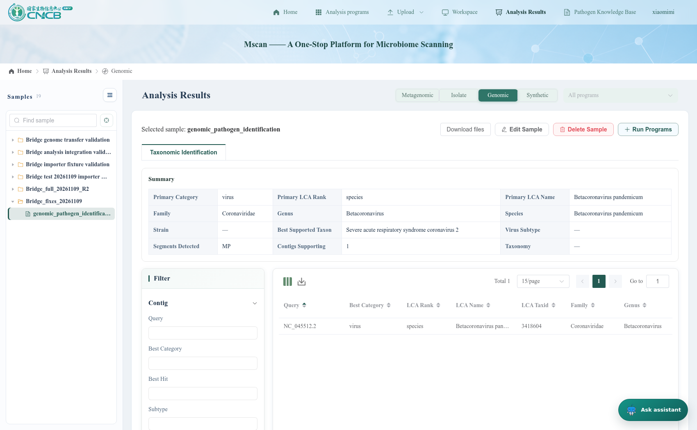
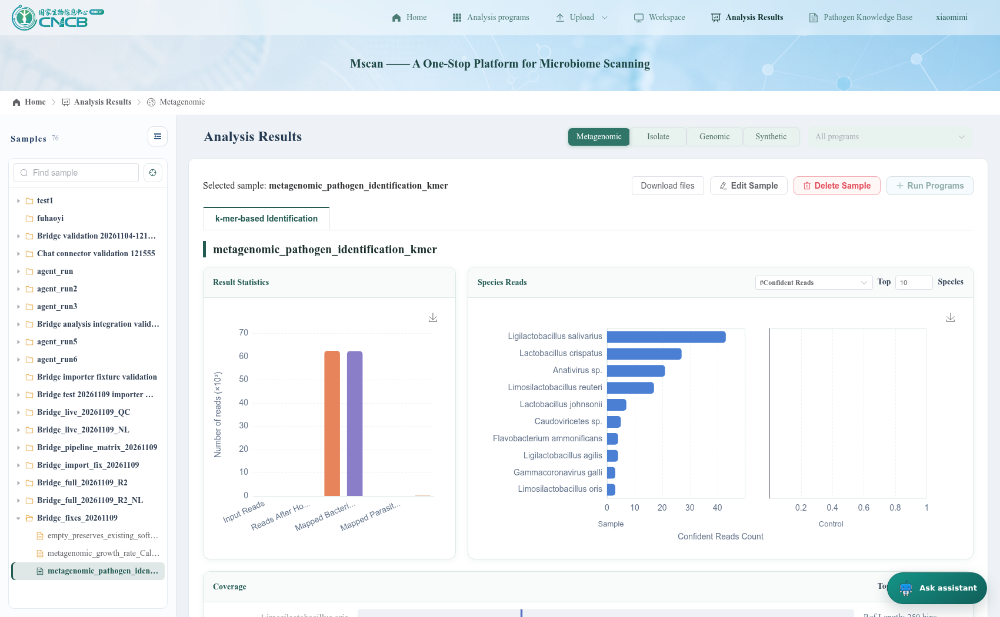
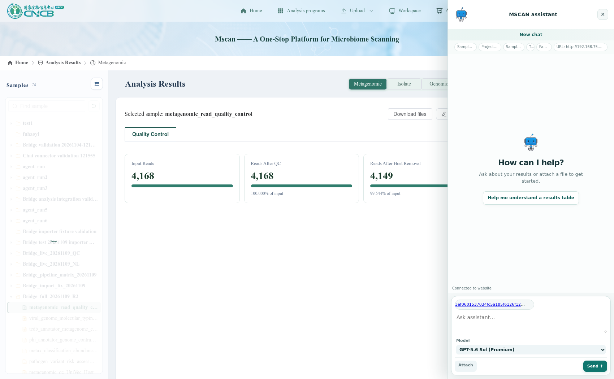
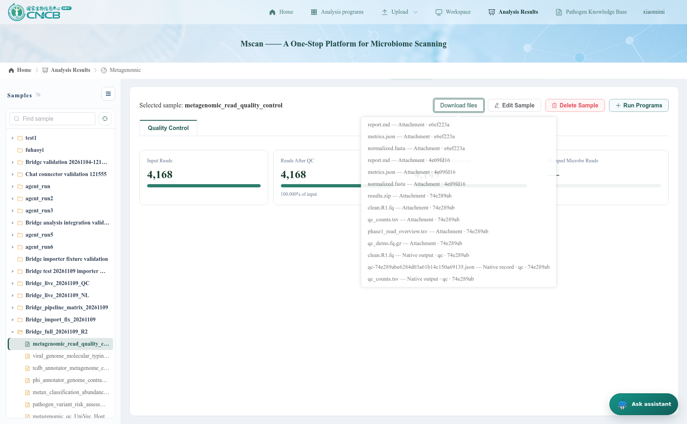
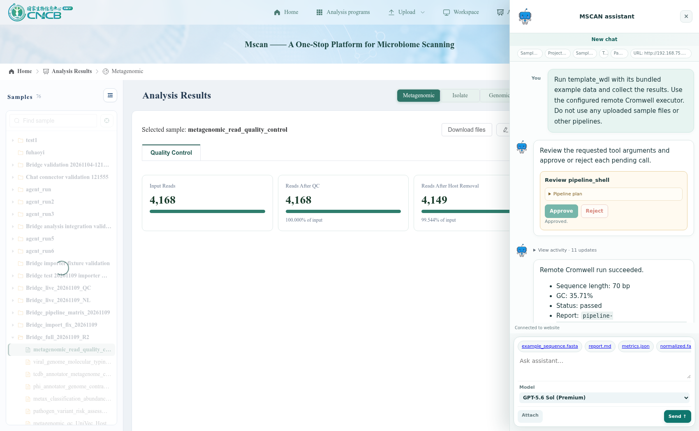

# MSCAN bridge bug fixes — live validation, 2026-11-09

Follow-up to the [R2 live test report](mscan_pipeline_bridge_test_report_2026-11-09_r2.md). The earlier report records the failures before these changes. This report covers the fixes and their verification.

## Fixed behavior

| Finding | Change | Verification |
|---|---|---|
| CSV export returned the wrong artifact schema | Resolve the published file from the owning session; return canonical workspace metadata. Disk operations run outside the async event loop. | Live `website_import_data` succeeds; exported CSV downloads from the embedded assistant after reload. |
| Embedded results had filenames but no usable links | Render authenticated download links in the workspace file list; refresh it when runs finish or reconnect. | Fresh remote `template_wdl` finishes while MSCAN is closed; reopening restores results and downloads valid `metrics.json`. |
| Genomic identification rejected repeated output roles | Keep repeated WDL roles as arrays, while requiring scalar native inputs to be unambiguous; register `MashIdentify`. | Replayed the R2 job’s real output bundle; native import succeeds and its native JSON record pulls back to the owning agent session. |
| K-mer outputs were only generic attachments | Register `StrobeTaxaDetection` against MSCAN’s existing parser, and expose its native records for search/pull. | Replayed the real R2 output bundle; native import succeeds, 21 native records are discoverable, and a record pulls back with the correct sample ID. |
| Empty growth CSV falsely reported imported | Header-only input returns `empty` before mutation; a transactional postcondition rolls back if the parser produces no valid records. | Both header-only and invalid-numeric fixtures preserve existing native record IDs and SHA-256 values. |
| Duplicate download filenames were ambiguous | Label receipt attachments separately from native outputs/records, including their receipt or record identity. | Browser sees distinct `qc_counts.tsv` labels and downloads the attachment successfully. |
| Highlight callback missing | Add a callback restricted to registered, visible resources and fixed selectors. | QC highlighting succeeds; an unregistered `body` target is rejected. |

## Native import replay

These cases reuse existing R2 outputs. They do not rerun biological workflows. The only new workflow execution in this follow-up is the bundled WDL template used to verify detached completion and downloads.

| Pipeline output | Native result | Destination |
|---|---|---|
| `genomic_pathogen_identification` | `MashIdentify` → **imported** | `Bridge_fixes_20261109` / `2e930d0b43333ac19973e935be27fb47` |
| `metagenomic_pathogen_identification_kmer` | `StrobeTaxaDetection` → **imported** | `Bridge_fixes_20261109` / `6d3b542a2d5c38bba8cd81ef02d0a396` |
| `metagenomic_growth_rate_Calculation` | `StrainCoPTR` → **empty** | `Bridge_fixes_20261109` / `6ca0a95ade7b37bc9383ef749e1042e6` |

[Exact source paths, transfer IDs and importer responses](mscan_bridge_bugfix_validation_2026-11-09/replayed-imports.json); [Native pull-back evidence](mscan_bridge_bugfix_validation_2026-11-09/native-exports.json).

## Empty-result preservation

A clearly labelled synthetic software fixture creates one growth record (`software_fixture`, value `0.5`). A header-only CSV is then sent to that same sample, followed by a separate CSV containing `NaN`. Neither is a scientific workflow run. Both return native state `empty`, and the previous record’s identity and content hash remain unchanged.

[Header-only preservation](mscan_bridge_bugfix_validation_2026-11-09/empty-preservation.json); [Invalid numeric result rollback](mscan_bridge_bugfix_validation_2026-11-09/invalid-preservation.json).

## Browser verification

[CSV, highlighting, download and label checks](mscan_bridge_bugfix_validation_2026-11-09/browser/checks.json); [Detached WDL completion and download checks](mscan_bridge_bugfix_validation_2026-11-09/detached/checks.json).

## Builds and regression checks

| Check | Result | Evidence |
|---|---|---|
| Web bridge Python unittest suite | 47 passed | [Log](mscan_bridge_bugfix_validation_2026-11-09/python-tests.log) |
| MSCAN Java checks | Six check programs passed, including ownership, importer contracts, empty output and ambiguous scalar regression cases | [Log](mscan_bridge_bugfix_validation_2026-11-09/java-tests.log) |
| Clean installation from original ZIPs | Passed; repeated installation leaves files identical | [Log](mscan_bridge_bugfix_validation_2026-11-09/installer-test.log) |
| Agent frontend (`pnpm --dir frontend build`) | Passed | [Log](mscan_bridge_bugfix_validation_2026-11-09/frontend-build.log) |
| MSCAN frontend (`pnpm run build:dev`) | Passed, including type checking; existing dependency/style warnings remain | [Log](mscan_bridge_bugfix_validation_2026-11-09/mscan-ui-build.log) |
| MSCAN backend (`mvn package -DskipTests`) | Passed; standalone Java regression checks run separately above | Build and live backend verified |

The initial Python test command inherited an invalid shell proxy scheme; rerunning with proxy variables removed passed. An early label check clicked a hover-triggered menu and closed it; the corrected browser check waits for the actual attachment label. Neither harness issue is reported as an application failure.

During validation, rebuilding a JAR used by the running backend caused lazy class-loading failures. The backend was stopped, rebuilt and restarted from a separate runtime copy; requests recovered. The startup documentation now says to stop the backend before rebuilding.

## Installation changes

Changes stay in the generic tool/UI code and the MSCAN adapter. The installer retains the three frontend hooks and adds two narrow import-only methods across four existing backend files: `IGenomeTracingService` plus its implementation, and `IMetadataProcessService` plus its implementation. These delegate to existing parsers and do not call a poller or submit additional workflows. No database migration is needed. See [adapter installation details](../../web_bridge/adapters/mscan/README.md#minimal-mscan-changes).

The native registry now advertises 17 formats. Five template pipelines still have no corresponding MSCAN analysis schema: their generic attachments remain available, and their native state remains explicitly `unsupported`. No unrelated native records are fabricated.

## Remaining limits

- The two earlier long-running analyses were cancelled at the R2 test’s 15-minute observation limit. Their eventual completion was not verified here. No execution limit or pipeline definition was changed.
- Production CAS login and permanent account unlinking remain unverified; the live MSCAN environment still uses the development login bypass.
- Original R2 safety exclusions remain in place. No skipped biological workflow was executed during this fix.
- Agent and MSCAN remain running. [Final health and unchanged pipeline check](mscan_bridge_bugfix_validation_2026-11-09/final-checks.json).
