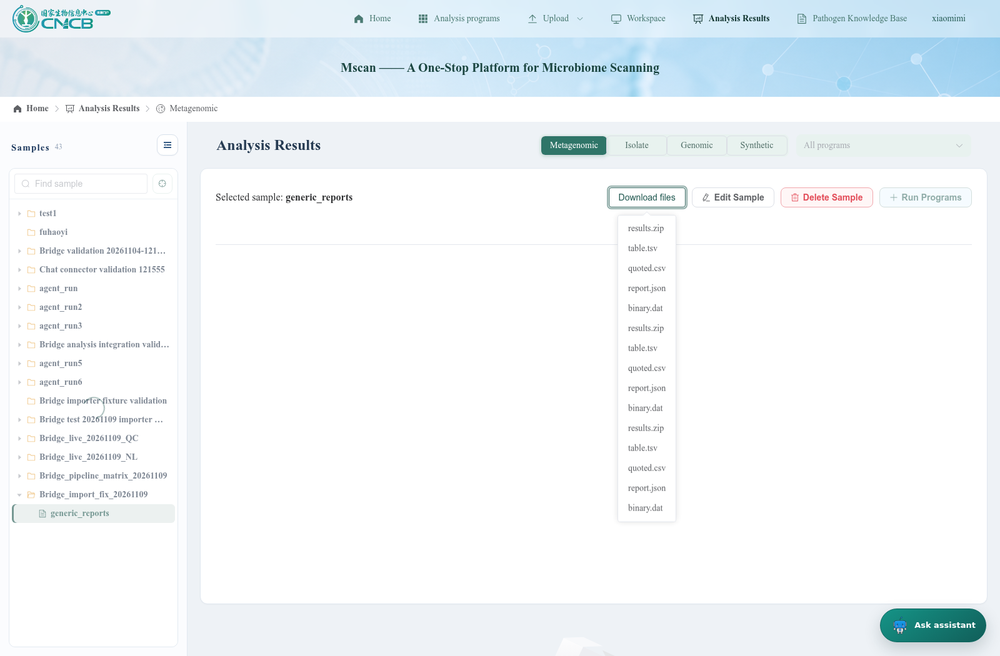

# MSCAN importer repair and generic-result verification — 2026-11-09

Follow-up to [the original full-system report](mscan_web_bridge_test_report_2026-11-09.md). The original report remains the baseline; its ten native conversion failures are resolved by this follow-up.

## Result

All **10 previously failing dummy-fixture transfers were retried successfully** against the running MSCAN backend. Combining those retries with the original six successes gives this 19-case matrix:

| Outcome | Before | After |
|---|---:|---:|
| Native imported | 6 | 16 |
| Native failed | 10 | 0 |
| Incomplete inputs (expected) | 1 | 1 |
| Incompatible sample type (expected) | 1 | 1 |
| Unsupported native format, files attached (expected) | 1 | 1 |

The six original successes and three deliberate negative cases were retained from the baseline, not claimed as newly rerun live cases. The existing Java regression checks were rerun. The live retry matrix uses small artificial fixtures already present in the original test. No biological workflow was submitted or rerun for this repair; these checks validate software import and storage behavior, not scientific correctness or every possible pipeline output schema.

## Root cause and reproduction

MSCAN’s Java process inherited `http_proxy=http://127.0.0.1:10801/`. DuckDB httpfs rejected the trailing slash with `Failed to parse port from http_proxy`. Its outer exception obscured this with “Attempting to execute an unsuccessful or closed pending query result.” A direct JDBC probe reproduced the failure reading an already uploaded dummy table. Normalizing the same proxy URL to `http://127.0.0.1:10801` allowed that same object to convert to Parquet and read back correctly.

This was a shared storage-reader environment error, not evidence of ten independently broken result mappings. No changes were made to MSCAN’s scientific parser implementations, database schema, or BioAgent’s pipeline definitions.

## Changes

- `run.py backend` now removes a root trailing slash from HTTP(S) proxy URLs, preserving credentials and NO_PROXY settings. The direct `java -jar` startup documentation includes equivalent exports. The live backend was restarted with its original configuration and normalized proxy environment.
- `ImportFailure` classifies nested failures using stable, credential-free error codes. It does not return raw JDBC SQL or proxy credentials.
- `ResultArtifactInspector` adds pipeline-independent metadata for newly delivered TSV, quoted CSV, JSON, text, and binary files. It reads at most 64 KiB, samples at most three table rows, and bounds each metadata object to 1,536 bytes. These limits affect previews only; full artifacts remain unchanged and downloadable.
- Receipts explicitly separate `generic_import` (sample file attachment) from native mapping status. Connector capabilities advertise generic results alongside native format contracts.
- The installer corrects one original frontend condition in ProgramResultPanel.vue: synthetic samples now use the assembly-results component instead of querying reads records. Browser testing exposed this separate display bug after the native imports were repaired.
- Existing ownership checks, transactional native writes, retry behavior, and newer-result preservation remain in place.

An LLM can use the discovered metadata and pull the complete files through existing bridge tools. No new LLM-driven parser or database-writing step was introduced: it would not solve this proxy failure and cannot reliably invent absent native fields. Unknown formats remain attached files rather than fabricated native records. Native table views still require a validated format contract.

## Native importer retries

Input fixtures and original runs are documented in the baseline report. Retries reused the same transfer IDs, destinations, and received files. [Raw retry receipts](mscan_importer_fix_2026-11-09/retry-results.json) and [combined matrix](mscan_importer_fix_2026-11-09/matrix.json) provide the exact identities.

| Format | Sample type | Before → after | Live page screenshot |
|---|---|---|---|
| FuncAssembly | genomic | failed → imported | [MSCAN page](mscan_importer_fix_2026-11-09/screenshots/01-FuncAssembly-genomic.png) |
| FuncAssembly | synthetic | failed → imported | [MSCAN page](mscan_importer_fix_2026-11-09/screenshots/02-FuncAssembly-synthetic.png) |
| FuncReads | meta | failed → imported | [MSCAN page](mscan_importer_fix_2026-11-09/screenshots/03-FuncReads-meta.png) |
| TcdbAnnotatorGenome | genomic | failed → imported | [MSCAN page](mscan_importer_fix_2026-11-09/screenshots/04-TcdbAnnotatorGenome-genomic.png) |
| PhiAnnotatorGenome | genomic | failed → imported | [MSCAN page](mscan_importer_fix_2026-11-09/screenshots/05-PhiAnnotatorGenome-genomic.png) |
| PhiAnnotatorMetagenome | meta | failed → imported | [MSCAN page](mscan_importer_fix_2026-11-09/screenshots/06-PhiAnnotatorMetagenome-meta.png) |
| BacDef | genomic | failed → imported | [MSCAN page](mscan_importer_fix_2026-11-09/screenshots/07-BacDef-genomic.png) |
| BacBGC | genomic | failed → imported | [MSCAN page](mscan_importer_fix_2026-11-09/screenshots/08-BacBGC-genomic.png) |
| TcdbAnnotatorMetagenome | shortReads | failed → imported | [MSCAN page](mscan_importer_fix_2026-11-09/screenshots/09-TcdbAnnotatorMetagenome-shortReads.png) |
| BacSec | genomic | failed → imported | [MSCAN page](mscan_importer_fix_2026-11-09/screenshots/10-BacSec-genomic.png) |

Browser checks verified the dummy table row on the genomic, synthetic, and metagenomic functional-result pages, loaded the other MSCAN pages, and independently read `/assistant/received` for every retried sample, asserting the saved native state was `imported`. HTTP error responses are recorded in [browser evidence](mscan_importer_fix_2026-11-09/browser-checks.json). A minimal fixture supplies only its declared files; empty unrelated native tabs do not indicate a failed import.

## Generic pipeline round trip

The new test constructed a completed-job fixture named `generic_report_regression`, with an unregistered `GenericReport` output namespace. This exercises result delivery without executing a scientific pipeline. It pushed to MSCAN project `Bridge_import_fix_20261109`, sample `generic_reports`.

| Input | Content | Discovered type | Result |
|---|---|---|---|
| `table.tsv` | Header `item`, `value`; row `example`, `1` | table | push, search, pull passed; exact bytes matched |
| `quoted.csv` | Header `item,value`; quoted value `two, words`, `2` | table | push, search, pull passed; exact bytes matched |
| `report.json` | `[{"item":"example","value":3}]` | json | push, search, pull passed; exact bytes matched |
| `binary.dat` | Four bytes: `00 01 ff 08` | file | push, search, pull passed; exact bytes matched |

The transfer succeeded with `generic_import.state=imported` and native `state=unsupported`, accurately distinguishing attached files from native records. [Inputs, discovery metadata, transfer results, and hash checks](mscan_importer_fix_2026-11-09/generic-roundtrip.json).

Test-harness note: repeating the test against the same sample correctly preserved previous deliveries. An initial rerun counted eight matching filenames rather than four. The harness was corrected to select resources by the current transfer ID, and the final run passed. No product data was deleted to make the test pass.

## Automated checks

- Maven backend package completed.
- Two Python proxy-normalization tests passed, covering root slashes, credential preservation, NO_PROXY, unchanged invalid/non-root URLs and idempotence.
- Six Java check programs passed: ownership boundaries; QC formats; receipt/job scope, retries and negative outcomes; generic previews and sanitized failures; download security; concurrent transfers and sample locks.
- Generic preview checks cover quoted multiline CSV, renamed TSV, malformed/duplicate headers, JSON, binary data, and bounded previews without modifying original files.
- Clean-ZIP installation passed: exactly three original frontend files modified, original line endings preserved, reinstallation identical.
- `git diff --check` passed.

[Check summary](mscan_importer_fix_2026-11-09/checks.txt).

## Deployment and limits

The canonical changes live in the web-bridge adapter and documentation. The installer copied them into the local MSCAN checkout; one narrow original-file fix was added in ProgramResultPanel.vue for synthetic-sample result display. Existing App.vue and sampleProgramResults hooks remain unchanged. The live agent and MSCAN frontend remained running. The rebuilt MSCAN backend is running with normalized proxy settings.

MSCAN still uses the development login bypass. This follow-up does not establish production-login readiness, arbitrary native-format compatibility, or scientific pipeline correctness. Older successfully delivered receipts retain their original metadata; new deliveries receive generic previews. Real application screenshots are included above; no generated evidence pages are presented as application UI.
