# MSCAN pipeline and web bridge live test — 2026-11-09 (R2)

Follow-up: the confirmed bridge bugs were fixed and retested in the [bug-fix validation report](mscan_bridge_bugfix_validation_2026-11-09.md). The results below describe the original test run.

This is a fresh test of the current 28-pipeline checkout. It does not reuse the earlier 37-pipeline execution totals. The user authorized live testing and explicitly allowed unsafe workflows to be skipped. Scientific workflows outside the permitted scope were not executed.

## Results at a glance

- Pipeline definitions inspected: **28**. **12 succeeded**, **2 timed out and were cancelled**, **14 skipped for safety**.
- Push/pull checks passed for **12 actual input/result sets** and **16 inert JSON fixtures**. Downloaded files with matching SHA-256: **101/101**. Inert transfers do not count as successful pipeline executions.
- Native importer reported **5 imported** (including one empty growth result) and **7 unsupported**. All successful jobs delivered their generic attachments.
- Live bridge checks include login/account mapping, page observation/navigation, table/chart/manual reading, source imports, natural-language search/pull/push, existing/new destinations, bad-resource retries, cross-user denial, logout/reconnection, and Stop.
- These are integration checks, not validation of scientific accuracy. Not every pipeline completed, and not every result format has a native MSCAN importer.

## Environment and method

- Checkout: `pipeline2agent-v3.0.0`, commit `11f845ddbe1e246072dc6ff1aca0bdb484ecaed6`.
- Agent: `http://192.168.75.56:8000`; MSCAN frontend: `http://192.168.75.56:8848`; backend: port 8080. Configured remote Cromwell was used.
- Agent user: `fuhaoyi`; MSCAN development identity: `xiaomimi`. Credentials and browser login storage are excluded from this report.
- Docker worker was rebuilt before execution and verified to contain 28 manifests. Image: `sha256:6c93124cdb2d35cef091406f064141ebca9785d5424e82f6d4b136e38387d0b0`.
- Pipeline cases used the isolated broker under the authenticated user scope, bundled examples, default parameters, and actual configured engines. The separate natural-language browser cases used the application model selection `gpt-5.6-sol`.
- Execution observation limit: 15 minutes per workflow after admission. On timeout, cancellation was requested and remote terminal status checked. Timeout does not prove that a workflow could never finish.
- The account pipeline quota is 2 concurrent jobs. An initial three-worker harness exceeded that quota. Admission failures were preserved, then retried with waiting; they are not counted as scientific workflow failures.
- For each successful job: push actual bundled inputs plus its results ZIP, create/reuse a dedicated project/sample, search the receipt, pull each delivered resource, and compare SHA-256.
- For safety-skipped or timed-out workflows: only an explicitly labelled `contract-check.json` was transferred. Those transfers do not validate scientific execution or native result parsing.
- Dedicated MSCAN projects: `Bridge_full_20261109_R2` and `Bridge_full_20261109_R2_NL`. They remain available for inspection.

[Preflight evidence](mscan_pipeline_bridge_2026-11-09_r2/preflight.json)

## Pipeline matrix

| Pipeline | Engine | Execution | Push/pull | Native import | Evidence |
|---|---|---|---|---|---|
| bacterial_biosynthetic_gene_clusters | wdl | not_executed | passed (inert JSON) | Not exercised | [JSON](mscan_pipeline_bridge_2026-11-09_r2/pipelines/bacterial_biosynthetic_gene_clusters.json) |
| bacterial_defense_system_annotation | wdl | not_executed | passed (inert JSON) | Not exercised | [JSON](mscan_pipeline_bridge_2026-11-09_r2/pipelines/bacterial_defense_system_annotation.json) |
| bacterial_secretion_system_annotation | wdl | not_executed | passed (inert JSON) | Not exercised | [JSON](mscan_pipeline_bridge_2026-11-09_r2/pipelines/bacterial_secretion_system_annotation.json) |
| bacterial_viral_variant_analysis | wdl | not_executed | passed (inert JSON) | Not exercised | [JSON](mscan_pipeline_bridge_2026-11-09_r2/pipelines/bacterial_viral_variant_analysis.json) |
| genomic_pathogen_identification | wdl | succeeded | passed (inputs/results) | unrecognized: unsupported | [JSON](mscan_pipeline_bridge_2026-11-09_r2/pipelines/genomic_pathogen_identification.json) |
| metagenomic_de_novo_assembly | wdl | observation_timeout | passed (inert JSON) | Not exercised | [JSON](mscan_pipeline_bridge_2026-11-09_r2/pipelines/metagenomic_de_novo_assembly.json) |
| metagenomic_growth_rate_Calculation | wdl | succeeded | passed (inputs/results) | StrainCoPTR: imported | [JSON](mscan_pipeline_bridge_2026-11-09_r2/pipelines/metagenomic_growth_rate_Calculation.json) |
| metagenomic_pathogen_identification | wdl | observation_timeout | passed (inert JSON) | Not exercised | [JSON](mscan_pipeline_bridge_2026-11-09_r2/pipelines/metagenomic_pathogen_identification.json) |
| metagenomic_pathogen_identification_kmer | wdl | succeeded | passed (inputs/results) | StrobeTaxaDetection: unsupported | [JSON](mscan_pipeline_bridge_2026-11-09_r2/pipelines/metagenomic_pathogen_identification_kmer.json) |
| metagenomic_pathogen_identification_marker | wdl | succeeded | passed (inputs/results) | StrainMeta: imported | [JSON](mscan_pipeline_bridge_2026-11-09_r2/pipelines/metagenomic_pathogen_identification_marker.json) |
| metagenomic_qc_UniVec_Host | wdl | succeeded | passed (inputs/results) | ReadQc: imported | [JSON](mscan_pipeline_bridge_2026-11-09_r2/pipelines/metagenomic_qc_UniVec_Host.json) |
| metagenomic_read_quality_control | wdl | succeeded | passed (inputs/results) | MetagenomicQc: imported | [JSON](mscan_pipeline_bridge_2026-11-09_r2/pipelines/metagenomic_read_quality_control.json) |
| metax_classification_abundance_analysis | wdl | succeeded | passed (inputs/results) | metax: imported | [JSON](mscan_pipeline_bridge_2026-11-09_r2/pipelines/metax_classification_abundance_analysis.json) |
| pathogen_variant_risk_assessment | wdl | not_executed | passed (inert JSON) | Not exercised | [JSON](mscan_pipeline_bridge_2026-11-09_r2/pipelines/pathogen_variant_risk_assessment.json) |
| pathogen_variant_risk_assessment_consensus | wdl | not_executed | passed (inert JSON) | Not exercised | [JSON](mscan_pipeline_bridge_2026-11-09_r2/pipelines/pathogen_variant_risk_assessment_consensus.json) |
| phi_annotator_genome | wdl | not_executed | passed (inert JSON) | Not exercised | [JSON](mscan_pipeline_bridge_2026-11-09_r2/pipelines/phi_annotator_genome.json) |
| phi_annotator_metagenome | wdl | not_executed | passed (inert JSON) | Not exercised | [JSON](mscan_pipeline_bridge_2026-11-09_r2/pipelines/phi_annotator_metagenome.json) |
| risk_screen | wdl | not_executed | passed (inert JSON) | Not exercised | [JSON](mscan_pipeline_bridge_2026-11-09_r2/pipelines/risk_screen.json) |
| tcdb_annotator_genome | wdl | not_executed | passed (inert JSON) | Not exercised | [JSON](mscan_pipeline_bridge_2026-11-09_r2/pipelines/tcdb_annotator_genome.json) |
| tcdb_annotator_metagenome | wdl | not_executed | passed (inert JSON) | Not exercised | [JSON](mscan_pipeline_bridge_2026-11-09_r2/pipelines/tcdb_annotator_metagenome.json) |
| template_bio | shell | succeeded | passed (inputs/results) | unrecognized: unsupported | [JSON](mscan_pipeline_bridge_2026-11-09_r2/pipelines/template_bio.json) |
| template_nextflow | nextflow | succeeded | passed (inputs/results) | unrecognized: unsupported | [JSON](mscan_pipeline_bridge_2026-11-09_r2/pipelines/template_nextflow.json) |
| template_shell | shell | succeeded | passed (inputs/results) | unrecognized: unsupported | [JSON](mscan_pipeline_bridge_2026-11-09_r2/pipelines/template_shell.json) |
| template_snakemake | snakemake | succeeded | passed (inputs/results) | unrecognized: unsupported | [JSON](mscan_pipeline_bridge_2026-11-09_r2/pipelines/template_snakemake.json) |
| template_wdl | wdl | succeeded | passed (inputs/results) | TemplateWdl: unsupported | [JSON](mscan_pipeline_bridge_2026-11-09_r2/pipelines/template_wdl.json) |
| traceback_covid19 | wdl | not_executed | passed (inert JSON) | Not exercised | [JSON](mscan_pipeline_bridge_2026-11-09_r2/pipelines/traceback_covid19.json) |
| viral_genome_molecular_typing | wdl | not_executed | passed (inert JSON) | Not exercised | [JSON](mscan_pipeline_bridge_2026-11-09_r2/pipelines/viral_genome_molecular_typing.json) |
| viral_read_molecular_typing | wdl | not_executed | passed (inert JSON) | Not exercised | [JSON](mscan_pipeline_bridge_2026-11-09_r2/pipelines/viral_read_molecular_typing.json) |

## Findings and limitations

1. **CSV table export fails.** `website_import_data` returns a `FunctionArtifact` validation error: the emitted record has incompatible fields (`session_id`, `sha256`) and lacks `modified_at`. Source-resource import is a different path and passed. See [actual response](mscan_pipeline_bridge_2026-11-09_r2/browser/website_import_data.json).
2. **MSCAN does not register the optional highlight callback.** Calling `website_highlight` returns “Website callback is not registered: highlight.” The raw test expected success, so its check is marked failed; this is an unsupported adapter capability. See [response](mscan_pipeline_bridge_2026-11-09_r2/browser/website_highlight.json).
3. **Long database-dependent runs exceeded the observation window.** Assembly completed its early assembly/read-support steps, then remained in identification; broad metagenomic identification had one completed mapping branch and other branches still running. They were stopped at the test deadline, not reported as successful. See [verified cancellation](mscan_pipeline_bridge_2026-11-09_r2/cancellation-verification.json).
4. **Generic delivery does not guarantee native records.** Unsupported/ambiguous formats remain attached and can be downloaded and pulled. In particular, genomic identification reported duplicate output roles; no native import is claimed for it. The exact native decision is recorded per case.
5. **Production MSCAN login was not exercised.** The live environment uses the development bypass. Existing account mapping, logout revocation, and reconnection were tested; a real CAS login and two different production MSCAN accounts were not.
6. **Logout is not permanent unlink.** Revoking embedded logins leaves the account identity mapping intact. Permanent account unlink is not claimed tested.
7. **Download labels can be ambiguous.** QC attachment and native export can both appear as `qc_counts.tsv`. The initial browser selector matched two items; selecting the first (receipt attachment) produced the correct SHA-256. This is a UI clarity issue, not corrupted data. [Initial selector evidence](mscan_pipeline_bridge_2026-11-09_r2/download-ui-initial.json).
8. **Embedded completion lacks clickable artifact links after restoration.** The extra live WDL completed while the host page was closed. Reopening restored its result text and file-name chips, but `metrics.json` had no visible workspace download link. The authenticated backend download returned HTTP 200 and valid JSON; this isolates the problem to the embedded result presentation. [Browser evidence](mscan_pipeline_bridge_2026-11-09_r2/detached/checks.json); [Backend download](mscan_pipeline_bridge_2026-11-09_r2/detached/backend-download.json).
9. **Growth output is empty despite the imported status.** The bundled growth-rate example produced a header-only CSV. MSCAN reported native import success but exposed no native records. This validates file delivery and acceptance of an empty result, not a populated growth report. [Native-record export checks](mscan_pipeline_bridge_2026-11-09_r2/native-record-pulls.json).
10. No existing application source or pipeline definitions were changed by this testing task. Earlier reports remain historical evidence.

## Live web bridge functions

The direct browser checks operated against a real MSCAN page and real callbacks. Some table/chart checks used an existing QC sample. They are not represented as newly generated pipeline results.

| Function/check | Outcome | Actions and evidence | Screenshot |
|---|---|---|---|
| standalone_login | passed | [check details](mscan_pipeline_bridge_2026-11-09_r2/browser/checks.json) | [Screenshot](mscan_pipeline_bridge_2026-11-09_r2/browser/standalone-login.png) |
| embedded_account_mapping | passed | [check details](mscan_pipeline_bridge_2026-11-09_r2/browser/checks.json) | [Screenshot](mscan_pipeline_bridge_2026-11-09_r2/browser/account-mapping.png) |
| website_observe | passed | `{}`; [response](mscan_pipeline_bridge_2026-11-09_r2/browser/website_observe.json) | [Screenshot](mscan_pipeline_bridge_2026-11-09_r2/browser/website_observe.png) |
| website_context | passed | `{}`; [response](mscan_pipeline_bridge_2026-11-09_r2/browser/website_context.json) | [Screenshot](mscan_pipeline_bridge_2026-11-09_r2/browser/website_context.png) |
| website_read_table | passed | `{"resource_id": "qc_summary", "offset": 0, "limit": 50}`; [response](mscan_pipeline_bridge_2026-11-09_r2/browser/website_read_table.json) | [Screenshot](mscan_pipeline_bridge_2026-11-09_r2/browser/website_read_table.png) |
| website_read_figure | passed | `{"resource_id": "qc_chart"}`; [response](mscan_pipeline_bridge_2026-11-09_r2/browser/website_read_figure.json) | [Screenshot](mscan_pipeline_bridge_2026-11-09_r2/browser/website_read_figure.png) |
| website_search_manual | passed | `{"query": "QC", "limit": 5}`; [response](mscan_pipeline_bridge_2026-11-09_r2/browser/website_search_manual.json) | [Screenshot](mscan_pipeline_bridge_2026-11-09_r2/browser/website_search_manual.png) |
| website_read_manual | passed | `{"section_id": "using-the-assistant"}`; [response](mscan_pipeline_bridge_2026-11-09_r2/browser/website_read_manual.json) | [Screenshot](mscan_pipeline_bridge_2026-11-09_r2/browser/website_read_manual.png) |
| website_import_data | failed | `{"resource_id": "qc_summary"}`; [response](mscan_pipeline_bridge_2026-11-09_r2/browser/website_import_data.json) | [Screenshot](mscan_pipeline_bridge_2026-11-09_r2/browser/website_import_data.png) |
| website_list_resources | passed | `{"sample_id": "", "offset": 0, "limit": 50}`; [response](mscan_pipeline_bridge_2026-11-09_r2/browser/website_list_resources.json) | [Screenshot](mscan_pipeline_bridge_2026-11-09_r2/browser/website_list_resources.png) |
| website_import_resource | passed | `{"resource_id": "source:meta:7e383540885a3afe93100bf2d9e9efd4:R1"}`; [response](mscan_pipeline_bridge_2026-11-09_r2/browser/website_import_resource.json) | [Screenshot](mscan_pipeline_bridge_2026-11-09_r2/browser/website_import_resource.png) |
| website_import_resource-repeat | passed | `{"resource_id": "source:meta:7e383540885a3afe93100bf2d9e9efd4:R1"}`; [response](mscan_pipeline_bridge_2026-11-09_r2/browser/website_import_resource-repeat.json) | [Screenshot](mscan_pipeline_bridge_2026-11-09_r2/browser/website_import_resource-repeat.png) |
| repeat_source_import | passed | [check details](mscan_pipeline_bridge_2026-11-09_r2/browser/checks.json) | See related account/source-import screenshot |
| website_connections | passed | `{}`; [response](mscan_pipeline_bridge_2026-11-09_r2/browser/website_connections.json) | [Screenshot](mscan_pipeline_bridge_2026-11-09_r2/browser/website_connections.png) |
| website_search | passed | `{"site_id": "mscan", "query": "Bridge_full_20261109_R2", "offset": 0}`; [response](mscan_pipeline_bridge_2026-11-09_r2/browser/website_search.json) | [Screenshot](mscan_pipeline_bridge_2026-11-09_r2/browser/website_search.png) |
| website_highlight | failed | `{"element_id": "qc_summary", "message": "Live bridge verification"}`; [response](mscan_pipeline_bridge_2026-11-09_r2/browser/website_highlight.json) | [Screenshot](mscan_pipeline_bridge_2026-11-09_r2/browser/website_highlight.png) |
| website_action | passed | `{"action_id": "unsupported_test", "arguments_json": "{}"}`; [response](mscan_pipeline_bridge_2026-11-09_r2/browser/website_action.json) | [Screenshot](mscan_pipeline_bridge_2026-11-09_r2/browser/website_action.png) |
| website_navigate | passed | `{"route_id": "home"}`; [response](mscan_pipeline_bridge_2026-11-09_r2/browser/website_navigate.json) | [Screenshot](mscan_pipeline_bridge_2026-11-09_r2/browser/website_navigate.png) |
| website_observe-after-navigation | passed | `{}`; [response](mscan_pipeline_bridge_2026-11-09_r2/browser/website_observe-after-navigation.json) | [Screenshot](mscan_pipeline_bridge_2026-11-09_r2/browser/website_observe-after-navigation.png) |
| reload | passed | [check details](mscan_pipeline_bridge_2026-11-09_r2/browser/checks.json) | [Screenshot](mscan_pipeline_bridge_2026-11-09_r2/browser/reload.png) |
| website_logout_revocation | passed | [check details](mscan_pipeline_bridge_2026-11-09_r2/browser/checks.json) | See related account/source-import screenshot |
| reconnect_after_logout | passed | [check details](mscan_pipeline_bridge_2026-11-09_r2/browser/checks.json) | [Screenshot](mscan_pipeline_bridge_2026-11-09_r2/browser/reconnect.png) |

### Native-record exports

Pulled native JSON records for both QC formats, MetaX, and the marker profile into the owning agent sessions. Growth had no native records because its actual output was header-only. [Exact resource IDs, downloaded records, hashes and outcomes](mscan_pipeline_bridge_2026-11-09_r2/native-record-pulls.json).

### Natural-language operations

**01-observe-navigation**

> Software test: use website_observe to identify the current MSCAN page, then website_navigate to the registered home route, then website_observe again. Report both actual URLs. No analysis or data changes.

Run `12a26d5c6a724e9583b9d6351c844da4`; session `a49d6b6e-2e29-424c-8ab2-12b876b8d236`; status **succeeded**.

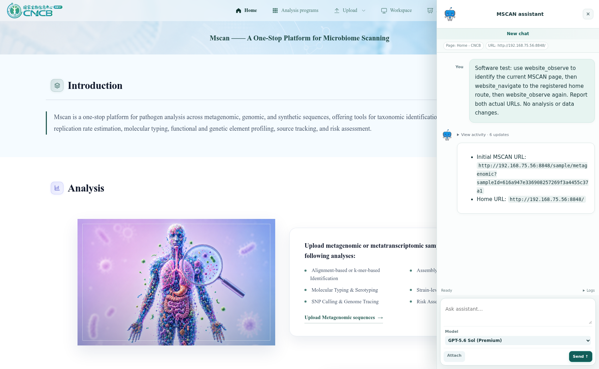

**06-backend-search-pull**

> Software test: use website_connections and website_search to find the MSCAN detection_demo source FASTQ. Use website_pull once, then website_transfer_status until terminal. Report actual status and session file path. No pipeline and no MSCAN modifications.

Run `734cef149d514cd18a45e81b1b4c0664`; session `a49d6b6e-2e29-424c-8ab2-12b876b8d236`; status **succeeded**.

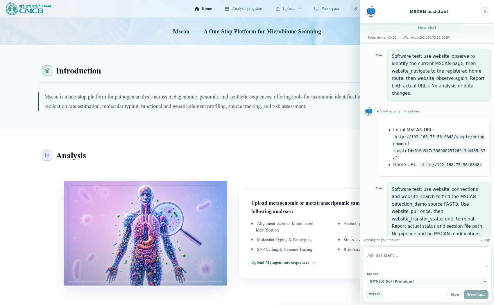

**07-write-push**

> Write a short Markdown report named Bridge software validation saying that this is a harmless connector test. Then use website_push to push ONLY that report to a new project named Bridge_full_20261109_R2_NL, sample named connector_report, data_type meta, create_missing true. Use website_transfer_status to confirm completion. Report actual IDs, delivery status and any importer status. Do not send any existing sample files or run pipelines.

Run `48ca3466e7ef40018a513adab5d1d7c3`; session `a49d6b6e-2e29-424c-8ab2-12b876b8d236`; status **succeeded**.

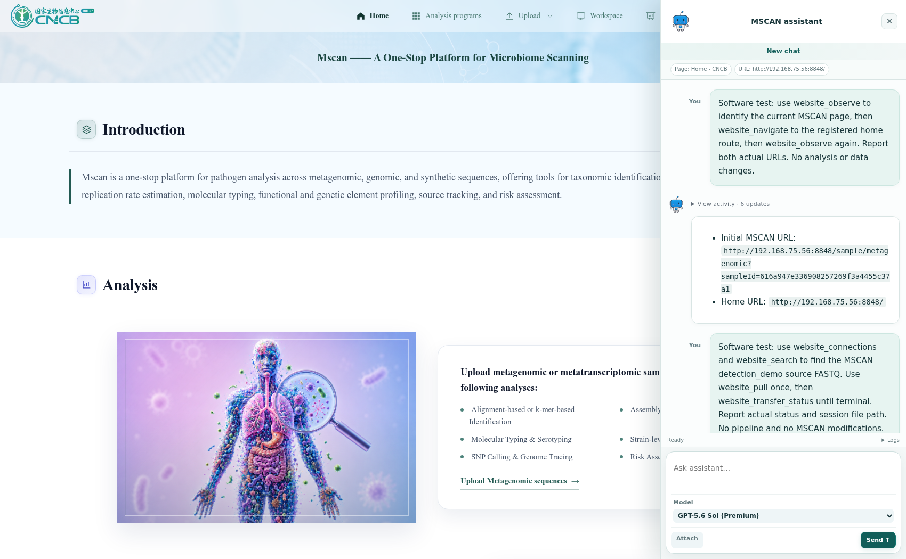

**09-reload**

Reloaded the host page and inspected restored conversation content.

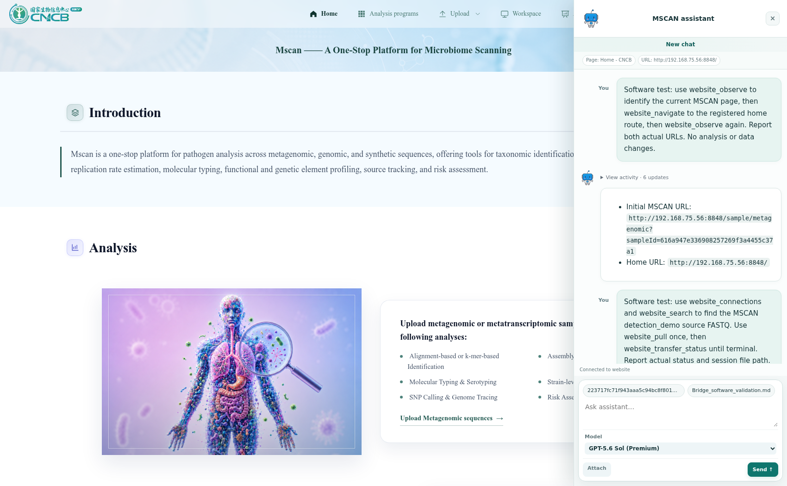

[Full natural-language results](mscan_pipeline_bridge_2026-11-09_r2/browser-nl/checks.json); [Verified durable transfer receipts](mscan_pipeline_bridge_2026-11-09_r2/browser-nl/durable-transfers.json)

### Access boundaries, delivery edges, and cancellation

A separate public-registration test account received HTTP 404 for another user’s messages, workspace and runs. It was disabled after testing. No foreign file contents were returned. [Boundary evidence](mscan_pipeline_bridge_2026-11-09_r2/account-boundary/checks.json).


Repeated push reused the exact destination sample; invalid resource pull failed; retry retained the transfer identity and the failure. [Transfer edge cases](mscan_pipeline_bridge_2026-11-09_r2/transfer-edges.json).

The embedded Stop control was visible and cancelled an actual server run. [Stop evidence](mscan_pipeline_bridge_2026-11-09_r2/stop-ui/checks.json).

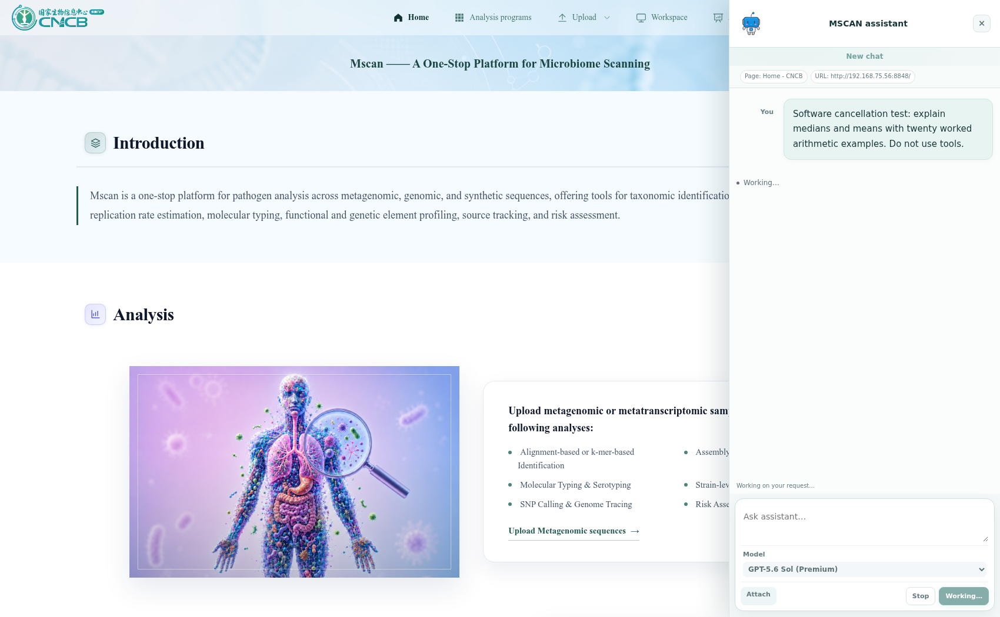

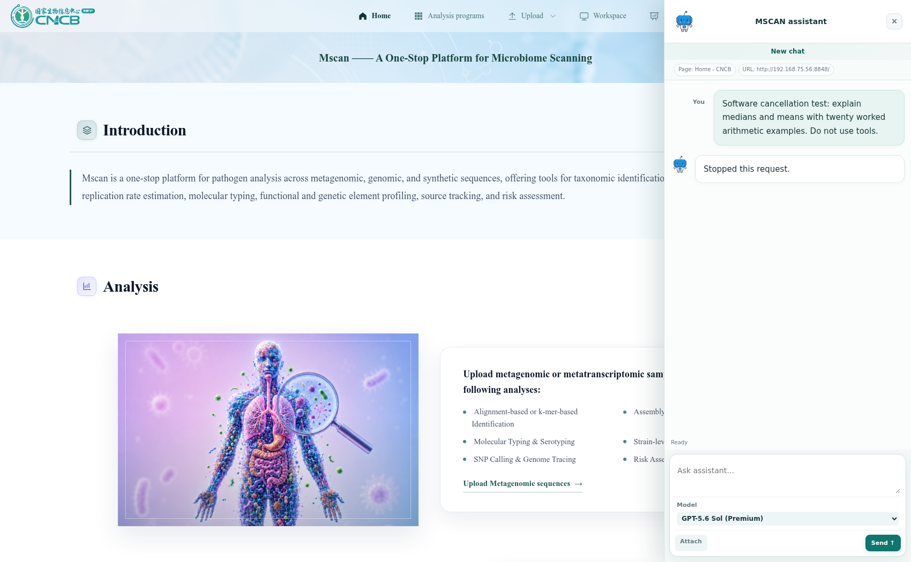

MSCAN browser downloads of a real QC results ZIP and TSV were compared with receipt hashes. [Browser download evidence](mscan_pipeline_bridge_2026-11-09_r2/download-ui/checks.json).

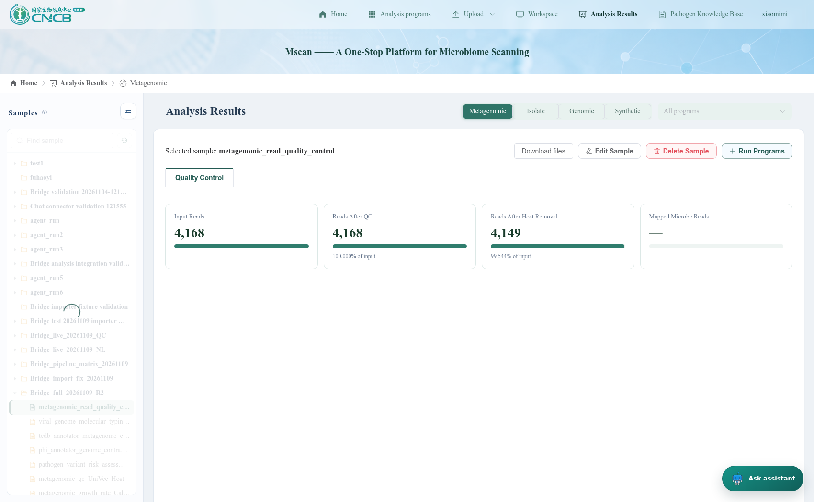


### Detached remote workflow and embedded downloads

[Exact checks and outcomes](mscan_pipeline_bridge_2026-11-09_r2/detached/checks.json); [Authenticated result download](mscan_pipeline_bridge_2026-11-09_r2/detached/backend-download.json)
The remote template completed while the MSCAN page was closed, and the conversation restored. A result-link rendering issue remains in the embedded UI (see findings).

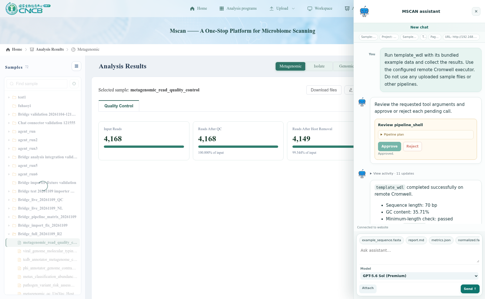


### User-driven navigation and renewed sign-in

[Exact inputs and results](mscan_pipeline_bridge_2026-11-09_r2/navigation-renewal/checks.json); [Observation after a user clicked Workspace](mscan_pipeline_bridge_2026-11-09_r2/navigation-renewal/observe-after-user-navigation.json)
The renewal check dispatches an auth-expired browser event and verifies a real new backend grant without changing the conversation. It is not a wall-clock token-expiration test.

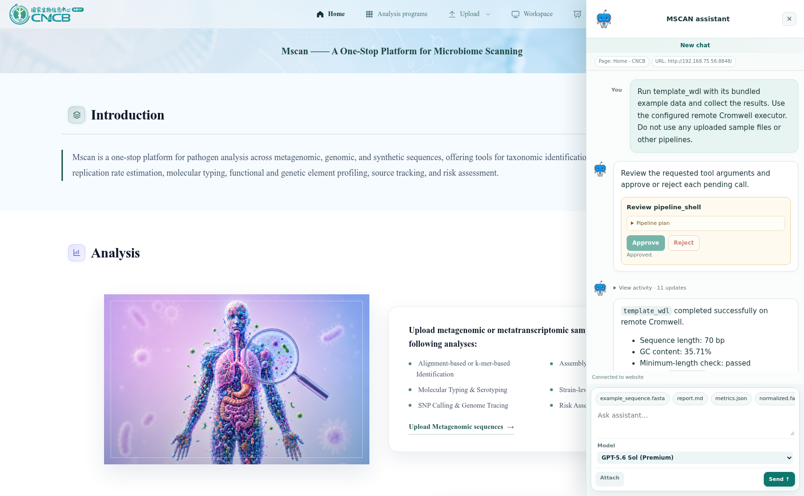

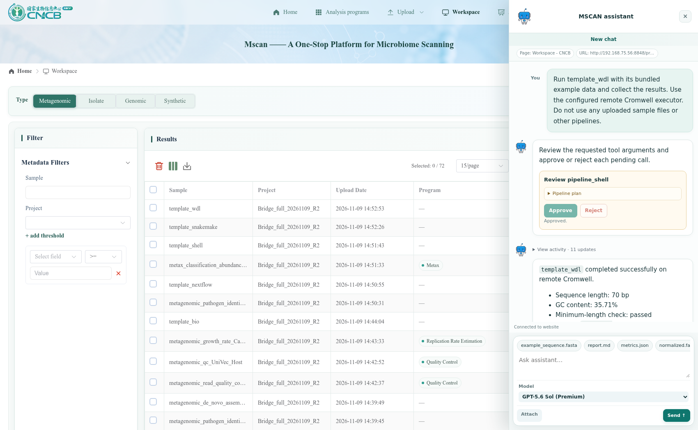


## Automated supporting checks

These supplement live tests. Mocked external-provider tests are not counted as real external service calls.

| Suite | Result | Evidence |
|---|---|---|
| Web bridge Python unit tests | 46 passed | [Log](mscan_pipeline_bridge_2026-11-09_r2/bridge-unit.log) |
| Isolation baseline | 66 run; 8 opt-in skips; no failures | [Log](mscan_pipeline_bridge_2026-11-09_r2/isolation-unittest.log) |
| Docker-enabled workers, brokers, tool compatibility | 61 passed | [Log](mscan_pipeline_bridge_2026-11-09_r2/docker-checks.log) |
| Generic browser observer | Passed: DOM/route changes, tables, password exclusion, cleanup | [Log](mscan_pipeline_bridge_2026-11-09_r2/observer.log) |
| MSCAN Java checks | Six programs passed: export ownership; QC parsing; importer registry/retry; generic artifact inspection; HTTP authorization; transfer concurrency | [Log](mscan_pipeline_bridge_2026-11-09_r2/mscan-java.log) |

The first pytest command could not run because pytest was absent from the application environment. Equivalent repository unittest entry points were then used; pytest is not claimed to have passed.

## Per-pipeline inputs, actions, results, and screenshots

### bacterial_biosynthetic_gene_clusters

Engine: `wdl`. Execution: **not_executed**. Total case elapsed (including admission/transfer): `16.3` seconds.

Contract and inert-transfer verification only; biological workflow/example outside the live execution safety scope.

Bundled examples inventoried (inventory alone does not mean executed):

| Input file | Bytes | SHA-256 |
|---|---:|---|
| `tools/runtime_tools/pipelines/bacterial_biosynthetic_gene_clusters/data/input/bgc_demo_pao1.fasta` | 6342768 | `3e9335fb76772d324537b0c4c8cc7935e8b467b2acb0fae0c6e6dbeb2f227117` |

Actions: inert software-check file only. Push: **succeeded**. Pull/hash verification: **passed**, 1 files.

MSCAN project `Bridge_full_20261109_R2`, sample `bacterial_biosynthetic_gene_clusters_contract_only`, sample ID `b77b5992bae136eaada279c1d0e8fbd6`.

[Complete inputs, transfer IDs, outputs, retry history, and hashes](mscan_pipeline_bridge_2026-11-09_r2/pipelines/bacterial_biosynthetic_gene_clusters.json)


### bacterial_defense_system_annotation

Engine: `wdl`. Execution: **not_executed**. Total case elapsed (including admission/transfer): `16.29` seconds.

Contract and inert-transfer verification only; biological workflow/example outside the live execution safety scope.

Bundled examples inventoried (inventory alone does not mean executed):

| Input file | Bytes | SHA-256 |
|---|---:|---|
| `tools/runtime_tools/pipelines/bacterial_defense_system_annotation/data/input/bacdef_demo_pao1.fasta` | 6342768 | `3e9335fb76772d324537b0c4c8cc7935e8b467b2acb0fae0c6e6dbeb2f227117` |

Actions: inert software-check file only. Push: **succeeded**. Pull/hash verification: **passed**, 1 files.

MSCAN project `Bridge_full_20261109_R2`, sample `bacterial_defense_system_annotation_contract_only`, sample ID `b8890c00cd733bc2b94af83934c13f57`.

[Complete inputs, transfer IDs, outputs, retry history, and hashes](mscan_pipeline_bridge_2026-11-09_r2/pipelines/bacterial_defense_system_annotation.json)


### bacterial_secretion_system_annotation

Engine: `wdl`. Execution: **not_executed**. Total case elapsed (including admission/transfer): `16.26` seconds.

Contract and inert-transfer verification only; biological workflow/example outside the live execution safety scope.

Bundled examples inventoried (inventory alone does not mean executed):

| Input file | Bytes | SHA-256 |
|---|---:|---|
| `tools/runtime_tools/pipelines/bacterial_secretion_system_annotation/data/input/bacsec_demo_pao1.fasta` | 6342768 | `3e9335fb76772d324537b0c4c8cc7935e8b467b2acb0fae0c6e6dbeb2f227117` |

Actions: inert software-check file only. Push: **succeeded**. Pull/hash verification: **passed**, 1 files.

MSCAN project `Bridge_full_20261109_R2`, sample `bacterial_secretion_system_annotation_contract_only`, sample ID `893a2adb7f3c39a5be582ca4129d879e`.

[Complete inputs, transfer IDs, outputs, retry history, and hashes](mscan_pipeline_bridge_2026-11-09_r2/pipelines/bacterial_secretion_system_annotation.json)


### bacterial_viral_variant_analysis

Engine: `wdl`. Execution: **not_executed**. Total case elapsed (including admission/transfer): `18.27` seconds.

Contract and inert-transfer verification only; biological workflow/example outside the live execution safety scope.

Bundled examples inventoried (inventory alone does not mean executed):

| Input file | Bytes | SHA-256 |
|---|---:|---|
| `tools/runtime_tools/pipelines/bacterial_viral_variant_analysis/data/input/example_bac_reads.fastq` | 306 | `61b8baa874e033323f09772b54c65695a809471b883d7924217c26134fea450a` |
| `tools/runtime_tools/pipelines/bacterial_viral_variant_analysis/data/input/example_bac_reference.fasta` | 92 | `e62f1223adf2772ce28429918c6e788f0183acbdb6cbf509bda91ba5c06001d3` |
| `tools/runtime_tools/pipelines/bacterial_viral_variant_analysis/data/input/example_vir_phiX174.fasta` | 5404 | `b9c1b4e766a0141aca5ff4cee25fbd7575dcbec2aaa49980d739c000ad114271` |
| `tools/runtime_tools/pipelines/bacterial_viral_variant_analysis/data/input/example_vir_phiX174_reference.fasta` | 5520 | `caa155c83967cc080f4f188f14f1f28c18d77448e87c3d00d3579ed348f4de2a` |

Actions: inert software-check file only. Push: **succeeded**. Pull/hash verification: **passed**, 1 files.

MSCAN project `Bridge_full_20261109_R2`, sample `bacterial_viral_variant_analysis_contract_only`, sample ID `f629eae18d2331e086ac682eef680234`.

[Complete inputs, transfer IDs, outputs, retry history, and hashes](mscan_pipeline_bridge_2026-11-09_r2/pipelines/bacterial_viral_variant_analysis.json)


### genomic_pathogen_identification

Engine: `wdl`. Execution: **succeeded**. Total case elapsed (including admission/transfer): `336.36` seconds.

Job: `1861959871c4487fa92e98d02e689e1d`. Remote workflow: `7ff6d736-9391-404f-9dc5-77104a7cfbfd`. Session: `fd15291e-5e35-47b5-8228-40a397c21272`. Parameter overrides: none (pipeline defaults).

Bundled examples inventoried and used as assigned below:

| Input file | Bytes | SHA-256 |
|---|---:|---|
| `tools/runtime_tools/pipelines/genomic_pathogen_identification/data/input/mash_identify_demo_sars_cov2.fasta` | 30429 | `0891c00cc2d503f58e0c600ce5ee64e9c64b939525c70d5486bc46cbc7cb073e` |

Assigned session inputs:
```json
{
  "query_fasta": "uploads/examples/genomic_pathogen_identification-633fcd751642400ba810975b2264741c/mash_identify_demo_sars_cov2.fasta"
}
```

Actions: actual bundled inputs and execution outputs. Push: **succeeded**. Pull/hash verification: **passed**, 9 files.

MSCAN project `Bridge_full_20261109_R2`, sample `genomic_pathogen_identification`, sample ID `f2107fb1e8823d4eb6d977f763a3b978`.

Native import: **unsupported**; format `None`; Duplicate output roles; select one complete job.. Generic import: `imported`.

Returned artifacts:

- `summary.tsv` — 334 bytes; `pipeline-artifacts/1861959871c4487fa92e98d02e689e1d/0/summary.tsv`.
- `per_contig_call.tsv` — 478 bytes; `pipeline-artifacts/1861959871c4487fa92e98d02e689e1d/1/per_contig_call.tsv`.
- `annotated_hits.tsv` — 714115 bytes; `pipeline-artifacts/1861959871c4487fa92e98d02e689e1d/2/annotated_hits.tsv`.
- `mash_dist-0` — 633027 bytes; `pipeline-artifacts/1861959871c4487fa92e98d02e689e1d/3/mash_dist-0`.
- `mash_dist-1` — 55302 bytes; `pipeline-artifacts/1861959871c4487fa92e98d02e689e1d/4/mash_dist-1`.
- `mash_dist-2` — 17080 bytes; `pipeline-artifacts/1861959871c4487fa92e98d02e689e1d/5/mash_dist-2`.
- `mash_dist-3` — 24196824 bytes; `pipeline-artifacts/1861959871c4487fa92e98d02e689e1d/6/mash_dist-3`.

[Complete inputs, transfer IDs, outputs, retry history, and hashes](mscan_pipeline_bridge_2026-11-09_r2/pipelines/genomic_pathogen_identification.json)

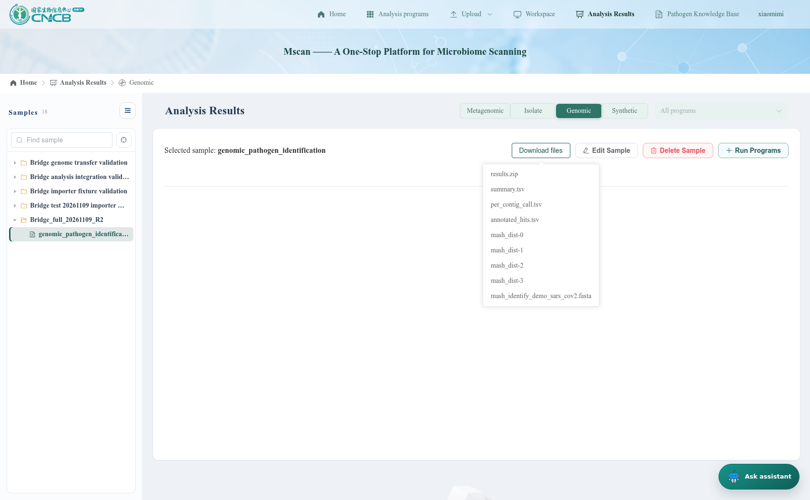

### metagenomic_de_novo_assembly

Engine: `wdl`. Execution: **observation_timeout**. Total case elapsed (including admission/transfer): `926.08` seconds.

Job: `af5ff61860524349bee7a8199304402d`. Remote workflow: `1a609138-d3be-477a-8714-f972848637ba`. Session: `85ee9a76-db58-4c98-942b-0d0987df994d`. Parameter overrides: none (pipeline defaults).

Bundled examples inventoried and used as assigned below:

| Input file | Bytes | SHA-256 |
|---|---:|---|
| `tools/runtime_tools/pipelines/metagenomic_de_novo_assembly/data/input/assembly_demo.fastq.gz` | 9480292 | `4d3438f07a5ffc48b96e0a45e3c674cdf5ef6a72740450e9cc73f3bb9244405d` |

Assigned session inputs:
```json
{
  "read1": "uploads/examples/metagenomic_de_novo_assembly-66e09a5625ba4760879bca65f1496f2a/assembly_demo.fastq.gz"
}
```

Actions: inert software-check file only. Push: **succeeded**. Pull/hash verification: **passed**, 1 files.

MSCAN project `Bridge_full_20261109_R2`, sample `metagenomic_de_novo_assembly_contract_only`, sample ID `87329a9978933ebeb555f9dd2f5ec00e`.

[Complete inputs, transfer IDs, outputs, retry history, and hashes](mscan_pipeline_bridge_2026-11-09_r2/pipelines/metagenomic_de_novo_assembly.json)


### metagenomic_growth_rate_Calculation

Engine: `wdl`. Execution: **succeeded**. Total case elapsed (including admission/transfer): `97.55` seconds.

Job: `ebe7b3672f5a49b1be039073160ff6c3`. Remote workflow: `0e3c4ca5-4b59-447c-aa88-4450da150b78`. Session: `f4e65fbb-04b1-4136-a3b1-27bdeadd6e8c`. Parameter overrides: none (pipeline defaults).

Bundled examples inventoried and used as assigned below:

| Input file | Bytes | SHA-256 |
|---|---:|---|
| `tools/runtime_tools/pipelines/metagenomic_growth_rate_Calculation/data/input/coptr_demo_R1.fastq.gz` | 8952270 | `8af4a0636892c823d6464c073a06d879d370469129cd9f6881be62e37d27f265` |
| `tools/runtime_tools/pipelines/metagenomic_growth_rate_Calculation/data/input/coptr_demo_R2.fastq.gz` | 10923663 | `56b1a9aa57e0edb87aabdbd2da110d596e117d6971ada9b96b0eab68af8029e0` |

Assigned session inputs:
```json
{
  "read1": "uploads/examples/metagenomic_growth_rate_Calculation-5b5f71a1f91f4f4f852b807d7d2c5584/coptr_demo_R1.fastq.gz",
  "read2": "uploads/examples/metagenomic_growth_rate_Calculation-5b5f71a1f91f4f4f852b807d7d2c5584/coptr_demo_R2.fastq.gz"
}
```

Actions: actual bundled inputs and execution outputs. Push: **succeeded**. Pull/hash verification: **passed**, 4 files.

MSCAN project `Bridge_full_20261109_R2`, sample `metagenomic_growth_rate_Calculation`, sample ID `9d3d758f7d0a361dbe9d9c69818d5f77`.

Native import: **imported**; format `StrainCoPTR`; Native result imported.. Generic import: `imported`.

Returned artifacts:

- `coptr_log2ptr.csv` — 36 bytes; `pipeline-artifacts/ebe7b3672f5a49b1be039073160ff6c3/0/coptr_log2ptr.csv`.

[Complete inputs, transfer IDs, outputs, retry history, and hashes](mscan_pipeline_bridge_2026-11-09_r2/pipelines/metagenomic_growth_rate_Calculation.json)

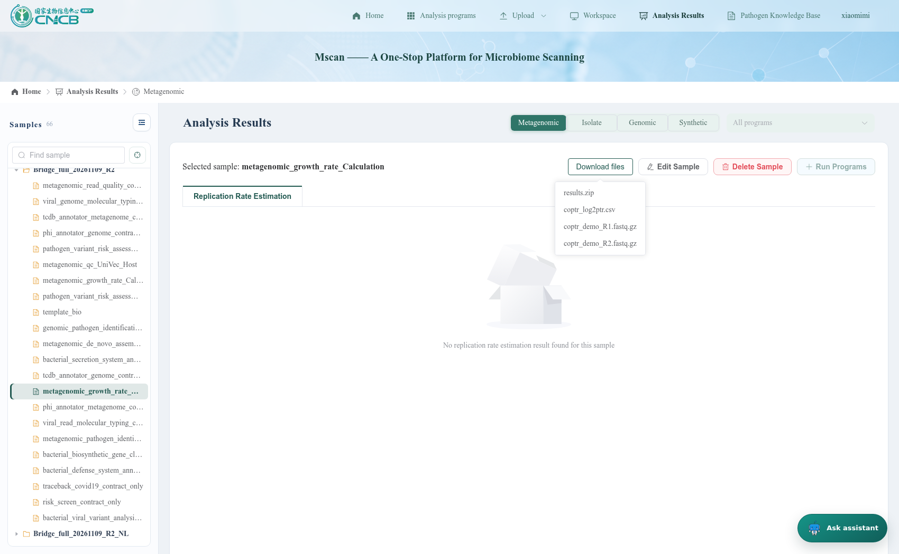

### metagenomic_pathogen_identification

Engine: `wdl`. Execution: **observation_timeout**. Total case elapsed (including admission/transfer): `922.09` seconds.

Job: `c751567beb9e463598a1bb2f99349f7f`. Remote workflow: `090feb07-a177-490d-b64d-501abb90c897`. Session: `c4454b15-4576-4139-951c-fd9826460674`. Parameter overrides: none (pipeline defaults).

Bundled examples inventoried and used as assigned below:

| Input file | Bytes | SHA-256 |
|---|---:|---|
| `tools/runtime_tools/pipelines/metagenomic_pathogen_identification/data/input/detection_demo.fq.gz` | 240118 | `9101bef1192734f4c50d2908a91b18762432f7f1d789a007e13644b2bccde82c` |

Assigned session inputs:
```json
{
  "sequence_file1": "uploads/examples/metagenomic_pathogen_identification-c0744d94a59845ce9cc0360de20170cb/detection_demo.fq.gz"
}
```

Actions: inert software-check file only. Push: **succeeded**. Pull/hash verification: **passed**, 1 files.

MSCAN project `Bridge_full_20261109_R2`, sample `metagenomic_pathogen_identification_contract_only`, sample ID `b255f675c410337abce78004d92d56ff`.

[Complete inputs, transfer IDs, outputs, retry history, and hashes](mscan_pipeline_bridge_2026-11-09_r2/pipelines/metagenomic_pathogen_identification.json)


### metagenomic_pathogen_identification_kmer

Engine: `wdl`. Execution: **succeeded**. Total case elapsed (including admission/transfer): `382.68` seconds.

Job: `91f18ae76e1e4253a834a1f1213275e9`. Remote workflow: `709d450b-f052-4bc8-bff8-824755330e14`. Session: `ca8d0504-6dd4-44ca-8921-43af3e03133d`. Parameter overrides: none (pipeline defaults).

Bundled examples inventoried and used as assigned below:

| Input file | Bytes | SHA-256 |
|---|---:|---|
| `tools/runtime_tools/pipelines/metagenomic_pathogen_identification_kmer/data/input/kmer_demo_R1.fastq.gz` | 8952270 | `8af4a0636892c823d6464c073a06d879d370469129cd9f6881be62e37d27f265` |
| `tools/runtime_tools/pipelines/metagenomic_pathogen_identification_kmer/data/input/kmer_demo_R2.fastq.gz` | 10923663 | `56b1a9aa57e0edb87aabdbd2da110d596e117d6971ada9b96b0eab68af8029e0` |

Assigned session inputs:
```json
{
  "clean_r1": "uploads/examples/metagenomic_pathogen_identification_kmer-382cb73370a5413a97f0ef1e587587d2/kmer_demo_R1.fastq.gz",
  "clean_r2": "uploads/examples/metagenomic_pathogen_identification_kmer-382cb73370a5413a97f0ef1e587587d2/kmer_demo_R2.fastq.gz"
}
```

Actions: actual bundled inputs and execution outputs. Push: **succeeded**. Pull/hash verification: **passed**, 6 files.

MSCAN project `Bridge_full_20261109_R2`, sample `metagenomic_pathogen_identification_kmer`, sample ID `c5ec86fceace385f8d22d0dc13d8b7ee`.

Native import: **unsupported**; format `StrobeTaxaDetection`; MSCAN has no registered importer for this result format; files remain available.. Generic import: `imported`.

Returned artifacts:

- `classified.tsv` — 15911058 bytes; `pipeline-artifacts/91f18ae76e1e4253a834a1f1213275e9/0/classified.tsv`.
- `report.tsv` — 255290 bytes; `pipeline-artifacts/91f18ae76e1e4253a834a1f1213275e9/1/report.tsv`.
- `signature_coverage.csv` — 16710 bytes; `pipeline-artifacts/91f18ae76e1e4253a834a1f1213275e9/2/signature_coverage.csv`.

[Complete inputs, transfer IDs, outputs, retry history, and hashes](mscan_pipeline_bridge_2026-11-09_r2/pipelines/metagenomic_pathogen_identification_kmer.json)

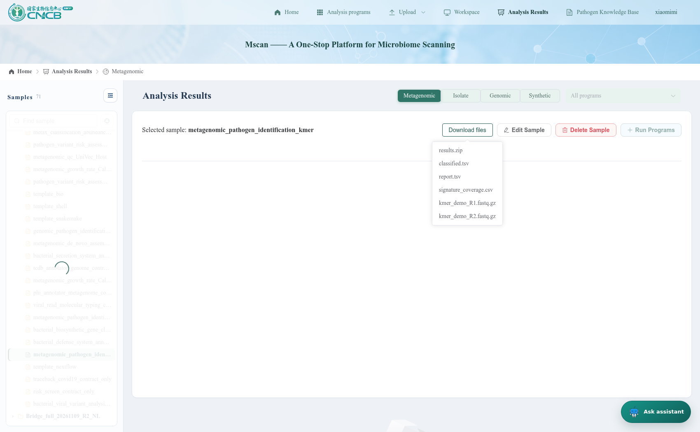

### metagenomic_pathogen_identification_marker

Engine: `wdl`. Execution: **succeeded**. Total case elapsed (including admission/transfer): `605.29` seconds.

Job: `b287eb41c563407c81964d9cb9c4c687`. Remote workflow: `313194bc-b0a4-4c63-a12c-df4a4d47642f`. Session: `e7f9ae78-4aa6-4311-b919-6b54462e6262`. Parameter overrides: none (pipeline defaults).

Bundled examples inventoried and used as assigned below:

| Input file | Bytes | SHA-256 |
|---|---:|---|
| `tools/runtime_tools/pipelines/metagenomic_pathogen_identification_marker/data/input/strainmeta_demo_R1.fastq.gz` | 8952270 | `8af4a0636892c823d6464c073a06d879d370469129cd9f6881be62e37d27f265` |
| `tools/runtime_tools/pipelines/metagenomic_pathogen_identification_marker/data/input/strainmeta_demo_R2.fastq.gz` | 10923663 | `56b1a9aa57e0edb87aabdbd2da110d596e117d6971ada9b96b0eab68af8029e0` |

Assigned session inputs:
```json
{
  "read1": "uploads/examples/metagenomic_pathogen_identification_marker-68f4060f1ebb448bb7716bb53dfc88c2/strainmeta_demo_R1.fastq.gz",
  "read2": "uploads/examples/metagenomic_pathogen_identification_marker-68f4060f1ebb448bb7716bb53dfc88c2/strainmeta_demo_R2.fastq.gz"
}
```

Actions: actual bundled inputs and execution outputs. Push: **succeeded**. Pull/hash verification: **passed**, 6 files.

MSCAN project `Bridge_full_20261109_R2`, sample `metagenomic_pathogen_identification_marker`, sample ID `92a9d6fa133638418e6befde479c340d`.

Native import: **imported**; format `StrainMeta`; Native result imported.. Generic import: `imported`.

Returned artifacts:

- `profile.txt` — 882 bytes; `pipeline-artifacts/b287eb41c563407c81964d9cb9c4c687/0/profile.txt`.
- `sam.bz2` — 63962668 bytes; `pipeline-artifacts/b287eb41c563407c81964d9cb9c4c687/1/sam.bz2`.
- `consensus_marker.json.bz2` — 122 bytes; `pipeline-artifacts/b287eb41c563407c81964d9cb9c4c687/2/consensus_marker.json.bz2`.

[Complete inputs, transfer IDs, outputs, retry history, and hashes](mscan_pipeline_bridge_2026-11-09_r2/pipelines/metagenomic_pathogen_identification_marker.json)

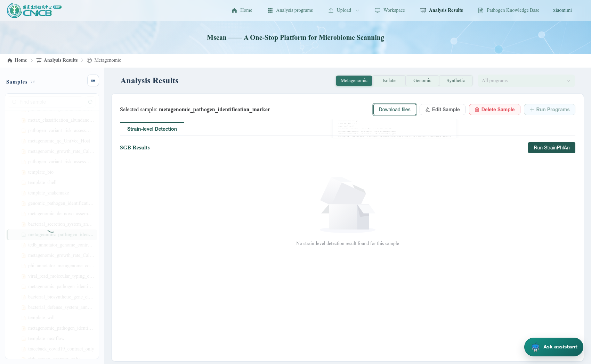

### metagenomic_qc_UniVec_Host

Engine: `wdl`. Execution: **succeeded**. Total case elapsed (including admission/transfer): `156.02` seconds.

Job: `9bd20d63bd2741cf9e08951e172cf3fd`. Remote workflow: `fb298b97-e1f6-462e-a8f6-4b2c32ac8a78`. Session: `26fad7a1-7580-4483-82f3-9a96528cb4b1`. Parameter overrides: none (pipeline defaults).

Bundled examples inventoried and used as assigned below:

| Input file | Bytes | SHA-256 |
|---|---:|---|
| `tools/runtime_tools/pipelines/metagenomic_qc_UniVec_Host/data/input/qc_demo_R1.fastq.gz` | 8952270 | `8af4a0636892c823d6464c073a06d879d370469129cd9f6881be62e37d27f265` |
| `tools/runtime_tools/pipelines/metagenomic_qc_UniVec_Host/data/input/qc_demo_R2.fastq.gz` | 10923663 | `56b1a9aa57e0edb87aabdbd2da110d596e117d6971ada9b96b0eab68af8029e0` |

Assigned session inputs:
```json
{
  "read1": "uploads/examples/metagenomic_qc_UniVec_Host-1166ecaf8b2544fd940e50dc362776f5/qc_demo_R1.fastq.gz",
  "read2": "uploads/examples/metagenomic_qc_UniVec_Host-1166ecaf8b2544fd940e50dc362776f5/qc_demo_R2.fastq.gz"
}
```

Actions: actual bundled inputs and execution outputs. Push: **succeeded**. Pull/hash verification: **passed**, 7 files.

MSCAN project `Bridge_full_20261109_R2`, sample `metagenomic_qc_UniVec_Host`, sample ID `51ecc052b8953704a385aac712dd35df`.

Native import: **imported**; format `ReadQc`; Native QC imported.. Generic import: `imported`.

Returned artifacts:

- `clean.R1.fastq.gz` — 7145823 bytes; `pipeline-artifacts/9bd20d63bd2741cf9e08951e172cf3fd/0/clean.R1.fastq.gz`.
- `clean.R2.fastq.gz` — 7170645 bytes; `pipeline-artifacts/9bd20d63bd2741cf9e08951e172cf3fd/1/clean.R2.fastq.gz`.
- `qc_summary.tsv` — 160 bytes; `pipeline-artifacts/9bd20d63bd2741cf9e08951e172cf3fd/2/qc_summary.tsv`.
- `multiqc_report.html` — 4775781 bytes; `pipeline-artifacts/9bd20d63bd2741cf9e08951e172cf3fd/3/multiqc_report.html`.

[Complete inputs, transfer IDs, outputs, retry history, and hashes](mscan_pipeline_bridge_2026-11-09_r2/pipelines/metagenomic_qc_UniVec_Host.json)

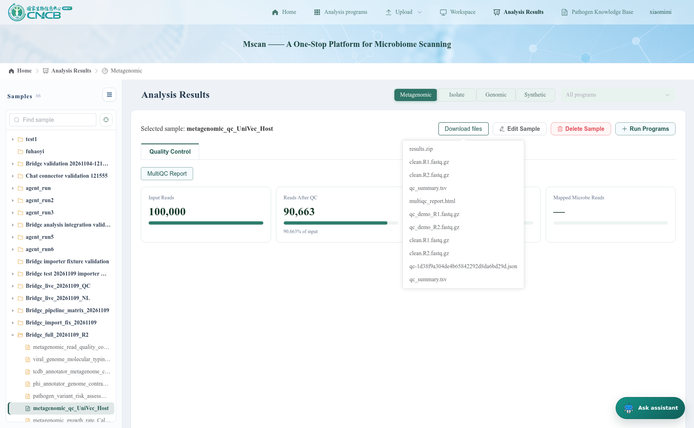

### metagenomic_read_quality_control

Engine: `wdl`. Execution: **succeeded**. Total case elapsed (including admission/transfer): `114.21` seconds.

Job: `caf4b5ed99e94edc946bdc2361d8dc3d`. Remote workflow: `9ef6c11c-9634-4203-9f63-afe8d5d2f495`. Session: `c1c0b631-1613-40ca-83a0-55e7489ab496`. Parameter overrides: none (pipeline defaults).

Bundled examples inventoried and used as assigned below:

| Input file | Bytes | SHA-256 |
|---|---:|---|
| `tools/runtime_tools/pipelines/metagenomic_read_quality_control/data/input/qc_demo.fq.gz` | 240118 | `9101bef1192734f4c50d2908a91b18762432f7f1d789a007e13644b2bccde82c` |

Assigned session inputs:
```json
{
  "read1": "uploads/examples/metagenomic_read_quality_control-7e9111c3f96c4180b691942dcc0c121e/qc_demo.fq.gz"
}
```

Actions: actual bundled inputs and execution outputs. Push: **succeeded**. Pull/hash verification: **passed**, 5 files.

MSCAN project `Bridge_full_20261109_R2`, sample `metagenomic_read_quality_control`, sample ID `095dbd0ef7fc314496dff2238a325e96`.

Native import: **imported**; format `MetagenomicQc`; Native QC imported.. Generic import: `imported`.

Returned artifacts:

- `clean.R1.fq` — 761681 bytes; `pipeline-artifacts/caf4b5ed99e94edc946bdc2361d8dc3d/0/clean.R1.fq`.
- `qc_counts.tsv` — 84 bytes; `pipeline-artifacts/caf4b5ed99e94edc946bdc2361d8dc3d/1/qc_counts.tsv`.
- `phase1_read_overview.tsv` — 75 bytes; `pipeline-artifacts/caf4b5ed99e94edc946bdc2361d8dc3d/2/phase1_read_overview.tsv`.

[Complete inputs, transfer IDs, outputs, retry history, and hashes](mscan_pipeline_bridge_2026-11-09_r2/pipelines/metagenomic_read_quality_control.json)

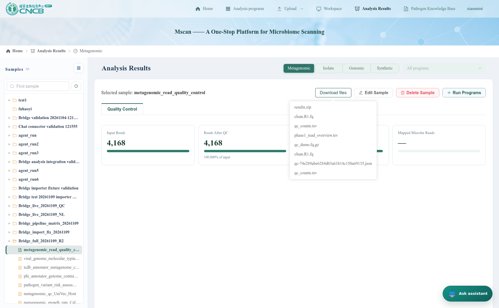

### metax_classification_abundance_analysis

Engine: `wdl`. Execution: **succeeded**. Total case elapsed (including admission/transfer): `538.74` seconds.

Job: `a243fd64bc15429ea4c8f08c2605a669`. Remote workflow: `c58ab7c3-e2fc-4ab7-b50a-7c177777647e`. Session: `780969f4-0a25-44c7-b0ab-e61b25fa87b9`. Parameter overrides: none (pipeline defaults).

Bundled examples inventoried and used as assigned below:

| Input file | Bytes | SHA-256 |
|---|---:|---|
| `tools/runtime_tools/pipelines/metax_classification_abundance_analysis/data/input/metax_demo_R1.fastq.gz` | 8952270 | `8af4a0636892c823d6464c073a06d879d370469129cd9f6881be62e37d27f265` |
| `tools/runtime_tools/pipelines/metax_classification_abundance_analysis/data/input/metax_demo_R2.fastq.gz` | 10923663 | `56b1a9aa57e0edb87aabdbd2da110d596e117d6971ada9b96b0eab68af8029e0` |

Assigned session inputs:
```json
{
  "reads": "uploads/examples/metax_classification_abundance_analysis-c52b88e94bdf44b49e071109dc17bb1a/metax_demo_R1.fastq.gz",
  "reads2": "uploads/examples/metax_classification_abundance_analysis-c52b88e94bdf44b49e071109dc17bb1a/metax_demo_R2.fastq.gz"
}
```

Actions: actual bundled inputs and execution outputs. Push: **succeeded**. Pull/hash verification: **passed**, 4 files.

MSCAN project `Bridge_full_20261109_R2`, sample `metax_classification_abundance_analysis`, sample ID `33a1181ba7d53642af52ede66678f68d`.

Native import: **imported**; format `metax`; Native result imported.. Generic import: `imported`.

Returned artifacts:

- `profile.txt` — 712 bytes; `pipeline-artifacts/a243fd64bc15429ea4c8f08c2605a669/0/profile.txt`.

[Complete inputs, transfer IDs, outputs, retry history, and hashes](mscan_pipeline_bridge_2026-11-09_r2/pipelines/metax_classification_abundance_analysis.json)

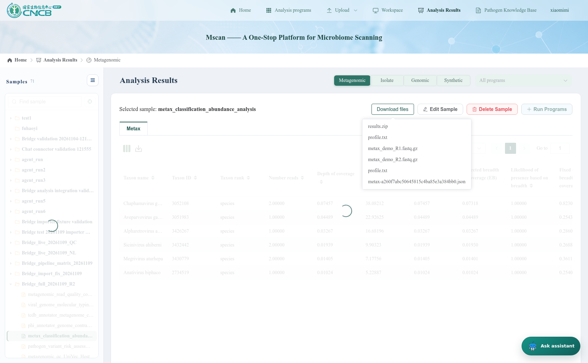

### pathogen_variant_risk_assessment

Engine: `wdl`. Execution: **not_executed**. Total case elapsed (including admission/transfer): `15.27` seconds.

Contract and inert-transfer verification only; biological workflow/example outside the live execution safety scope.

Bundled examples inventoried (inventory alone does not mean executed):

| Input file | Bytes | SHA-256 |
|---|---:|---|
| `tools/runtime_tools/pipelines/pathogen_variant_risk_assessment/data/input/h3n2_small.fastq.gz` | 1983743 | `1839a522320c8dc35a9e430d5b847e19c117508facdb2bc87a377111d69987c9` |
| `tools/runtime_tools/pipelines/pathogen_variant_risk_assessment/data/input/risk_demo_h1n1.fastq.gz` | 1662706 | `ab2db3d3d28e3c7b3edc9913f43cf14e2e333c035994ea91132f0a78526519c6` |

Actions: inert software-check file only. Push: **succeeded**. Pull/hash verification: **passed**, 1 files.

MSCAN project `Bridge_full_20261109_R2`, sample `pathogen_variant_risk_assessment_contract_only`, sample ID `526461ec885b34f6836974cca3695ef6`.

[Complete inputs, transfer IDs, outputs, retry history, and hashes](mscan_pipeline_bridge_2026-11-09_r2/pipelines/pathogen_variant_risk_assessment.json)

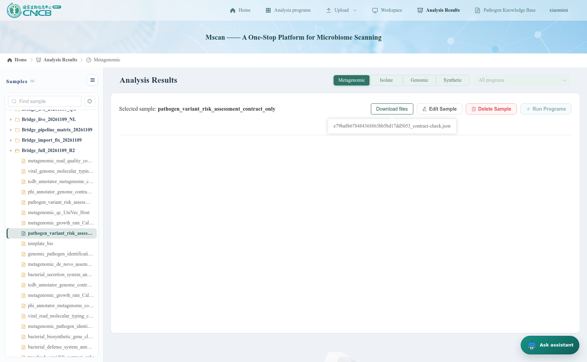

### pathogen_variant_risk_assessment_consensus

Engine: `wdl`. Execution: **not_executed**. Total case elapsed (including admission/transfer): `16.35` seconds.

Contract and inert-transfer verification only; biological workflow/example outside the live execution safety scope.

Bundled examples inventoried (inventory alone does not mean executed):

| Input file | Bytes | SHA-256 |
|---|---:|---|
| `tools/runtime_tools/pipelines/pathogen_variant_risk_assessment_consensus/data/input/H3N2_PX908176.1_HA.fasta` | 1909 | `70ff1f3ec4780c00908da5d7046f164f7345b0d59f0d99f39563fba3951f274e` |

Actions: inert software-check file only. Push: **succeeded**. Pull/hash verification: **passed**, 1 files.

MSCAN project `Bridge_full_20261109_R2`, sample `pathogen_variant_risk_assessment_consensus_contract_only`, sample ID `478f7a08a58d3df1962a0156f089a3a8`.

[Complete inputs, transfer IDs, outputs, retry history, and hashes](mscan_pipeline_bridge_2026-11-09_r2/pipelines/pathogen_variant_risk_assessment_consensus.json)


### phi_annotator_genome

Engine: `wdl`. Execution: **not_executed**. Total case elapsed (including admission/transfer): `17.34` seconds.

Contract and inert-transfer verification only; biological workflow/example outside the live execution safety scope.

Bundled examples inventoried (inventory alone does not mean executed):

| Input file | Bytes | SHA-256 |
|---|---:|---|
| `tools/runtime_tools/pipelines/phi_annotator_genome/data/input/phi_genome_demo.fasta` | 30429 | `0891c00cc2d503f58e0c600ce5ee64e9c64b939525c70d5486bc46cbc7cb073e` |

Actions: inert software-check file only. Push: **succeeded**. Pull/hash verification: **passed**, 1 files.

MSCAN project `Bridge_full_20261109_R2`, sample `phi_annotator_genome_contract_only`, sample ID `274bef3d02a930a48ab0b6adbfacc8a1`.

[Complete inputs, transfer IDs, outputs, retry history, and hashes](mscan_pipeline_bridge_2026-11-09_r2/pipelines/phi_annotator_genome.json)

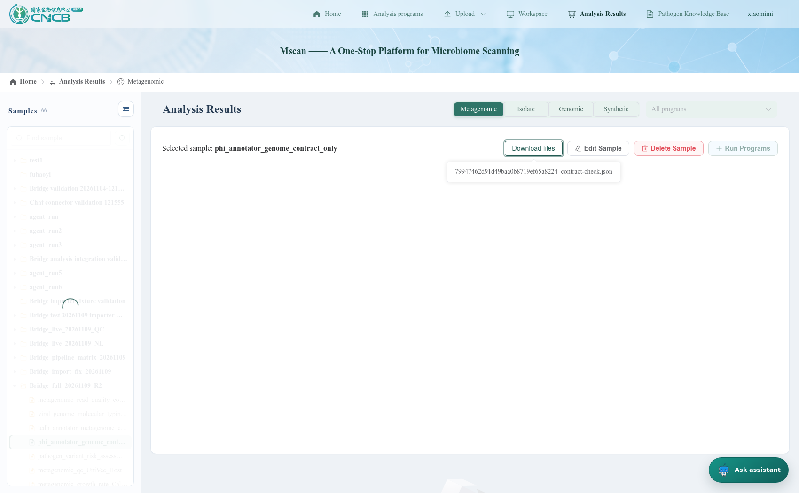

### phi_annotator_metagenome

Engine: `wdl`. Execution: **not_executed**. Total case elapsed (including admission/transfer): `15.31` seconds.

Contract and inert-transfer verification only; biological workflow/example outside the live execution safety scope.

Bundled examples inventoried (inventory alone does not mean executed):

| Input file | Bytes | SHA-256 |
|---|---:|---|
| `tools/runtime_tools/pipelines/phi_annotator_metagenome/data/input/phi_demo_R1.fastq.gz` | 8952270 | `8af4a0636892c823d6464c073a06d879d370469129cd9f6881be62e37d27f265` |
| `tools/runtime_tools/pipelines/phi_annotator_metagenome/data/input/phi_demo_R2.fastq.gz` | 10923663 | `56b1a9aa57e0edb87aabdbd2da110d596e117d6971ada9b96b0eab68af8029e0` |

Actions: inert software-check file only. Push: **succeeded**. Pull/hash verification: **passed**, 1 files.

MSCAN project `Bridge_full_20261109_R2`, sample `phi_annotator_metagenome_contract_only`, sample ID `a828b4500a293be0b99ef670e1b1a403`.

[Complete inputs, transfer IDs, outputs, retry history, and hashes](mscan_pipeline_bridge_2026-11-09_r2/pipelines/phi_annotator_metagenome.json)


### risk_screen

Engine: `wdl`. Execution: **not_executed**. Total case elapsed (including admission/transfer): `16.27` seconds.

Contract and inert-transfer verification only; biological workflow/example outside the live execution safety scope.

Bundled examples inventoried (inventory alone does not mean executed):

| Input file | Bytes | SHA-256 |
|---|---:|---|
| `tools/runtime_tools/pipelines/risk_screen/data/input/screenmec_demo.fasta` | 35949 | `0530a208a5c21fe0bfeaf620c5e0b5740acd7c69f9e4d8f62fcda72f47c2f834` |

Actions: inert software-check file only. Push: **succeeded**. Pull/hash verification: **passed**, 1 files.

MSCAN project `Bridge_full_20261109_R2`, sample `risk_screen_contract_only`, sample ID `f0325da73b0433c8a39a5f0b4a145790`.

[Complete inputs, transfer IDs, outputs, retry history, and hashes](mscan_pipeline_bridge_2026-11-09_r2/pipelines/risk_screen.json)

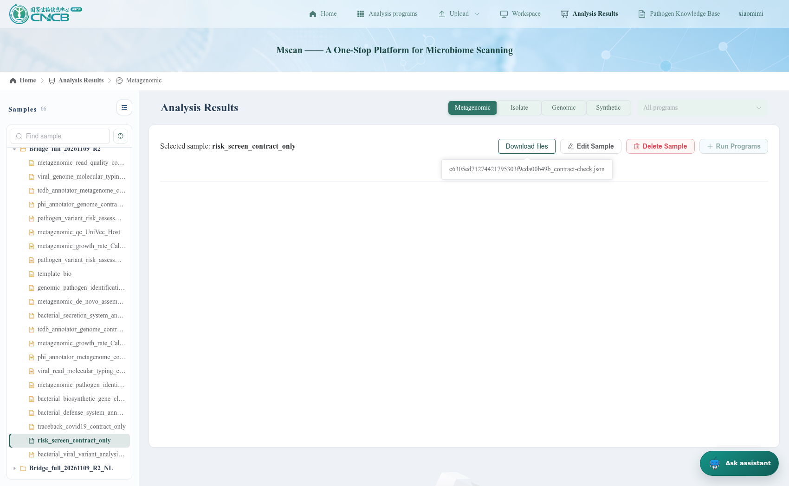

### tcdb_annotator_genome

Engine: `wdl`. Execution: **not_executed**. Total case elapsed (including admission/transfer): `20.26` seconds.

Contract and inert-transfer verification only; biological workflow/example outside the live execution safety scope.

Bundled examples inventoried (inventory alone does not mean executed):

| Input file | Bytes | SHA-256 |
|---|---:|---|
| `tools/runtime_tools/pipelines/tcdb_annotator_genome/data/input/tcdb_genome_demo.fasta` | 30429 | `0891c00cc2d503f58e0c600ce5ee64e9c64b939525c70d5486bc46cbc7cb073e` |

Actions: inert software-check file only. Push: **succeeded**. Pull/hash verification: **passed**, 1 files.

MSCAN project `Bridge_full_20261109_R2`, sample `tcdb_annotator_genome_contract_only`, sample ID `92f8a4ad1fe03fc1b7b27e13e7f01475`.

[Complete inputs, transfer IDs, outputs, retry history, and hashes](mscan_pipeline_bridge_2026-11-09_r2/pipelines/tcdb_annotator_genome.json)


### tcdb_annotator_metagenome

Engine: `wdl`. Execution: **not_executed**. Total case elapsed (including admission/transfer): `17.29` seconds.

Contract and inert-transfer verification only; biological workflow/example outside the live execution safety scope.

Bundled examples inventoried (inventory alone does not mean executed):

| Input file | Bytes | SHA-256 |
|---|---:|---|
| `tools/runtime_tools/pipelines/tcdb_annotator_metagenome/data/input/tcdb_demo_R1.fastq.gz` | 8952270 | `8af4a0636892c823d6464c073a06d879d370469129cd9f6881be62e37d27f265` |
| `tools/runtime_tools/pipelines/tcdb_annotator_metagenome/data/input/tcdb_demo_R2.fastq.gz` | 10923663 | `56b1a9aa57e0edb87aabdbd2da110d596e117d6971ada9b96b0eab68af8029e0` |

Actions: inert software-check file only. Push: **succeeded**. Pull/hash verification: **passed**, 1 files.

MSCAN project `Bridge_full_20261109_R2`, sample `tcdb_annotator_metagenome_contract_only`, sample ID `246ebbb7f233373e81a6fbcb2f3211c4`.

[Complete inputs, transfer IDs, outputs, retry history, and hashes](mscan_pipeline_bridge_2026-11-09_r2/pipelines/tcdb_annotator_metagenome.json)

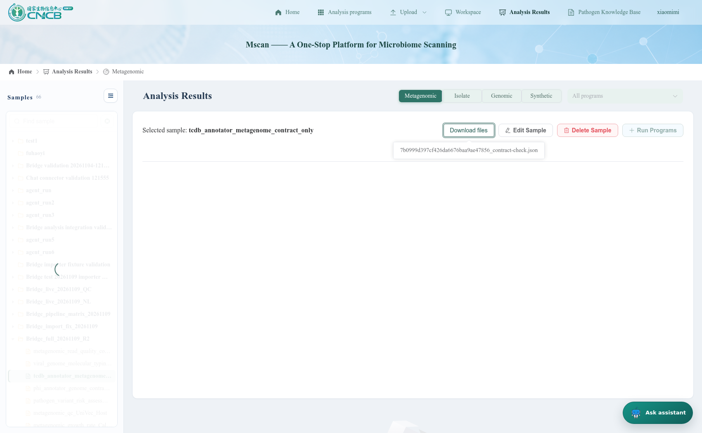

### template_bio

Engine: `shell`. Execution: **succeeded**. Total case elapsed (including admission/transfer): `115.79` seconds.

Job: `e5bf11f30dbb4edea909325d8b1c258a`. Remote workflow: `None`. Session: `6f7442f2-efb7-4462-bb87-a14c568952c0`. Parameter overrides: none (pipeline defaults).

Bundled examples inventoried and used as assigned below:

| Input file | Bytes | SHA-256 |
|---|---:|---|
| `tools/runtime_tools/pipelines/template_bio/data/input/example_reads.fastq` | 385 | `5e95fa95821c31e5446e051cdf4ccd4b82144ac71b809e065e1101c12386b60d` |
| `tools/runtime_tools/pipelines/template_bio/data/input/example_reference.fasta` | 61 | `73f4c86513507e373bc902232aded85b398678e313f059b42b26e1ae38c4fd09` |
| `tools/runtime_tools/pipelines/template_bio/data/input/example_samples.tsv` | 149 | `ab843cad4c085902847f8145aec07c0f932ef591663efdc9cd13bac0c6acb79e` |

Assigned session inputs:
```json
{
  "reads": "uploads/examples/template_bio-970ae7264f3d404caf6e3ac311e906d8/example_reads.fastq",
  "reference": "uploads/examples/template_bio-970ae7264f3d404caf6e3ac311e906d8/example_reference.fasta",
  "metadata": "uploads/examples/template_bio-970ae7264f3d404caf6e3ac311e906d8/example_samples.tsv"
}
```

Actions: actual bundled inputs and execution outputs. Push: **succeeded**. Pull/hash verification: **passed**, 20 files.

MSCAN project `Bridge_full_20261109_R2`, sample `template_bio`, sample ID `654ad25d6f4c300794b8ffea8bce2085`.

Native import: **unsupported**; format `None`; No unambiguous native result format; files remain available.. Generic import: `imported`.

Returned artifacts:

- `report` — 2442 bytes; `outputs/pipelines/e5bf11f30dbb4edea909325d8b1c258a/outputs/report.md`.
- `metrics` — 1240 bytes; `outputs/pipelines/e5bf11f30dbb4edea909325d8b1c258a/outputs/metrics.json`.
- `html_report` — 240684 bytes; `outputs/pipelines/e5bf11f30dbb4edea909325d8b1c258a/outputs/report.html`.
- `filtered_reads` — 253 bytes; `outputs/pipelines/e5bf11f30dbb4edea909325d8b1c258a/outputs/filtered_reads.fastq`.
- `read_qc` — 238 bytes; `outputs/pipelines/e5bf11f30dbb4edea909325d8b1c258a/outputs/read_qc.tsv`.
- `sample_summary` — 364 bytes; `outputs/pipelines/e5bf11f30dbb4edea909325d8b1c258a/outputs/sample_summary.tsv`.
- `coverage` — 889 bytes; `outputs/pipelines/e5bf11f30dbb4edea909325d8b1c258a/outputs/coverage.tsv`.
- `alignments` — 438 bytes; `outputs/pipelines/e5bf11f30dbb4edea909325d8b1c258a/outputs/alignments.sam`.
- `consensus` — 48 bytes; `outputs/pipelines/e5bf11f30dbb4edea909325d8b1c258a/outputs/consensus.fasta`.
- `variants` — 578 bytes; `outputs/pipelines/e5bf11f30dbb4edea909325d8b1c258a/outputs/variants.vcf`.
- `variant_table` — 133 bytes; `outputs/pipelines/e5bf11f30dbb4edea909325d8b1c258a/outputs/variant_summary.tsv`.
- `qc_figure` — 79528 bytes; `outputs/pipelines/e5bf11f30dbb4edea909325d8b1c258a/outputs/qc_overview.png`.
- `coverage_figure` — 35889 bytes; `outputs/pipelines/e5bf11f30dbb4edea909325d8b1c258a/outputs/coverage.png`.
- `variant_figure` — 28447 bytes; `outputs/pipelines/e5bf11f30dbb4edea909325d8b1c258a/outputs/variant_allele_fraction.png`.
- `phylogenetic_tree` — 58 bytes; `outputs/pipelines/e5bf11f30dbb4edea909325d8b1c258a/outputs/phylogenetic_tree.nwk`.
- `phylogenetic_tree_figure` — 32702 bytes; `outputs/pipelines/e5bf11f30dbb4edea909325d8b1c258a/outputs/phylogenetic_tree.png`.

[Complete inputs, transfer IDs, outputs, retry history, and hashes](mscan_pipeline_bridge_2026-11-09_r2/pipelines/template_bio.json)

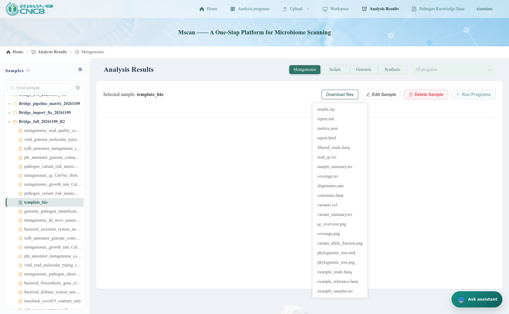

### template_nextflow

Engine: `nextflow`. Execution: **succeeded**. Total case elapsed (including admission/transfer): `345.46` seconds.

Job: `407fe96f938f424e879508522f490f51`. Remote workflow: `None`. Session: `3db2855f-54cb-48f4-a779-381b7342fff9`. Parameter overrides: none (pipeline defaults).

Bundled examples inventoried and used as assigned below:

| Input file | Bytes | SHA-256 |
|---|---:|---|
| `tools/runtime_tools/pipelines/template_nextflow/data/input/metadata.tsv` | 61 | `36ef43d849815a88547be9a8be6444f76feed4c05e847633dcad98db684727f3` |
| `tools/runtime_tools/pipelines/template_nextflow/data/input/sequences_segment1.fasta` | 43 | `b37bc1cc19ec912fca5274e6a9cf2782f9db274d0664ad7c4d06ab30cf2101ed` |

Assigned session inputs:
```json
{
  "sequence": "uploads/examples/template_nextflow-f3b422e623794c429f83459ccd9cfd4d/sequences_segment1.fasta",
  "metadata": "uploads/examples/template_nextflow-f3b422e623794c429f83459ccd9cfd4d/metadata.tsv"
}
```

Actions: actual bundled inputs and execution outputs. Push: **succeeded**. Pull/hash verification: **passed**, 6 files.

MSCAN project `Bridge_full_20261109_R2`, sample `template_nextflow`, sample ID `c7cd7d71fe5d3b0d87fd67ac52fb3290`.

Native import: **unsupported**; format `None`; No unambiguous native result format; files remain available.. Generic import: `imported`.

Returned artifacts:

- `report` — 320 bytes; `outputs/pipelines/407fe96f938f424e879508522f490f51/outputs/report.md`.
- `metrics` — 308 bytes; `outputs/pipelines/407fe96f938f424e879508522f490f51/outputs/metrics.json`.
- `normalized_sequence` — 53 bytes; `outputs/pipelines/407fe96f938f424e879508522f490f51/outputs/normalized.fasta`.

[Complete inputs, transfer IDs, outputs, retry history, and hashes](mscan_pipeline_bridge_2026-11-09_r2/pipelines/template_nextflow.json)


### template_shell

Engine: `shell`. Execution: **succeeded**. Total case elapsed (including admission/transfer): `50.67` seconds.

Job: `9470e6a9176b4a76a9c279769f58cf41`. Remote workflow: `None`. Session: `1f7414a0-1ba5-450e-8331-eae638a6bd1b`. Parameter overrides: none (pipeline defaults).

Bundled examples inventoried and used as assigned below:

| Input file | Bytes | SHA-256 |
|---|---:|---|
| `tools/runtime_tools/pipelines/template_shell/data/input/example_metadata.tsv` | 64 | `fd4cf6bb4f6a6a28fda1fa23763bcb73c30e9447391b4d77c935a2933a9ddc97` |
| `tools/runtime_tools/pipelines/template_shell/data/input/example_reads.txt` | 161 | `9bafdba3da5f47f80aefa077632e633cc888b99bdab98106043df3df69e33259` |

Assigned session inputs:
```json
{
  "reads": "uploads/examples/template_shell-54f7f054e2434e16a9745f0ae2c6e3ef/example_reads.txt",
  "metadata": "uploads/examples/template_shell-54f7f054e2434e16a9745f0ae2c6e3ef/example_metadata.tsv"
}
```

Actions: actual bundled inputs and execution outputs. Push: **succeeded**. Pull/hash verification: **passed**, 7 files.

MSCAN project `Bridge_full_20261109_R2`, sample `template_shell`, sample ID `73979b09c13332ec87bae06744618b0d`.

Native import: **unsupported**; format `None`; No unambiguous native result format; files remain available.. Generic import: `imported`.

Returned artifacts:

- `report` — 763 bytes; `outputs/pipelines/9470e6a9176b4a76a9c279769f58cf41/outputs/report.md`.
- `metrics` — 276 bytes; `outputs/pipelines/9470e6a9176b4a76a9c279769f58cf41/outputs/metrics.json`.
- `normalized_text` — 161 bytes; `outputs/pipelines/9470e6a9176b4a76a9c279769f58cf41/outputs/normalized.txt`.
- `subtype_assignments` — 64 bytes; `outputs/pipelines/9470e6a9176b4a76a9c279769f58cf41/outputs/subtypes.tsv`.

[Complete inputs, transfer IDs, outputs, retry history, and hashes](mscan_pipeline_bridge_2026-11-09_r2/pipelines/template_shell.json)


### template_snakemake

Engine: `snakemake`. Execution: **succeeded**. Total case elapsed (including admission/transfer): `56.52` seconds.

Job: `d9cb64bec82146608054693118bc3aab`. Remote workflow: `None`. Session: `d14acf7a-4c61-4820-b479-eabc92386124`. Parameter overrides: none (pipeline defaults).

Bundled examples inventoried and used as assigned below:

| Input file | Bytes | SHA-256 |
|---|---:|---|
| `tools/runtime_tools/pipelines/template_snakemake/data/input/metadata.tsv` | 91 | `e1987302cbff797a420941562dd19c784ded13a27e75b84dcd434bffdf4ea418` |
| `tools/runtime_tools/pipelines/template_snakemake/data/input/sequences_segment1.fasta` | 154 | `b9267f205f091c8ce27ac46ebcdc851334d65d318b4430e2752637db9b85fbb1` |
| `tools/runtime_tools/pipelines/template_snakemake/data/input/sequences_segment2.fasta` | 154 | `9445fa82f3cbb0fafc50c428bd4e3f2fb4ba68cfad70191ac4f9fea93e0b53a3` |

Assigned session inputs:
```json
{
  "sequence": "uploads/examples/template_snakemake-df98654ae4ba4e8e9e0e71b17daea040/sequences_segment1.fasta",
  "metadata": "uploads/examples/template_snakemake-df98654ae4ba4e8e9e0e71b17daea040/metadata.tsv"
}
```

Actions: actual bundled inputs and execution outputs. Push: **succeeded**. Pull/hash verification: **passed**, 6 files.

MSCAN project `Bridge_full_20261109_R2`, sample `template_snakemake`, sample ID `782805785dbb3709aa69ef9e34c84a64`.

Native import: **unsupported**; format `None`; No unambiguous native result format; files remain available.. Generic import: `imported`.

Returned artifacts:

- `report` — 590 bytes; `outputs/pipelines/d9cb64bec82146608054693118bc3aab/outputs/report.md`.
- `metrics` — 310 bytes; `outputs/pipelines/d9cb64bec82146608054693118bc3aab/outputs/metrics.json`.
- `normalized_sequence` — 139 bytes; `outputs/pipelines/d9cb64bec82146608054693118bc3aab/outputs/normalized.fasta`.

[Complete inputs, transfer IDs, outputs, retry history, and hashes](mscan_pipeline_bridge_2026-11-09_r2/pipelines/template_snakemake.json)

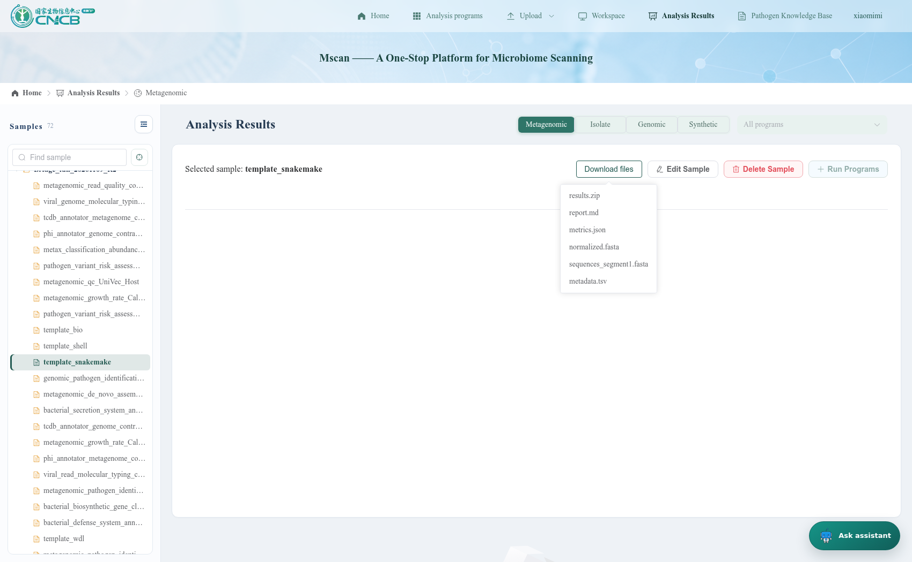

### template_wdl

Engine: `wdl`. Execution: **succeeded**. Total case elapsed (including admission/transfer): `65.13` seconds.

Job: `1d8d35153ec74b8680ec5e1ed4afb1cc`. Remote workflow: `95cc97fd-cb55-41a1-a12f-667a02c28a0a`. Session: `61834ae5-01c5-40e1-be94-5825dba55e44`. Parameter overrides: none (pipeline defaults).

Bundled examples inventoried and used as assigned below:

| Input file | Bytes | SHA-256 |
|---|---:|---|
| `tools/runtime_tools/pipelines/template_wdl/data/input/example_sequence.fasta` | 89 | `3e1e6d3fc9ce5708c6356156dd8db2bb983628e80a0f2605511c7002beffc6fa` |

Assigned session inputs:
```json
{
  "sequence": "uploads/examples/template_wdl-0c8db5001d05454ca073f84d73fafe9a/example_sequence.fasta"
}
```

Actions: actual bundled inputs and execution outputs. Push: **succeeded**. Pull/hash verification: **passed**, 5 files.

MSCAN project `Bridge_full_20261109_R2`, sample `template_wdl`, sample ID `c58803b812733e13a0ff52553a0dc90d`.

Native import: **unsupported**; format `TemplateWdl`; MSCAN has no registered importer for this result format; files remain available.. Generic import: `imported`.

Returned artifacts:

- `report.md` — 321 bytes; `pipeline-artifacts/1d8d35153ec74b8680ec5e1ed4afb1cc/0/report.md`.
- `metrics.json` — 198 bytes; `pipeline-artifacts/1d8d35153ec74b8680ec5e1ed4afb1cc/1/metrics.json`.
- `normalized.fasta` — 85 bytes; `pipeline-artifacts/1d8d35153ec74b8680ec5e1ed4afb1cc/2/normalized.fasta`.

[Complete inputs, transfer IDs, outputs, retry history, and hashes](mscan_pipeline_bridge_2026-11-09_r2/pipelines/template_wdl.json)


### traceback_covid19

Engine: `wdl`. Execution: **not_executed**. Total case elapsed (including admission/transfer): `16.29` seconds.

Contract and inert-transfer verification only; biological workflow/example outside the live execution safety scope.

Bundled examples inventoried (inventory alone does not mean executed):

| Input file | Bytes | SHA-256 |
|---|---:|---|
| `tools/runtime_tools/pipelines/traceback_covid19/data/input/QB159795.1.fasta` | 30358 | `9c4ca2ee874486065d65622036c12018b468e044e1eafc0f2f1cd0bbbb46df7c` |
| `tools/runtime_tools/pipelines/traceback_covid19/data/input/SARS-CoV-2.fa` | 30429 | `0891c00cc2d503f58e0c600ce5ee64e9c64b939525c70d5486bc46cbc7cb073e` |
| `tools/runtime_tools/pipelines/traceback_covid19/data/input/query.fasta` | 151374 | `28174c9c7fec164c25dd874d0047b712f8f2937c5ca575ac9ffa6dc65a961f6a` |
| `tools/runtime_tools/pipelines/traceback_covid19/data/input/sars-cov-2_1.fasta` | 30658 | `5956d665d2774ddba1d640c53d99dfe97f41afc4f963fbbcf7e7b46313ba89c2` |

Actions: inert software-check file only. Push: **succeeded**. Pull/hash verification: **passed**, 1 files.

MSCAN project `Bridge_full_20261109_R2`, sample `traceback_covid19_contract_only`, sample ID `df6ed1cbc66d301bb86aaf0e2f0c8b9f`.

[Complete inputs, transfer IDs, outputs, retry history, and hashes](mscan_pipeline_bridge_2026-11-09_r2/pipelines/traceback_covid19.json)


### viral_genome_molecular_typing

Engine: `wdl`. Execution: **not_executed**. Total case elapsed (including admission/transfer): `15.27` seconds.

Contract and inert-transfer verification only; biological workflow/example outside the live execution safety scope.

Bundled examples inventoried (inventory alone does not mean executed):

| Input file | Bytes | SHA-256 |
|---|---:|---|
| `tools/runtime_tools/pipelines/viral_genome_molecular_typing/data/input/H3N2_PX908176.1_HA.fasta` | 1909 | `70ff1f3ec4780c00908da5d7046f164f7345b0d59f0d99f39563fba3951f274e` |

Actions: inert software-check file only. Push: **succeeded**. Pull/hash verification: **passed**, 1 files.

MSCAN project `Bridge_full_20261109_R2`, sample `viral_genome_molecular_typing_contract_only`, sample ID `232980495dd839f881c712e4d753ec66`.

[Complete inputs, transfer IDs, outputs, retry history, and hashes](mscan_pipeline_bridge_2026-11-09_r2/pipelines/viral_genome_molecular_typing.json)


### viral_read_molecular_typing

Engine: `wdl`. Execution: **not_executed**. Total case elapsed (including admission/transfer): `16.25` seconds.

Contract and inert-transfer verification only; biological workflow/example outside the live execution safety scope.

Bundled examples inventoried (inventory alone does not mean executed):

| Input file | Bytes | SHA-256 |
|---|---:|---|
| `tools/runtime_tools/pipelines/viral_read_molecular_typing/data/input/molecular_demo_h1n1.fastq.gz` | 8803144 | `edf1d6cd93913afc3a9947805c714f9ce17bf167026ca7946524708c2c1c52f4` |

Actions: inert software-check file only. Push: **succeeded**. Pull/hash verification: **passed**, 1 files.

MSCAN project `Bridge_full_20261109_R2`, sample `viral_read_molecular_typing_contract_only`, sample ID `b1094e2b066435589b7526b8a60deffd`.

[Complete inputs, transfer IDs, outputs, retry history, and hashes](mscan_pipeline_bridge_2026-11-09_r2/pipelines/viral_read_molecular_typing.json)


## Evidence integrity and final state

Screenshots are captures of the running application. A skipped workflow screenshot shows only its inert software-check attachment, never a claimed scientific result. JSON evidence contains exact tool responses and transfer receipts. Login storage, passwords, service credentials, and raw authentication databases were excluded.

[Final checks: source/example integrity, service health and job state](mscan_pipeline_bridge_2026-11-09_r2/final-verification.json)

Generated at 2026-11-09T07:04:47.702014+00:00.
