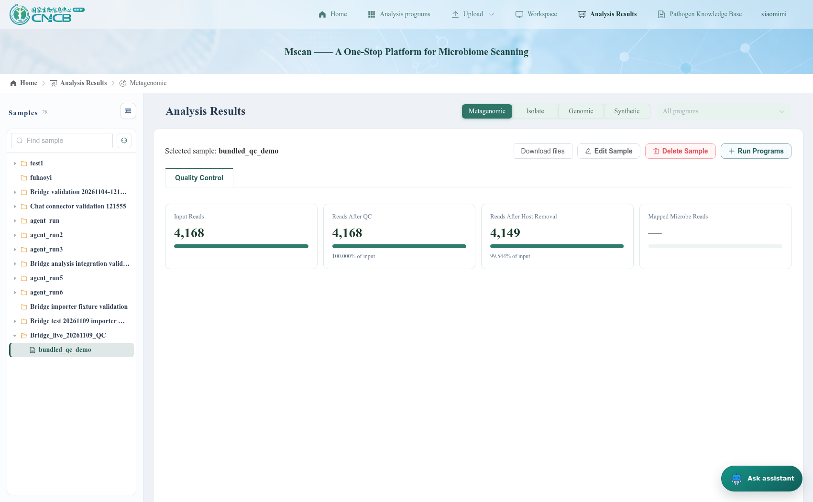

# MSCAN web bridge, pipeline and tool live test report

Test date: 2026-11-09 (Asia/Shanghai). Last report update: 2026-11-09T11:38:42.

> **Importer follow-up:** The 10 conversion failures below were fixed and retried successfully. The combined native matrix is now 16 imported, 0 failed, and 3 expected negative cases. See the [repair report, generic-format tests, and screenshots](mscan_importer_fix_2026-11-09.md). The results below are the original baseline.

## Outcome

The bridge works for account mapping, live page observation, navigation, structured reads, source-file import, backend search/pull/push, and the tested QC round trip. It is **not ready to claim that every pipeline and every native result importer works**. CSV export fails at its return-schema boundary, and a completed detached WDL run lacks embedded result-download links despite working backend downloads. Several MSCAN native imports deliver files but fail during TSV-to-Parquet conversion. Three local scientific workflows lack runtime dependencies.

- Pipeline inventory: **37** definitions. All manifests and referenced entry/configuration files passed static checks.
- Pipeline execution states: **22 not executed; 3 failed; 12 succeeded**. A static check or an unexecuted case is not a live success.
- Tool coverage: **58 of 58 registered tools attempted**. Latest outcomes: 53 PASS; 2 BLOCKED: external provider; 1 FAIL; 2 UNSUPPORTED IN MSCAN: expected rejection.
- Importer cases: **19**, covering all 15 registered native formats plus unsupported, incomplete and incompatible-input cases. Native outcomes: {'imported': 6, 'failed': 10, 'incomplete': 1, 'incompatible_sample_type': 1, 'unsupported': 1}.
- Automated checks: **46 bridge tests and 93 isolation/compatibility tests passed**. The latter included real Docker workers with fixture network responses; these are not all live external-provider tests.

## Environment and method

Source branch: `pipeline2agent-v3.0.0`, commit `ed8e33e04a32be6c211b303b00abb27b310efe47`. Agent: `http://192.168.75.56:8000`; MSCAN frontend: `http://192.168.75.56:8848`; MSCAN backend: port 8080. Cromwell: `http://192.168.164.46:39000`. Python: 3.11.16 in `openaisdk`. Worker image: `bioagent-worker:local`, image ID `1d3cae77ce94ce2171d41294c8583a6cf3f8d9243ad510ed6a9705130f57d7cc`.

Agent account `fuhaoyi` was linked to the MSCAN development identity displayed as `xiaomimi`. **MSCAN still uses development login bypass: real CAS login and two independent real MSCAN users were not tested.** Service credentials stayed outside the report. Existing MSCAN processes were reused. No application, pipeline-definition, or MSCAN source files were changed for this test.

Testing used four distinct layers:

1. Real Chromium pages and actual bridge callbacks, including natural-language agent requests.
2. Registered SDK tools, real isolated Docker execution, real public providers and configured model calls. Direct tool tests isolate tool behavior from model selection; they do not imply every user phrasing works.
3. Pipeline examples copied through `agent-pipeline example`, immutable plans and the configured Docker/Cromwell services, using pipeline defaults.
4. Synthetic importer-format fixtures through the running MSCAN connector, plus automated boundary/compatibility tests. Dummy importer records test software mappings, not scientific correctness.

Each case links its inputs, actual result/error and a screenshot. Screenshots prefixed `browser-` or `mscan-import-` show the real application. Screenshots named `tool-`, `pipeline-` or `import-` show a browser rendering of the recorded test evidence; they are **not application UI screenshots**. No result screen is fabricated.

## Verified QC round trip

Input: bundled `tools/runtime_tools/pipelines/metagenomic_read_quality_control/data/input/qc_demo.fq.gz`. Agent session: `1f96468e-0bfb-4189-8150-8da22dc592ca`. Pipeline job: `a99fcba5414748dea226f92d842726b0`; Cromwell ID: `164f785d-4c96-4cdf-8304-677852046afc`.

Actions: stage the bundled FASTQ, plan/run with defaults, collect remote results, push source plus `results.zip` into new MSCAN project `Bridge_live_20261109_QC` and sample `bundled_qc_demo`, search the sample, pull source/result resources, compare hashes, and push again to the explicit existing project/sample IDs.

Results: source registration and native QC import succeeded. The live MSCAN page shows **4,168 input reads → 4,168 after QC → 4,149 after host removal** (99.544% retained). Seven resources were pulled successfully; five resources advertised SHA-256 values and all five matched the downloaded bytes. Repeated delivery used the same sample and generated another receipt. An invalid resource failed, and retry retained the transfer ID and continued to report the failure honestly.



[Transfer inputs and receipts](mscan_web_bridge_2026-11-09/evidence/roundtrip.json) · [Native QC/API evidence](mscan_web_bridge_2026-11-09/evidence/browser-direct-native-qc.json) · [Actual download menu](mscan_web_bridge_2026-11-09/screenshots/browser-direct-native-downloads.png)

## Web bridge coverage

| Function | Actions and result | Evidence |
|---|---|---|
| Account mapping / embedded sign-in | Real browser exchange mapped the development MSCAN identity to fuhaoyi. | [identity](mscan_web_bridge_2026-11-09/evidence/browser-direct-login.json), [screen](mscan_web_bridge_2026-11-09/screenshots/browser-direct-account-link.png) |
| Page understanding | Observed real title, URL, table and selected sample; navigated home and observed the changed URL. Generic observer also passed DOM/SPA updates without a site adapter. | [before](mscan_web_bridge_2026-11-09/evidence/browser-direct-website_observe.json), [after](mscan_web_bridge_2026-11-09/evidence/browser-direct-website_observe-after-navigation.json) |
| Structured context/table/figure | Current context, QC counts and retention data returned successfully. | Tool cases below |
| Manual | Search and read the returned section succeeded. | Tool cases below |
| CSV export | File written, but returned artifact violates FunctionArtifact schema. | Confirmed defect below |
| Source import | Resource listing and direct FASTQ import into the owned session succeeded. | Tool cases below |
| Backend transfer | Search, push, pull, status and invalid-resource retry exercised through the service and SDK tools. | [round trip](mscan_web_bridge_2026-11-09/evidence/roundtrip.json) |
| Reload | Same conversation ID after reload. | [IDs](mscan_web_bridge_2026-11-09/evidence/browser-direct-reload.json), [screen](mscan_web_bridge_2026-11-09/screenshots/browser-direct-reload.png) |
| Native results | Both QC formats and several other formats imported; multiple Parquet-backed formats failed. | Importer matrix below |
| Highlight/action | MSCAN does not register highlight or invokeAction; requests reject with explicit errors. | Tool cases below |
| Isolation/concurrency | Owner checks, stolen binding, replay, scoped downloads, leases, duplicate IDs and bounded worker concurrency passed automated tests. | [isolation log](mscan_web_bridge_2026-11-09/evidence/isolation.log), [Java checks](mscan_web_bridge_2026-11-09/evidence/mscan-java.log) |
| Detached execution / automatic delivery | Approved WDL example finished with MSCAN closed; automatic delivery stored three files; direct metrics API returned 200. Embedded output download links were absent. | [verification](mscan_web_bridge_2026-11-09/evidence/detached-verification-checks.json), [screen](mscan_web_bridge_2026-11-09/screenshots/detached-verification-missing-download-links.png) |
| Development logout | Host logout returned 200; replay of old agent credential returned 401. Real CAS remains untested. | [verification](mscan_web_bridge_2026-11-09/evidence/detached-verification-checks.json) |
| Installer/logout | Clean ZIP installation changed exactly two original files and was idempotent. Java logout hook passed verified-identity revocation checks. Live production logout/CAS remains untested. | [installer](mscan_web_bridge_2026-11-09/evidence/installer.log), [logout](mscan_web_bridge_2026-11-09/evidence/logout.log) |

## Pipeline matrix

Inputs and SHA-256 fingerprints are listed in [bundled-examples.json](mscan_web_bridge_2026-11-09/inputs/bundled-examples.json). Failed execution and observation timeouts are distinct from policy exclusions or unexecuted cases. Existing policy was preserved. The remaining biological workflows were not automatically run as part of this general software test.

| Pipeline | Engine | Live result | Evidence |
|---|---|---|---|
| `antimicrobial_resistance_detection` | shell | not_executed | [evidence](mscan_web_bridge_2026-11-09/cases/pipeline-antimicrobial_resistance_detection.json) · [screenshot](mscan_web_bridge_2026-11-09/screenshots/pipeline-antimicrobial_resistance_detection.png) |
| `bacterial_biosynthetic_gene_clusters` | wdl | not_executed | [evidence](mscan_web_bridge_2026-11-09/cases/pipeline-bacterial_biosynthetic_gene_clusters.json) · [screenshot](mscan_web_bridge_2026-11-09/screenshots/pipeline-bacterial_biosynthetic_gene_clusters.png) |
| `bacterial_defense_system_annotation` | wdl | not_executed | [evidence](mscan_web_bridge_2026-11-09/cases/pipeline-bacterial_defense_system_annotation.json) · [screenshot](mscan_web_bridge_2026-11-09/screenshots/pipeline-bacterial_defense_system_annotation.png) |
| `bacterial_functional_annotation` | shell | failed | [evidence](mscan_web_bridge_2026-11-09/cases/pipeline-bacterial_functional_annotation.json) · [screenshot](mscan_web_bridge_2026-11-09/screenshots/pipeline-bacterial_functional_annotation.png) |
| `bacterial_genome_annotation` | shell | failed | [evidence](mscan_web_bridge_2026-11-09/cases/pipeline-bacterial_genome_annotation.json) · [screenshot](mscan_web_bridge_2026-11-09/screenshots/pipeline-bacterial_genome_annotation.png) |
| `bacterial_genome_mutation_analysis` | shell | not_executed | [evidence](mscan_web_bridge_2026-11-09/cases/pipeline-bacterial_genome_mutation_analysis.json) · [screenshot](mscan_web_bridge_2026-11-09/screenshots/pipeline-bacterial_genome_mutation_analysis.png) |
| `bacterial_read_variant_analysis` | shell | not_executed | [evidence](mscan_web_bridge_2026-11-09/cases/pipeline-bacterial_read_variant_analysis.json) · [screenshot](mscan_web_bridge_2026-11-09/screenshots/pipeline-bacterial_read_variant_analysis.png) |
| `bacterial_secretion_system_annotation` | wdl | not_executed | [evidence](mscan_web_bridge_2026-11-09/cases/pipeline-bacterial_secretion_system_annotation.json) · [screenshot](mscan_web_bridge_2026-11-09/screenshots/pipeline-bacterial_secretion_system_annotation.png) |
| `bacterial_viral_variant_analysis` | wdl | not_executed | [evidence](mscan_web_bridge_2026-11-09/cases/pipeline-bacterial_viral_variant_analysis.json) · [screenshot](mscan_web_bridge_2026-11-09/screenshots/pipeline-bacterial_viral_variant_analysis.png) |
| `bacterial_virulence_factor_detection` | shell | not_executed | [evidence](mscan_web_bridge_2026-11-09/cases/pipeline-bacterial_virulence_factor_detection.json) · [screenshot](mscan_web_bridge_2026-11-09/screenshots/pipeline-bacterial_virulence_factor_detection.png) |
| `genomic_pathogen_identification` | wdl | not_executed | [evidence](mscan_web_bridge_2026-11-09/cases/pipeline-genomic_pathogen_identification.json) · [screenshot](mscan_web_bridge_2026-11-09/screenshots/pipeline-genomic_pathogen_identification.png) |
| `metagenomic_de_novo_assembly` | wdl | succeeded | [evidence](mscan_web_bridge_2026-11-09/cases/pipeline-metagenomic_de_novo_assembly.json) · [screenshot](mscan_web_bridge_2026-11-09/screenshots/pipeline-metagenomic_de_novo_assembly.png) |
| `metagenomic_growth_rate_Calculation` | wdl | not_executed | [evidence](mscan_web_bridge_2026-11-09/cases/pipeline-metagenomic_growth_rate_Calculation.json) · [screenshot](mscan_web_bridge_2026-11-09/screenshots/pipeline-metagenomic_growth_rate_Calculation.png) |
| `metagenomic_pathogen_identification` | wdl | succeeded | [evidence](mscan_web_bridge_2026-11-09/cases/pipeline-metagenomic_pathogen_identification.json) · [screenshot](mscan_web_bridge_2026-11-09/screenshots/pipeline-metagenomic_pathogen_identification.png) |
| `metagenomic_pathogen_identification_kmer` | wdl | succeeded | [evidence](mscan_web_bridge_2026-11-09/cases/pipeline-metagenomic_pathogen_identification_kmer.json) · [screenshot](mscan_web_bridge_2026-11-09/screenshots/pipeline-metagenomic_pathogen_identification_kmer.png) |
| `metagenomic_pathogen_identification_marker` | wdl | succeeded | [evidence](mscan_web_bridge_2026-11-09/cases/pipeline-metagenomic_pathogen_identification_marker.json) · [screenshot](mscan_web_bridge_2026-11-09/screenshots/pipeline-metagenomic_pathogen_identification_marker.png) |
| `metagenomic_qc_UniVec_Host` | wdl | succeeded | [evidence](mscan_web_bridge_2026-11-09/cases/pipeline-metagenomic_qc_UniVec_Host.json) · [screenshot](mscan_web_bridge_2026-11-09/screenshots/pipeline-metagenomic_qc_UniVec_Host.png) |
| `metagenomic_read_quality_control` | wdl | succeeded | [evidence](mscan_web_bridge_2026-11-09/cases/pipeline-metagenomic_read_quality_control.json) · [screenshot](mscan_web_bridge_2026-11-09/screenshots/pipeline-metagenomic_read_quality_control.png) |
| `metax_classification_abundance_analysis` | wdl | succeeded | [evidence](mscan_web_bridge_2026-11-09/cases/pipeline-metax_classification_abundance_analysis.json) · [screenshot](mscan_web_bridge_2026-11-09/screenshots/pipeline-metax_classification_abundance_analysis.png) |
| `pathogen_variant_risk_assessment` | wdl | not_executed | [evidence](mscan_web_bridge_2026-11-09/cases/pipeline-pathogen_variant_risk_assessment.json) · [screenshot](mscan_web_bridge_2026-11-09/screenshots/pipeline-pathogen_variant_risk_assessment.png) |
| `pathogen_variant_risk_assessment_consensus` | wdl | not_executed | [evidence](mscan_web_bridge_2026-11-09/cases/pipeline-pathogen_variant_risk_assessment_consensus.json) · [screenshot](mscan_web_bridge_2026-11-09/screenshots/pipeline-pathogen_variant_risk_assessment_consensus.png) |
| `phi_annotator_genome` | wdl | not_executed | [evidence](mscan_web_bridge_2026-11-09/cases/pipeline-phi_annotator_genome.json) · [screenshot](mscan_web_bridge_2026-11-09/screenshots/pipeline-phi_annotator_genome.png) |
| `phi_annotator_metagenome` | wdl | not_executed | [evidence](mscan_web_bridge_2026-11-09/cases/pipeline-phi_annotator_metagenome.json) · [screenshot](mscan_web_bridge_2026-11-09/screenshots/pipeline-phi_annotator_metagenome.png) |
| `risk_screen` | wdl | not_executed | [evidence](mscan_web_bridge_2026-11-09/cases/pipeline-risk_screen.json) · [screenshot](mscan_web_bridge_2026-11-09/screenshots/pipeline-risk_screen.png) |
| `rna_secondary_structure_prediction` | shell | failed | [evidence](mscan_web_bridge_2026-11-09/cases/pipeline-rna_secondary_structure_prediction.json) · [screenshot](mscan_web_bridge_2026-11-09/screenshots/pipeline-rna_secondary_structure_prediction.png) |
| `tcdb_annotator_genome` | wdl | not_executed | [evidence](mscan_web_bridge_2026-11-09/cases/pipeline-tcdb_annotator_genome.json) · [screenshot](mscan_web_bridge_2026-11-09/screenshots/pipeline-tcdb_annotator_genome.png) |
| `tcdb_annotator_metagenome` | wdl | not_executed | [evidence](mscan_web_bridge_2026-11-09/cases/pipeline-tcdb_annotator_metagenome.json) · [screenshot](mscan_web_bridge_2026-11-09/screenshots/pipeline-tcdb_annotator_metagenome.png) |
| `template_bio` | shell | succeeded | [evidence](mscan_web_bridge_2026-11-09/cases/pipeline-template_bio.json) · [screenshot](mscan_web_bridge_2026-11-09/screenshots/pipeline-template_bio.png) |
| `template_nextflow` | nextflow | succeeded | [evidence](mscan_web_bridge_2026-11-09/cases/pipeline-template_nextflow.json) · [screenshot](mscan_web_bridge_2026-11-09/screenshots/pipeline-template_nextflow.png) |
| `template_shell` | shell | succeeded | [evidence](mscan_web_bridge_2026-11-09/cases/pipeline-template_shell.json) · [screenshot](mscan_web_bridge_2026-11-09/screenshots/pipeline-template_shell.png) |
| `template_snakemake` | snakemake | succeeded | [evidence](mscan_web_bridge_2026-11-09/cases/pipeline-template_snakemake.json) · [screenshot](mscan_web_bridge_2026-11-09/screenshots/pipeline-template_snakemake.png) |
| `template_wdl` | wdl | succeeded | [evidence](mscan_web_bridge_2026-11-09/cases/pipeline-template_wdl.json) · [screenshot](mscan_web_bridge_2026-11-09/screenshots/pipeline-template_wdl.png) |
| `traceback_covid19` | wdl | not_executed | [evidence](mscan_web_bridge_2026-11-09/cases/pipeline-traceback_covid19.json) · [screenshot](mscan_web_bridge_2026-11-09/screenshots/pipeline-traceback_covid19.png) |
| `viral_genome_molecular_typing` | wdl | not_executed | [evidence](mscan_web_bridge_2026-11-09/cases/pipeline-viral_genome_molecular_typing.json) · [screenshot](mscan_web_bridge_2026-11-09/screenshots/pipeline-viral_genome_molecular_typing.png) |
| `viral_genome_mutation_analysis` | shell | not_executed | [evidence](mscan_web_bridge_2026-11-09/cases/pipeline-viral_genome_mutation_analysis.json) · [screenshot](mscan_web_bridge_2026-11-09/screenshots/pipeline-viral_genome_mutation_analysis.png) |
| `viral_molecular_typing` | wdl | not_executed | [evidence](mscan_web_bridge_2026-11-09/cases/pipeline-viral_molecular_typing.json) · [screenshot](mscan_web_bridge_2026-11-09/screenshots/pipeline-viral_molecular_typing.png) |
| `viral_read_molecular_typing` | wdl | not_executed | [evidence](mscan_web_bridge_2026-11-09/cases/pipeline-viral_read_molecular_typing.json) · [screenshot](mscan_web_bridge_2026-11-09/screenshots/pipeline-viral_read_molecular_typing.png) |

## Registered tool matrix

Every registered tool received an attempt. A successful envelope was checked against its content; negative capability tests are labelled separately. Corrections to the test harness included valid SDK ToolContext, refreshing workspace metadata, explicit sequence IDs for multi-record FASTA, a PDF for document_read, the allowlisted unittest command, and JSON evidence for report tools. Initial invalid test inputs are retained in case histories and are not counted as product defects.

| Tool | Latest outcome | Inputs, result and screenshot |
|---|---|---|
| `sequence_stats` | PASS | [evidence](mscan_web_bridge_2026-11-09/cases/tool-sequence_stats.json) · [screenshot](mscan_web_bridge_2026-11-09/screenshots/tool-sequence_stats.png) |
| `sequence_find_orfs` | PASS | [evidence](mscan_web_bridge_2026-11-09/cases/tool-sequence_find_orfs.json) · [screenshot](mscan_web_bridge_2026-11-09/screenshots/tool-sequence_find_orfs.png) |
| `sequence_translate` | PASS | [evidence](mscan_web_bridge_2026-11-09/cases/tool-sequence_translate.json) · [screenshot](mscan_web_bridge_2026-11-09/screenshots/tool-sequence_translate.png) |
| `sequence_reverse_complement` | PASS | [evidence](mscan_web_bridge_2026-11-09/cases/tool-sequence_reverse_complement.json) · [screenshot](mscan_web_bridge_2026-11-09/screenshots/tool-sequence_reverse_complement.png) |
| `alphafold_download` | PASS | [evidence](mscan_web_bridge_2026-11-09/cases/tool-alphafold_download.json) · [screenshot](mscan_web_bridge_2026-11-09/screenshots/tool-alphafold_download.png) |
| `ncbi_retrieval` | PASS | [evidence](mscan_web_bridge_2026-11-09/cases/tool-ncbi_retrieval.json) · [screenshot](mscan_web_bridge_2026-11-09/screenshots/tool-ncbi_retrieval.png) |
| `database_lookup` | PASS | [evidence](mscan_web_bridge_2026-11-09/cases/tool-database_lookup.json) · [screenshot](mscan_web_bridge_2026-11-09/screenshots/tool-database_lookup.png) |
| `pdb_download` | PASS | [evidence](mscan_web_bridge_2026-11-09/cases/tool-pdb_download.json) · [screenshot](mscan_web_bridge_2026-11-09/screenshots/tool-pdb_download.png) |
| `blast_search` | BLOCKED: external provider | [evidence](mscan_web_bridge_2026-11-09/cases/tool-blast_search.json) · [screenshot](mscan_web_bridge_2026-11-09/screenshots/tool-blast_search.png) |
| `structure_inspect` | PASS | [evidence](mscan_web_bridge_2026-11-09/cases/tool-structure_inspect.json) · [screenshot](mscan_web_bridge_2026-11-09/screenshots/tool-structure_inspect.png) |
| `genome_read_features` | PASS | [evidence](mscan_web_bridge_2026-11-09/cases/tool-genome_read_features.json) · [screenshot](mscan_web_bridge_2026-11-09/screenshots/tool-genome_read_features.png) |
| `genome_render_map` | PASS | [evidence](mscan_web_bridge_2026-11-09/cases/tool-genome_render_map.json) · [screenshot](mscan_web_bridge_2026-11-09/screenshots/tool-genome_render_map.png) |
| `table_profile` | PASS | [evidence](mscan_web_bridge_2026-11-09/cases/tool-table_profile.json) · [screenshot](mscan_web_bridge_2026-11-09/screenshots/tool-table_profile.png) |
| `table_group` | PASS | [evidence](mscan_web_bridge_2026-11-09/cases/tool-table_group.json) · [screenshot](mscan_web_bridge_2026-11-09/screenshots/tool-table_group.png) |
| `table_plot` | PASS | [evidence](mscan_web_bridge_2026-11-09/cases/tool-table_plot.json) · [screenshot](mscan_web_bridge_2026-11-09/screenshots/tool-table_plot.png) |
| `pubmed_search` | PASS | [evidence](mscan_web_bridge_2026-11-09/cases/tool-pubmed_search.json) · [screenshot](mscan_web_bridge_2026-11-09/screenshots/tool-pubmed_search.png) |
| `web_search` | BLOCKED: external provider | [evidence](mscan_web_bridge_2026-11-09/cases/tool-web_search.json) · [screenshot](mscan_web_bridge_2026-11-09/screenshots/tool-web_search.png) |
| `web_fetch` | PASS | [evidence](mscan_web_bridge_2026-11-09/cases/tool-web_fetch.json) · [screenshot](mscan_web_bridge_2026-11-09/screenshots/tool-web_fetch.png) |
| `evidence_index` | PASS | [evidence](mscan_web_bridge_2026-11-09/cases/tool-evidence_index.json) · [screenshot](mscan_web_bridge_2026-11-09/screenshots/tool-evidence_index.png) |
| `evidence_retrieve` | PASS | [evidence](mscan_web_bridge_2026-11-09/cases/tool-evidence_retrieve.json) · [screenshot](mscan_web_bridge_2026-11-09/screenshots/tool-evidence_retrieve.png) |
| `knowledge_ingest` | PASS | [evidence](mscan_web_bridge_2026-11-09/cases/tool-knowledge_ingest.json) · [screenshot](mscan_web_bridge_2026-11-09/screenshots/tool-knowledge_ingest.png) |
| `knowledge_status` | PASS | [evidence](mscan_web_bridge_2026-11-09/cases/tool-knowledge_status.json) · [screenshot](mscan_web_bridge_2026-11-09/screenshots/tool-knowledge_status.png) |
| `knowledge_retrieve` | PASS | [evidence](mscan_web_bridge_2026-11-09/cases/tool-knowledge_retrieve.json) · [screenshot](mscan_web_bridge_2026-11-09/screenshots/tool-knowledge_retrieve.png) |
| `file_inspection` | PASS | [evidence](mscan_web_bridge_2026-11-09/cases/tool-file_inspection.json) · [screenshot](mscan_web_bridge_2026-11-09/screenshots/tool-file_inspection.png) |
| `document_read` | PASS | [evidence](mscan_web_bridge_2026-11-09/cases/tool-document_read.json) · [screenshot](mscan_web_bridge_2026-11-09/screenshots/tool-document_read.png) |
| `workspace_search` | PASS | [evidence](mscan_web_bridge_2026-11-09/cases/tool-workspace_search.json) · [screenshot](mscan_web_bridge_2026-11-09/screenshots/tool-workspace_search.png) |
| `report_write` | PASS | [evidence](mscan_web_bridge_2026-11-09/cases/tool-report_write.json) · [screenshot](mscan_web_bridge_2026-11-09/screenshots/tool-report_write.png) |
| `code_inspection` | PASS | [evidence](mscan_web_bridge_2026-11-09/cases/tool-code_inspection.json) · [screenshot](mscan_web_bridge_2026-11-09/screenshots/tool-code_inspection.png) |
| `code_edit` | PASS | [evidence](mscan_web_bridge_2026-11-09/cases/tool-code_edit.json) · [screenshot](mscan_web_bridge_2026-11-09/screenshots/tool-code_edit.png) |
| `code_test` | PASS | [evidence](mscan_web_bridge_2026-11-09/cases/tool-code_test.json) · [screenshot](mscan_web_bridge_2026-11-09/screenshots/tool-code_test.png) |
| `python_execute` | PASS | [evidence](mscan_web_bridge_2026-11-09/cases/tool-python_execute.json) · [screenshot](mscan_web_bridge_2026-11-09/screenshots/tool-python_execute.png) |
| `research_specialist` | PASS | [evidence](mscan_web_bridge_2026-11-09/cases/tool-research_specialist.json) · [screenshot](mscan_web_bridge_2026-11-09/screenshots/tool-research_specialist.png) |
| `pipeline_specialist` | PASS | [evidence](mscan_web_bridge_2026-11-09/cases/tool-pipeline_specialist.json) · [screenshot](mscan_web_bridge_2026-11-09/screenshots/tool-pipeline_specialist.png) |
| `document_specialist` | PASS | [evidence](mscan_web_bridge_2026-11-09/cases/tool-document_specialist.json) · [screenshot](mscan_web_bridge_2026-11-09/screenshots/tool-document_specialist.png) |
| `data_analysis_specialist` | PASS | [evidence](mscan_web_bridge_2026-11-09/cases/tool-data_analysis_specialist.json) · [screenshot](mscan_web_bridge_2026-11-09/screenshots/tool-data_analysis_specialist.png) |
| `coding_specialist` | PASS | [evidence](mscan_web_bridge_2026-11-09/cases/tool-coding_specialist.json) · [screenshot](mscan_web_bridge_2026-11-09/screenshots/tool-coding_specialist.png) |
| `website_guide_specialist` | PASS | [evidence](mscan_web_bridge_2026-11-09/cases/tool-website_guide_specialist.json) · [screenshot](mscan_web_bridge_2026-11-09/screenshots/tool-website_guide_specialist.png) |
| `report_review` | PASS | [evidence](mscan_web_bridge_2026-11-09/cases/tool-report_review.json) · [screenshot](mscan_web_bridge_2026-11-09/screenshots/tool-report_review.png) |
| `report_synthesize` | PASS | [evidence](mscan_web_bridge_2026-11-09/cases/tool-report_synthesize.json) · [screenshot](mscan_web_bridge_2026-11-09/screenshots/tool-report_synthesize.png) |
| `website_observe` | PASS | [evidence](mscan_web_bridge_2026-11-09/cases/tool-website_observe.json) · [screenshot](mscan_web_bridge_2026-11-09/screenshots/tool-website_observe.png) |
| `website_transfer_retry` | PASS | [evidence](mscan_web_bridge_2026-11-09/cases/tool-website_transfer_retry.json) · [screenshot](mscan_web_bridge_2026-11-09/screenshots/tool-website_transfer_retry.png) |
| `website_connections` | PASS | [evidence](mscan_web_bridge_2026-11-09/cases/tool-website_connections.json) · [screenshot](mscan_web_bridge_2026-11-09/screenshots/tool-website_connections.png) |
| `website_search` | PASS | [evidence](mscan_web_bridge_2026-11-09/cases/tool-website_search.json) · [screenshot](mscan_web_bridge_2026-11-09/screenshots/tool-website_search.png) |
| `website_pull` | PASS | [evidence](mscan_web_bridge_2026-11-09/cases/tool-website_pull.json) · [screenshot](mscan_web_bridge_2026-11-09/screenshots/tool-website_pull.png) |
| `website_push` | PASS | [evidence](mscan_web_bridge_2026-11-09/cases/tool-website_push.json) · [screenshot](mscan_web_bridge_2026-11-09/screenshots/tool-website_push.png) |
| `website_transfer_status` | PASS | [evidence](mscan_web_bridge_2026-11-09/cases/tool-website_transfer_status.json) · [screenshot](mscan_web_bridge_2026-11-09/screenshots/tool-website_transfer_status.png) |
| `website_list_resources` | PASS | [evidence](mscan_web_bridge_2026-11-09/cases/tool-website_list_resources.json) · [screenshot](mscan_web_bridge_2026-11-09/screenshots/tool-website_list_resources.png) |
| `website_import_resource` | PASS | [evidence](mscan_web_bridge_2026-11-09/cases/tool-website_import_resource.json) · [screenshot](mscan_web_bridge_2026-11-09/screenshots/tool-website_import_resource.png) |
| `website_context` | PASS | [evidence](mscan_web_bridge_2026-11-09/cases/tool-website_context.json) · [screenshot](mscan_web_bridge_2026-11-09/screenshots/tool-website_context.png) |
| `website_read_table` | PASS | [evidence](mscan_web_bridge_2026-11-09/cases/tool-website_read_table.json) · [screenshot](mscan_web_bridge_2026-11-09/screenshots/tool-website_read_table.png) |
| `website_read_figure` | PASS | [evidence](mscan_web_bridge_2026-11-09/cases/tool-website_read_figure.json) · [screenshot](mscan_web_bridge_2026-11-09/screenshots/tool-website_read_figure.png) |
| `website_search_manual` | PASS | [evidence](mscan_web_bridge_2026-11-09/cases/tool-website_search_manual.json) · [screenshot](mscan_web_bridge_2026-11-09/screenshots/tool-website_search_manual.png) |
| `website_read_manual` | PASS | [evidence](mscan_web_bridge_2026-11-09/cases/tool-website_read_manual.json) · [screenshot](mscan_web_bridge_2026-11-09/screenshots/tool-website_read_manual.png) |
| `website_import_data` | FAIL | [evidence](mscan_web_bridge_2026-11-09/cases/tool-website_import_data.json) · [screenshot](mscan_web_bridge_2026-11-09/screenshots/tool-website_import_data.png) |
| `website_highlight` | UNSUPPORTED IN MSCAN: expected rejection | [evidence](mscan_web_bridge_2026-11-09/cases/tool-website_highlight.json) · [screenshot](mscan_web_bridge_2026-11-09/screenshots/tool-website_highlight.png) |
| `website_navigate` | PASS | [evidence](mscan_web_bridge_2026-11-09/cases/tool-website_navigate.json) · [screenshot](mscan_web_bridge_2026-11-09/screenshots/tool-website_navigate.png) |
| `website_action` | UNSUPPORTED IN MSCAN: expected rejection | [evidence](mscan_web_bridge_2026-11-09/cases/tool-website_action.json) · [screenshot](mscan_web_bridge_2026-11-09/screenshots/tool-website_action.png) |
| `pipeline_shell` | PASS | [evidence](mscan_web_bridge_2026-11-09/cases/tool-pipeline_shell.json) · [screenshot](mscan_web_bridge_2026-11-09/screenshots/tool-pipeline_shell.png) |

## Native importer matrix

These used minimal dummy software fixtures through the live backend. No virulence or engineering analysis was executed to construct them. A `delivered` file status does not mean a successful native import. Missing roles, incompatible sample types and unknown formats intentionally exercised fallback states. The full assembly-format fixture also received an import attempt.

| Fixture/sample | Native state | Evidence and real MSCAN page |
|---|---|---|
| metax shortReads fixture | imported | [evidence](mscan_web_bridge_2026-11-09/cases/import-7e1a07ccd31749c38cba81a2f9c680a1.json) · [screenshot](mscan_web_bridge_2026-11-09/screenshots/import-7e1a07ccd31749c38cba81a2f9c680a1.png) · [MSCAN](mscan_web_bridge_2026-11-09/screenshots/mscan-import-7e1a07ccd31749c38cba81a2f9c680a1.png) |
| FuncAssembly genomic fixture | failed | [evidence](mscan_web_bridge_2026-11-09/cases/import-849414151caa4cac931f1140080300a8.json) · [screenshot](mscan_web_bridge_2026-11-09/screenshots/import-849414151caa4cac931f1140080300a8.png) · [MSCAN](mscan_web_bridge_2026-11-09/screenshots/mscan-import-849414151caa4cac931f1140080300a8.png) |
| FuncAssembly synthetic fixture | failed | [evidence](mscan_web_bridge_2026-11-09/cases/import-359a8d83e0f6408ba14f064b04463b74.json) · [screenshot](mscan_web_bridge_2026-11-09/screenshots/import-359a8d83e0f6408ba14f064b04463b74.png) · [MSCAN](mscan_web_bridge_2026-11-09/screenshots/mscan-import-359a8d83e0f6408ba14f064b04463b74.png) |
| FuncReads meta fixture | failed | [evidence](mscan_web_bridge_2026-11-09/cases/import-b8a60543a9294274b3136f48a38447fd.json) · [screenshot](mscan_web_bridge_2026-11-09/screenshots/import-b8a60543a9294274b3136f48a38447fd.png) · [MSCAN](mscan_web_bridge_2026-11-09/screenshots/mscan-import-b8a60543a9294274b3136f48a38447fd.png) |
| AssemblyId meta fixture incomplete | incomplete | [evidence](mscan_web_bridge_2026-11-09/cases/import-045d08bc607340d7bd2be3f04945bf19.json) · [screenshot](mscan_web_bridge_2026-11-09/screenshots/import-045d08bc607340d7bd2be3f04945bf19.png) · [MSCAN](mscan_web_bridge_2026-11-09/screenshots/mscan-import-045d08bc607340d7bd2be3f04945bf19.png) |
| AssemblyId genomic fixture mismatch | incompatible_sample_type | [evidence](mscan_web_bridge_2026-11-09/cases/import-d0a9a98391234df48a6872dd11bd561e.json) · [screenshot](mscan_web_bridge_2026-11-09/screenshots/import-d0a9a98391234df48a6872dd11bd561e.png) · [MSCAN](mscan_web_bridge_2026-11-09/screenshots/mscan-import-d0a9a98391234df48a6872dd11bd561e.png) |
| UnknownExampleFormat meta fixture | unsupported | [evidence](mscan_web_bridge_2026-11-09/cases/import-3a419f476c724960a892342924460903.json) · [screenshot](mscan_web_bridge_2026-11-09/screenshots/import-3a419f476c724960a892342924460903.png) · [MSCAN](mscan_web_bridge_2026-11-09/screenshots/mscan-import-3a419f476c724960a892342924460903.png) |
| TcdbAnnotatorGenome genomic fixture | failed | [evidence](mscan_web_bridge_2026-11-09/cases/import-e574ff28103f4fa58fa0d875ab99ec92.json) · [screenshot](mscan_web_bridge_2026-11-09/screenshots/import-e574ff28103f4fa58fa0d875ab99ec92.png) · [MSCAN](mscan_web_bridge_2026-11-09/screenshots/mscan-import-e574ff28103f4fa58fa0d875ab99ec92.png) |
| PhiAnnotatorGenome genomic fixture | failed | [evidence](mscan_web_bridge_2026-11-09/cases/import-c7355162c3014c86a86a16ad2efd8105.json) · [screenshot](mscan_web_bridge_2026-11-09/screenshots/import-c7355162c3014c86a86a16ad2efd8105.png) · [MSCAN](mscan_web_bridge_2026-11-09/screenshots/mscan-import-c7355162c3014c86a86a16ad2efd8105.png) |
| PhiAnnotatorMetagenome meta fixture | failed | [evidence](mscan_web_bridge_2026-11-09/cases/import-fa6136de715846af917a0d9b48e9dbc2.json) · [screenshot](mscan_web_bridge_2026-11-09/screenshots/import-fa6136de715846af917a0d9b48e9dbc2.png) · [MSCAN](mscan_web_bridge_2026-11-09/screenshots/mscan-import-fa6136de715846af917a0d9b48e9dbc2.png) |
| StrainMeta meta fixture | imported | [evidence](mscan_web_bridge_2026-11-09/cases/import-402a2b760a2d4256b45189710cd8fb8e.json) · [screenshot](mscan_web_bridge_2026-11-09/screenshots/import-402a2b760a2d4256b45189710cd8fb8e.png) · [MSCAN](mscan_web_bridge_2026-11-09/screenshots/mscan-import-402a2b760a2d4256b45189710cd8fb8e.png) |
| StrainCoPTR meta fixture | imported | [evidence](mscan_web_bridge_2026-11-09/cases/import-955e697026cf4ba9bc0820a5fe252d0e.json) · [screenshot](mscan_web_bridge_2026-11-09/screenshots/import-955e697026cf4ba9bc0820a5fe252d0e.png) · [MSCAN](mscan_web_bridge_2026-11-09/screenshots/mscan-import-955e697026cf4ba9bc0820a5fe252d0e.png) |
| BacDef genomic fixture | failed | [evidence](mscan_web_bridge_2026-11-09/cases/import-91cae4da506a45dea2c9e26c24aeeadc.json) · [screenshot](mscan_web_bridge_2026-11-09/screenshots/import-91cae4da506a45dea2c9e26c24aeeadc.png) · [MSCAN](mscan_web_bridge_2026-11-09/screenshots/mscan-import-91cae4da506a45dea2c9e26c24aeeadc.png) |
| BacBGC genomic fixture | failed | [evidence](mscan_web_bridge_2026-11-09/cases/import-1d4dfe232f804e6b858998a2f4399b51.json) · [screenshot](mscan_web_bridge_2026-11-09/screenshots/import-1d4dfe232f804e6b858998a2f4399b51.png) · [MSCAN](mscan_web_bridge_2026-11-09/screenshots/mscan-import-1d4dfe232f804e6b858998a2f4399b51.png) |
| ReadQc meta fixture | imported | [evidence](mscan_web_bridge_2026-11-09/cases/import-bab45ef2999544cd93250e68bd346f14.json) · [screenshot](mscan_web_bridge_2026-11-09/screenshots/import-bab45ef2999544cd93250e68bd346f14.png) · [MSCAN](mscan_web_bridge_2026-11-09/screenshots/mscan-import-bab45ef2999544cd93250e68bd346f14.png) |
| MetagenomicQc meta fixture | imported | [evidence](mscan_web_bridge_2026-11-09/cases/import-c485c08b75e644fe9137bb89db61bb24.json) · [screenshot](mscan_web_bridge_2026-11-09/screenshots/import-c485c08b75e644fe9137bb89db61bb24.png) · [MSCAN](mscan_web_bridge_2026-11-09/screenshots/mscan-import-c485c08b75e644fe9137bb89db61bb24.png) |
| TcdbAnnotatorMetagenome shortReads fixture | failed | [evidence](mscan_web_bridge_2026-11-09/cases/import-ff96b5a133ab44d1bb119d5a26020927.json) · [screenshot](mscan_web_bridge_2026-11-09/screenshots/import-ff96b5a133ab44d1bb119d5a26020927.png) · [MSCAN](mscan_web_bridge_2026-11-09/screenshots/mscan-import-ff96b5a133ab44d1bb119d5a26020927.png) |
| BacSec genomic fixture | failed | [evidence](mscan_web_bridge_2026-11-09/cases/import-c40d2e03bbcc4df794e44058f242fce6.json) · [screenshot](mscan_web_bridge_2026-11-09/screenshots/import-c40d2e03bbcc4df794e44058f242fce6.png) · [MSCAN](mscan_web_bridge_2026-11-09/screenshots/mscan-import-c40d2e03bbcc4df794e44058f242fce6.png) |
| AssemblyId meta fixture complete | imported | [evidence](mscan_web_bridge_2026-11-09/cases/import-b3d6359dd1554be7ae056f264d4b87ef.json) · [screenshot](mscan_web_bridge_2026-11-09/screenshots/import-b3d6359dd1554be7ae056f264d4b87ef.png) · [MSCAN](mscan_web_bridge_2026-11-09/screenshots/mscan-import-b3d6359dd1554be7ae056f264d4b87ef.png) |

## Natural-language and presentation checks

Live GPT-5.6 Sol requests successfully searched/pulled `detection_demo` and created project `Bridge_live_20261109_NL` with sample `connector_report`, delivering the requested Markdown report. [Prompts and responses](mscan_web_bridge_2026-11-09/evidence/browser-nl-checks.json), [pull screenshot](mscan_web_bridge_2026-11-09/screenshots/browser-nl-06-backend-search-pull.png), [push screenshot](mscan_web_bridge_2026-11-09/screenshots/browser-nl-07-write-push.png).

A real native download matched the bundled FASTQ exactly (240,118 bytes). The embedded view had zero runtime panels; the standalone view had two. The Stop button was visible and its run reached `cancelled`. [Checks](mscan_web_bridge_2026-11-09/evidence/ui-extras-checks.json), [embedded](mscan_web_bridge_2026-11-09/screenshots/ui-extras-embedded-compact.png), [standalone](mscan_web_bridge_2026-11-09/screenshots/ui-extras-standalone-runtime.png), [Stop](mscan_web_bridge_2026-11-09/screenshots/ui-extras-stop-visible.png).

## Visual artifacts

A real agent run inspected human hemoglobin structure `1A3N`, generated an interactive map for the bundled synthetic `mock_contig_1`, and plotted the bundled metadata. The 3D viewer rendered one structure, switching between ribbons and sticks worked, and the genome browser loaded with no error. [Recorded run and browser checks](mscan_web_bridge_2026-11-09/evidence/visuals-checks.json), [structure](mscan_web_bridge_2026-11-09/screenshots/visuals-structure.png), [sticks](mscan_web_bridge_2026-11-09/screenshots/visuals-structure-sticks.png), [genome map](mscan_web_bridge_2026-11-09/screenshots/visuals-genome.png).

## Completed pipeline results delivered to MSCAN

Each successful bundled-example workflow was pushed to its own sample in `Bridge_pipeline_matrix_20261109`. FASTQ source slots were registered where available; other templates used result-only delivery. Unsupported native formats remain downloadable files and are not native analysis records.

| Pipeline | Delivery | Native status | Evidence |
|---|---|---|---|
| `metagenomic_de_novo_assembly` | succeeded | AssemblyId: imported | [evidence](mscan_web_bridge_2026-11-09/cases/transfer-metagenomic_de_novo_assembly.json) · [screenshot](mscan_web_bridge_2026-11-09/screenshots/transfer-metagenomic_de_novo_assembly.png) · [MSCAN](mscan_web_bridge_2026-11-09/screenshots/mscan-transfer-metagenomic_de_novo_assembly.png) |
| `metagenomic_pathogen_identification` | succeeded | MetagenomicDetection: unsupported | [evidence](mscan_web_bridge_2026-11-09/cases/transfer-metagenomic_pathogen_identification.json) · [screenshot](mscan_web_bridge_2026-11-09/screenshots/transfer-metagenomic_pathogen_identification.png) · [MSCAN](mscan_web_bridge_2026-11-09/screenshots/mscan-transfer-metagenomic_pathogen_identification.png) |
| `metagenomic_pathogen_identification_kmer` | succeeded | StrobeTaxaDetection: unsupported | [evidence](mscan_web_bridge_2026-11-09/cases/transfer-metagenomic_pathogen_identification_kmer.json) · [screenshot](mscan_web_bridge_2026-11-09/screenshots/transfer-metagenomic_pathogen_identification_kmer.png) · [MSCAN](mscan_web_bridge_2026-11-09/screenshots/mscan-transfer-metagenomic_pathogen_identification_kmer.png) |
| `metagenomic_qc_UniVec_Host` | succeeded | ReadQc: imported | [evidence](mscan_web_bridge_2026-11-09/cases/transfer-metagenomic_qc_UniVec_Host.json) · [screenshot](mscan_web_bridge_2026-11-09/screenshots/transfer-metagenomic_qc_UniVec_Host.png) · [MSCAN](mscan_web_bridge_2026-11-09/screenshots/mscan-transfer-metagenomic_qc_UniVec_Host.png) |
| `metagenomic_read_quality_control` | succeeded | MetagenomicQc: imported | [evidence](mscan_web_bridge_2026-11-09/cases/transfer-metagenomic_read_quality_control.json) · [screenshot](mscan_web_bridge_2026-11-09/screenshots/transfer-metagenomic_read_quality_control.png) · [MSCAN](mscan_web_bridge_2026-11-09/screenshots/mscan-transfer-metagenomic_read_quality_control.png) |
| `template_bio` | succeeded | generic: unsupported | [evidence](mscan_web_bridge_2026-11-09/cases/transfer-template_bio.json) · [screenshot](mscan_web_bridge_2026-11-09/screenshots/transfer-template_bio.png) · [MSCAN](mscan_web_bridge_2026-11-09/screenshots/mscan-transfer-template_bio.png) |
| `template_nextflow` | succeeded | generic: unsupported | [evidence](mscan_web_bridge_2026-11-09/cases/transfer-template_nextflow.json) · [screenshot](mscan_web_bridge_2026-11-09/screenshots/transfer-template_nextflow.png) · [MSCAN](mscan_web_bridge_2026-11-09/screenshots/mscan-transfer-template_nextflow.png) |
| `template_shell` | succeeded | generic: unsupported | [evidence](mscan_web_bridge_2026-11-09/cases/transfer-template_shell.json) · [screenshot](mscan_web_bridge_2026-11-09/screenshots/transfer-template_shell.png) · [MSCAN](mscan_web_bridge_2026-11-09/screenshots/mscan-transfer-template_shell.png) |
| `template_snakemake` | succeeded | generic: unsupported | [evidence](mscan_web_bridge_2026-11-09/cases/transfer-template_snakemake.json) · [screenshot](mscan_web_bridge_2026-11-09/screenshots/transfer-template_snakemake.png) · [MSCAN](mscan_web_bridge_2026-11-09/screenshots/mscan-transfer-template_snakemake.png) |
| `template_wdl` | succeeded | TemplateWdl: unsupported | [evidence](mscan_web_bridge_2026-11-09/cases/transfer-template_wdl.json) · [screenshot](mscan_web_bridge_2026-11-09/screenshots/transfer-template_wdl.png) · [MSCAN](mscan_web_bridge_2026-11-09/screenshots/mscan-transfer-template_wdl.png) |
| `metagenomic_pathogen_identification_marker` | succeeded | StrainMeta: imported | [evidence](mscan_web_bridge_2026-11-09/cases/transfer-metagenomic_pathogen_identification_marker.json) · [screenshot](mscan_web_bridge_2026-11-09/screenshots/transfer-metagenomic_pathogen_identification_marker.png) · [MSCAN](mscan_web_bridge_2026-11-09/screenshots/mscan-transfer-metagenomic_pathogen_identification_marker.png) |
| `metax_classification_abundance_analysis` | succeeded | metax: imported | [evidence](mscan_web_bridge_2026-11-09/cases/transfer-metax_classification_abundance_analysis.json) · [screenshot](mscan_web_bridge_2026-11-09/screenshots/transfer-metax_classification_abundance_analysis.png) · [MSCAN](mscan_web_bridge_2026-11-09/screenshots/mscan-transfer-metax_classification_abundance_analysis.png) |

## Confirmed defects and deployment blockers

1. **CSV export returns an error after writing the file.** `website_import_data` passes the upload publisher's record directly into `FunctionArtifact`: `modified_at` is missing, while `session_id` and `sha256` are extra fields. The agent receives a ValidationError and may retry, creating duplicate CSVs. Normalize the artifact record at the tool boundary and test the real publisher response. [Exact error](mscan_web_bridge_2026-11-09/evidence/browser-direct-website_import_data.json).
2. **Several native importers fail after successful delivery.** Live receipts report TSV-to-Parquet errors, including DuckDB's “Attempting to execute an unsuccessful or closed pending query result.” Functional annotation and multiple annotation-family importers fail while QC, taxonomic profile and complete assembly fixture imports succeed. This confirms the boundary failure but does not establish whether the root cause is DuckDB lifecycle, S3 access/configuration or another backend dependency; investigate the first backend exception before changing schemas. Files remain delivered and failure is reported honestly. [All receipts](mscan_web_bridge_2026-11-09/evidence/importers.json).
3. **Embedded remote output download links are missing after detached completion.** The WDL example finished, its metrics endpoint returned HTTP 200, and MSCAN automatically received three output files. However, the embedded conversation had zero clickable `metrics.json` links. The final run payload had an empty `artifacts` list, only the input in `files`, and pipeline evidence with file paths but no `output_records`; the frontend download collector does not turn these into links. Normalize published remote artifacts into the final result contract and test both embedded and standalone rendering. This is a display/result-contract issue, not a lost Cromwell output. [Actual screen](mscan_web_bridge_2026-11-09/screenshots/detached-verification-missing-download-links.png) · [API and receipt proof](mscan_web_bridge_2026-11-09/evidence/detached-verification-checks.json).
4. **Missing native mappings for completed detection workflows.** `MetagenomicDetection` and `StrobeTaxaDetection` results were delivered successfully but explicitly reported `unsupported` for native import. Their completion does not imply native MSCAN analysis tables were populated.
5. **Worker dependencies are incomplete.** `rna_secondary_structure_prediction`: RNAfold absent; `bacterial_genome_annotation`: Prokka absent; `bacterial_functional_annotation`: `conda: not found`. Host-installed packages do not automatically exist inside `bioagent-worker:local`. Use the intended pipeline runtime environments/images and rerun these bundled examples.
6. **External provider availability is uneven.** Live web search requested browser verification; BLAST returned a public-network request failure. Fixture transport checks passed, so those alone do not prove live provider reachability. Knowledge retrieval succeeded after ingestion finished and a transient connection failure was retried.
7. **MSCAN capability gap.** The generic agent registers highlight and action tools, but this adapter has no corresponding callbacks. Prefer capability-aware availability or a clear unsupported response; do not claim these interactions work on MSCAN.

Some natural-language runs also encountered transient model connection errors. Direct live callback tests isolate the working bridge from those provider failures. Specialist requests using exact workspace paths succeeded where earlier basename-only requests reported missing files; this is a useful usability regression case.

## Limits and retained test data

- This is a dated deployment test, not a guarantee of scientific accuracy, all parameter combinations, large-input capacity or production readiness.
- The existing account mapping was reused. First-time real MSCAN account linking and permanent unlink/remapping were not exercised against the deployed service.
- Only the pipeline rows marked succeeded completed live. Unexecuted biological workflows and production CAS/two-user login must not be inferred to pass.
- Importer fixtures are not substitute evidence that their upstream scientific pipelines execute successfully.
- Test projects/samples are retained for inspection, including `Bridge_live_20261109_QC`, `Bridge test 20261109 importer matrix`, `Bridge_pipeline_matrix_20261109`, and initial `Bridge importer fixture validation` records. The natural-language test also created `Bridge_live_20261109_NL`; its receipt/result is recorded separately. No pre-existing scientific samples were intentionally edited.
- A duplicate test workflow created during a test-harness restart was identified and cancelled; this was a harness artifact, not evidence of an application duplicate-submission bug. [Cancellation evidence](mscan_web_bridge_2026-11-09/evidence/duplicate-test-cancellation.json).
- Agent and MSCAN services remain available for manual inspection. Tests did not alter their application source or pipeline definitions. No push or commit was performed.

## Reproduction and evidence

The exact input paths, job/session/transfer IDs, hashes and responses are in the linked case JSON files. Live harness scripts are retained locally under `runtime/live-validation/comprehensive-20261109/`; they read the existing agent process configuration and do not contain API keys. The report omits private credentials and the auth database.

Automated checks run:

```bash
python -B -m unittest discover -s web_bridge/tests -p 'test_*.py' -v
AGENT_TEST_DOCKER=1 python -B -m unittest evals.test_tool_compatibility evals.test_pipeline_plugins evals.test_isolated_workers evals.test_isolated_brokers evals.test_user_isolation -v
python -B web_bridge/tests/check_mscan_java.py
python -B web_bridge/tests/check_mscan_logout.py
python -B web_bridge/tests/check_mscan_install.py
python -B web_bridge/tests/check_browser_observer.py
node web_bridge/adapters/mscan/tests/check_sample_files.mjs
```

Use the configured `openaisdk` Python for application checks and a Python environment with Playwright/Chrome for browser checks. Re-running live fixtures creates test sessions, files and MSCAN records and may incur configured provider costs.
