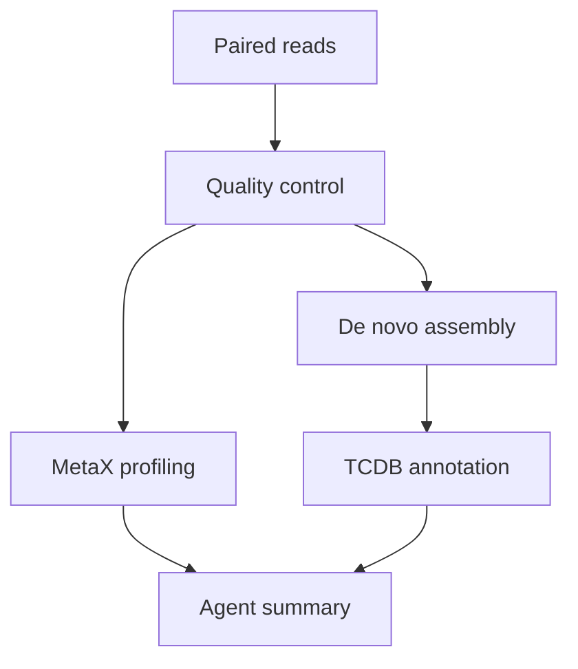

# Live combined pipeline validation — 2026-11-20

Final result **PASS after local corrections**. Four scientific pipeline steps were requested through the live application runtime using OpenRouter and the configured Cromwell/S3 services. The primary workflow finished as **succeeded**, and the agent returned **ok**. The additional plain-language check exposed catalog discovery and approval-guidance issues described below.

Tested branch `pipeline2agent-v4.0.0` at commit `92486c5`. Model alias `gpt-5.6-sol` resolved to `openai/gpt-5.6-sol-pro` for these test processes. The recorded approval belongs to `pipeline_specialist`. This checkout supports direct main-agent pipeline calls as well as specialist calls. All times in the table use Asia/Shanghai, UTC+08:00.

The test used the same `async_run_agent` and `async_resume_agent` entry points used by the application, with streaming events, a dedicated conversation database, workspace and metadata directory. Test settings were `AGENT_AUTH_MODE=singleuser` and `AGENT_WORKER_BACKEND=docker`. The supplied OpenRouter proxy and Cromwell/S3 configuration were loaded for the test processes. A live premium-model request, Cromwell health request, and S3 access check succeeded. [Service and manifest checks](combination_pipeline_2026-11-20/preflight.json). [Premium-model response](combination_pipeline_2026-11-20/model-preflight.json).

The main run used public paired-end reads from [ENA DRR000852](https://www.ebi.ac.uk/ena/browser/view/DRR000852), documented as *Bacillus subtilis* subsp. *subtilis* strain 168. The first 250,000 records from each mate were retained. All retained mate identifiers and FASTQ record structures were checked. Each mate contains 18,750,000 sequence bases. The subset hashes are saved separately from the full-source file checksums. [Source metadata](combination_pipeline_2026-11-20/dataset_source.json). [Subset sizes and SHA-256 hashes](combination_pipeline_2026-11-20/input_manifest.json).

The prompt asked the agent to discover the installed pipelines, infer the dependency links, save one graph, and request approval. The driver checked all five expected file links and approved the saved workflow under the user’s authorization. [Exact prompt](combination_pipeline_2026-11-20/request.json). [Approved agent-generated graph](combination_pipeline_2026-11-20/approved-workflow.json).

Workflow ID `3667336148ce4e7d800ebeea6bce340b`. Session ID `live-combination-20261120`. Tracked main-workflow Cromwell IDs appear below.

| Step | Pipeline | Cromwell workflow ID | Submitted | Cromwell finished | Status |
|---|---|---|---|---|---|
| qc | `metagenomic_read_quality_control` | `08b9be9a-c315-4a9c-8bc0-ef3dc5c2d898` | 18:02:48 | 18:03:47 | succeeded |
| assembly | `metagenomic_de_novo_assembly` | `6761928e-7de2-4dac-90d3-a08291b7f7d3` | 18:04:07 | 18:23:56 | succeeded |
| metax | `metax_classification_abundance_analysis` | `271e47b7-3f32-4c6d-812d-0b6ca191ed54` | 18:04:40 | 18:14:17 | succeeded |
| tcdb | `tcdb_annotator_genome` | `dd3bcc97-c3df-40cb-a8a1-be7cc9649dec` | 18:24:01 | 18:25:34 | succeeded |

[Server timings and checks](combination_pipeline_2026-11-20/verification.json). [Observed state transitions](combination_pipeline_2026-11-20/execution-timeline.jsonl).

| Check | Result | Evidence |
|---|---|---|
| All four pipeline steps succeeded | PASS | [verification.json](combination_pipeline_2026-11-20/verification.json) |
| All five upstream-output input links match by SHA-256 | PASS | [verification.json](combination_pipeline_2026-11-20/verification.json) |
| Every dependent submission followed upstream artifact registration | PASS | [verification.json](combination_pipeline_2026-11-20/verification.json) |
| One distinct tracked Cromwell workflow per pipeline step | PASS | [verification.json](combination_pipeline_2026-11-20/verification.json) |
| All remote jobs created by these tests reached terminal states | PASS | [verification.json](combination_pipeline_2026-11-20/verification.json) |
| At most two of the test remote workflows were active concurrently | PASS | [verification.json](combination_pipeline_2026-11-20/verification.json) |
| Assembly and MetaX ran concurrently | PASS | [verification.json](combination_pipeline_2026-11-20/verification.json) |
| Failed prerequisite blocks its dependent before submission | PASS | [upstream-failure.json](combination_pipeline_2026-11-20/upstream-failure.json) |
| Stop cancels the active remote job and its waiting dependent | PASS | [stop-result.json](combination_pipeline_2026-11-20/stop-result.json) |
| Plain-language request produces the correct graph and SDK approval controls after corrections | PASS | [plain-language-plan-check.json](combination_pipeline_2026-11-20/plain-language-plan-check.json) |

The file-link checks streamed each referenced upstream artifact from S3, computed SHA-256, and compared it with the immutable downstream input snapshot. Recorded submission times were also compared with upstream artifact-registration times.

| Output | Downstream input | SHA-256 matches | Submission after upstream registration |
|---|---|---|---|
| `qc.clean_r1` | `assembly.read1` | True | True |
| `qc.clean_r2` | `assembly.read2` | True | True |
| `qc.clean_r1` | `metax.reads` | True | True |
| `qc.clean_r2` | `metax.reads2` | True | True |
| `assembly.contigs` | `tcdb.genome_fasta` | True | True |

The controlled failure case used the workflow service directly and submitted a malformed FASTQ to a real QC job. Cromwell reported the single-end QC task exited with code 1. Its dependent MetaX step became `blocked` and received no pipeline job ID. This case validates failure propagation through the scheduler. [Failure case and remote ID](combination_pipeline_2026-11-20/upstream-failure.json).

The Stop case used a separate live-model request, a workflow approval, and the application’s `resume_agent(..., cancel_requested=...)` mechanism. Cancellation was triggered after the QC remote ID appeared. Cromwell confirmed `Aborted`; the application recorded the QC job and its waiting MetaX dependent as `cancelled`. The dependent received no job ID. [Application Stop response](combination_pipeline_2026-11-20/stop-agent-response.json). [Final cancellation state](combination_pipeline_2026-11-20/stop-result.json).

QC reported 250,000 input read pairs, 207,207 after QC, and 206,721 after host removal. The MetaX profile contains *Bacillus subtilis*, consistent with the submitted dataset metadata. Assembly produced a 4,187,390-byte contig FASTA. TCDB reported 1,768 input contigs covering 4,151,334 bases and generated 7,838 annotation rows across 1,152 queries with hits. Available output previews, sizes and hashes are recorded in [output-previews.json](combination_pipeline_2026-11-20/output-previews.json).

The assembly contig-identification and species-identification reports were both zero bytes. The contig FASTA was populated and passed to annotation successfully. Table population and identification accuracy require further validation for the configured reference collection. TCDB transmembrane prediction was disabled by its existing settings, and its prediction table contains a header only.

The application’s final answer is retained in [agent-final-response.json](combination_pipeline_2026-11-20/agent-final-response.json). Its workflow events and public model/tool event stream are retained in [events.jsonl](combination_pipeline_2026-11-20/events.jsonl).

**Findings and local corrections**

A separate plain-language request omitted command names and graph instructions. Initially the agent said TCDB was unavailable. The recorded shell history confirms that the catalog response was truncated and omitted the TCDB entry. The available compact catalog was about 57,000 characters, exceeding the shell tool’s 32,000-character output budget. [Initial failed discovery](combination_pipeline_2026-11-20/plain-language-initial-plan-response.json). [Truncated tool-response evidence](combination_pipeline_2026-11-20/catalog-truncation-evidence.json).

Catalog commands now return complete entries in bounded pages, expose `next_offset`, and support `catalog --pipeline NAME`. Shared instructions explain how to discover later entries. After this correction the live model found TCDB and constructed the expected graph, but asked for approval in prose without opening SDK approval controls. [Graph after the catalog correction](combination_pipeline_2026-11-20/plain-language-catalog-fix-graphs.json). [Intermediate approval behavior](combination_pipeline_2026-11-20/plain-language-catalog-fix-plan-response.json).

The workflow-run instructions now explicitly tell the agent to invoke the saved plan’s approval-controlled tool to open the review. The final live-model planning check generated all five required links and reached SDK approval. Its execution request was rejected after inspection, with zero remote jobs submitted for that extra check. [Final live planning response](combination_pipeline_2026-11-20/plain-language-plan-response.json). [Rejection and completion](combination_pipeline_2026-11-20/plain-language-plan-rejection.json).

Regression checks cover catalog page boundaries, complete discovery, named lookup and existing pipeline/approval behavior. The suite ran 49 tests, with 47 passing and two Docker opt-in tests skipped. [Regression test results](combination_pipeline_2026-11-20/catalog-regressions.log). The local source changes are retained for review in [Patch](combination_pipeline_2026-11-20/catalog-fix.diff).

This run validates planning, approval, remote execution, data handoff, dependency gating, parallel execution, cancellation, and result delivery to the main agent. Scientific accuracy and the completeness of a whole-genome reconstruction were not benchmarked. The input is a subset of a real public dataset. The test used an isolated SDK session; browser interactions, SSO and MSCAN result transfer were outside this run.

The tests created 6 tracked remote workflows. Their final server states are recorded in [verification.json](combination_pipeline_2026-11-20/verification.json). The main execution used the baseline checkout; the later plain-language retest used the local catalog and instruction corrections. These changes awaited user review at the validation checkpoint. Credentials are excluded from the report and evidence.

**Follow-up specialist organization**

The subsequent local refactor moves the shell tool into `tools/agent_tools/specialist/pipeline/pipeline_shell.py`. The specialist is defined in that package's `__init__.py`, and the main agent delegates pipeline requests to it. Catalog paging and SDK approval guidance are preserved in the moved module.

Refactor verification ran 79 tests, with 63 passing and 16 opt-in container tests skipped. The architecture smoke check also passed. The checks cover specialist-only registration, streaming, approval and rejection, saved approvals from the earlier layout, and a two-step fixture workflow returning verified results to the main agent. The live Cromwell evidence above describes the layout used before this refactor. The refactor was uncommitted at this validation checkpoint.

The graph validation and dependency-ordering code was then extracted into `tools/infrastructure/pipeline_engine/dependency_graph.py`. `workflow.py` calls its `build()` function before saving a plan and continues to handle scheduling and recovery. Verification ran 46 tests, with 45 passing and one opt-in Docker test skipped, plus the architecture smoke check. The saved four-step live graph also validated through the extracted module, and the existing completed workflow remained readable with four succeeded steps and four tracked jobs.

**Follow-up autograph planning specialist**

The internal planner is named `autograph_specialist`. The main agent delegates pipeline work to `pipeline_specialist`, which calls the planner for a new combined analysis. The planner reads installed contracts and owned file metadata, returns a typed proposal with explicit input links and explanations, and validates ready proposals through `dependency_graph.py`. The coordinator saves the graph and opens SDK approval. The planner has read-only discovery tools. Missing data or decisions return as `needs_input`, and registered remote files are identified as requiring import before local use.

A live planning check used `openai/gpt-5.6-sol-pro` with the same four-pipeline goal. It called `autograph_specialist`, produced all five expected input links and saved explanations, and reached approval owned by `pipeline_specialist`. The approval was rejected after review, leaving zero new pipeline jobs. [Planning checks](combination_pipeline_2026-11-20/autograph-live-planning.json). [SDK response and recoverable tool errors](combination_pipeline_2026-11-20/autograph-live-plan-response.json). [Public events](combination_pipeline_2026-11-20/autograph-live-events.jsonl).

During that check, an oversized catalog page request and a core count above the pipeline's limit were rejected. The coordinator obtained a corrected proposal and reached approval. Full catalog contracts now expose effective `plan_limits` for cores and timeout, including isolated worker deadlines, and planner instructions use these bounds. Regression checks verify this metadata. This final metadata correction was tested locally after the live planning check.

The final regression suite ran 98 tests, with 81 passing and 17 skipped. It covers structured proposals, read-only tool composition, nested planning through approval and two real local fixture executions, invalid links, missing requirements, session ownership, remote-file metadata, catalog limits, scheduling, model adapters and approval compatibility. The architecture smoke check also passed. [Final regression output](combination_pipeline_2026-11-20/autograph-regressions.log). The live scientific execution recorded earlier was completed before this planner refactor. These implementation changes were uncommitted at this validation checkpoint. Publication was subsequently authorized together with the main integration described in [main_merge_2026-11-20.md](main_merge_2026-11-20.md).
