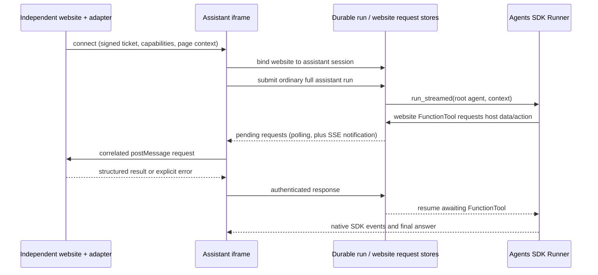

# Embed the full assistant in a trusted website

This contract describes protocol version **1**. The host website owns its pages,
tables, charts, workflow and login. BioAgent supplies an iframe drawer, the full
assistant, and an additional `website_guide` specialist. The host does not import
BioAgent workspace components. Its data does not become an assistant workspace
file until an explicit `website_import_data` call exports it.

## Architecture and SDK requirements



* The root keeps **all** existing biology, data analysis, search, knowledge,
  coding, files, reports, pipelines and specialist capabilities. Website mode
  adds capabilities; it does not replace the root with a restricted chatbot.
* `website_guide` is an SDK **Agent.as_tool()**, with the same shared run context
  as the root. Its job is explanation and guidance grounded in the current page,
  measured data and manual. It delegates computational work back to the root.
* Website reads/actions are small SDK FunctionTools. The bridge is application
  infrastructure, not a new tool type or another agent execution loop.
* Queued jobs retain the website binding. SQLite request/response records work
  across detached workers and HTTP server restarts. A live browser is needed for
  new page requests. A dead worker is marked interrupted by the existing queue;
  its side effects are not automatically replayed.
* DOM text, manuals and data are source material, not instructions that override
  the user or tool policy. Credentials and connection tokens never enter prompts.

The implementation uses native `function_tool`, `Agent.as_tool`, run context and
`Runner.run_streamed`; see the [OpenAI tools guide](https://developers.openai.com/api/docs/guides/tools).

## Quick start: the embedded host-page demo

`/assistant-demo` is the canonical local host page. It owns its table, figure,
filters, workflow, manual, and adapter callbacks; the assistant remains the
embedded `/assistant` iframe. Run this from the repository root:

```bash
npm --prefix frontend ci
npm --prefix frontend run build
python -m interfaces.web --host 127.0.0.1 --port 8000
```

The assistant page is maintained in `frontend/src/features/assistant/`; bridge
components and the generic demo live in `web_bridge/frontend/`. Vite builds their HTML entries into
`frontend/dist/`, which the Python server serves. The public embed client lives
in `web_bridge/frontend/embed.ts`; the build generates `frontend/dist/static/assistant-embed.js`
from that same source used by the demo.
The URLs `/assistant`, `/assistant-demo`, and `/static/assistant-embed.js` stay
stable; host integrations do not need to know the generated bundle filenames.
Keep the Python server's working directory at the repository root because its
default runtime paths are relative to the current process directory.

Open `http://localhost:8000/assistant-demo`. Click the assistant launcher and
ask it to explain the visible table or figure. The page requests a short-lived
demo ticket from `/website/demo-token`; the signing secret stays on the server.
In local mode, when website settings are absent, startup generates a process-local
signing secret and trusts localhost for the demo. Local mode must bind to a
loopback address. Network listeners default to authenticated multi-user mode;
see [User accounts and isolation](user_isolation.md) for LAN access and HTTPS deployment.

An explicitly set `AGENT_WEBSITE_SITES` always takes precedence, including an
empty allowlist. In multi-user mode, configure a stable `AGENT_WEBSITE_SECRET`
and exact trusted origins explicitly. Origins include scheme, hostname and
port, with no path or trailing slash. The demo uses the current BioAgent login.
For independent websites, use the backend connector below: it maps the website's
authenticated subject and signs in the iframe without a second password prompt
or third-party cookies. Never put service or signing secrets in browser code.

## Independent website accounts and durable results

The [independent web bridge module](../web_bridge/README.md) owns the connector in `web_bridge/identity.py`,
`web_bridge/conversations.py` and `web_bridge/http.py`. It has no MSCAN
schema dependencies. [The MSCAN reference adapter](../web_bridge/adapters/mscan/README.md)
adds one backend controller and small frontend hooks.

Configure `AGENT_WEBSITE_CLIENTS_FILE` with the absolute path to a private JSON
file outside version control. Each site has a different random service secret,
an agent-only signing secret, and exact allowed browser origins:

```json
{
  "lab-portal": {
    "secret": "REPLACE_WITH_RANDOM_SERVICE_SECRET_AT_LEAST_32_CHARACTERS",
    "signing_secret": "REPLACE_WITH_DIFFERENT_RANDOM_AGENT_ONLY_SECRET",
    "origins": ["https://lab.example.com"]
  }
}
```

`AGENT_WEBSITE_CLIENTS` can supply the same JSON inline and takes precedence over
the file. An explicit `AGENT_WEBSITE_SITES` still overrides the origin allowlist.
The host backend gets only its service secret. It derives `subject` from its
authenticated user, never from a browser-supplied user ID. Its service requests
send `X-Website-Site: lab-portal` and `Authorization: Bearer <service-secret>`.
These backend endpoints reject browser `Origin` headers. HTTPS is required for
production transport; plain HTTP is supported for local/LAN development.

The mapping key is `(site_id, external_subject)`. A new identity gets a separate
BioAgent account; usernames or emails are not automatically matched. An
administrator can explicitly link an existing account before first use:

```bash
python -m web_bridge.identity lab-portal EXTERNAL_USER_ID EXISTING_AGENT_USERNAME
```

The same runtime/auth database and connector configuration must be used by the
CLI and server. Reassigning an already-linked identity is rejected.
An explicitly linked website is trusted to authenticate as that account. The
embedded assistant uses its normal account permissions; use separate provisioned
accounts when a website must not share an existing standalone account's data.

| Backend endpoint | Input and result |
| --- | --- |
| `POST /website/service/bootstrap` | `{subject, origin, scope_key?}` → single-use login `code` (60 seconds). Creates or restores the user's current website conversation. Default scope is `workspace`. |
| `POST /website/service/ticket` | `{subject, origin}` → short-lived bridge `token`. The service resolves the internal account ID. |
| `POST /website/service/results` | `{subject, scope_key?}` → conversations, recent runs (up to 100 per conversation), original page context, answers and workspace file metadata. |
| `POST /website/service/uploads` | `{subject, session_id, resource_id, revision, filename, size}` → resumable upload state. A repeated source/revision reuses a matching upload or completed file. |
| `PATCH /website/service/uploads/{upload_id}` | Raw bytes, `Upload-Offset`, `Content-Length`, and `X-Website-Subject`. Uses the ordinary owned-upload quotas and chunk limit. |
| `POST /website/service/uploads/{upload_id}/complete` | `{subject, sha256?}` → published owned artifact with SHA256. A supplied checksum must match before publishing. |
| `POST /website/service/uploads/{upload_id}/cancel` | `{subject}` → release incomplete staging storage. |
| `POST /website/service/artifact-ticket` | `{subject, session_id, path}` → single-use download token (60 seconds). Open `/website/download/{token}` for native streaming download. |
| `GET /website/service/artifact?session_id=...&path=...` | Backend streaming alternative. Send `X-Website-Subject`; byte ranges are supported. |
| `POST /website/service/revoke` | `{subject}` → revoke this site's login sessions, grants, download tickets and bindings for this user. Standalone logins remain valid. |

Every conversation/file operation checks site membership and user ownership.
The host must additionally check permission to the source record before sending
its file. Imports carry resource/revision provenance and become independent
session files under `uploads/`; they do not modify the source website's files.
Binary and large files use this streaming API, not `postMessage` text callbacks.

Add `getAuthorization` to the browser mount below. The host exchanges its own
login for a one-time code through its backend; only the trusted assistant iframe
exchanges that code for an eight-hour bearer login. It keeps the credential in
memory, never parent messages, local storage, URL parameters or model context.
The parent receives only session IDs and bridge events. Downloads use short-lived
single-use URLs; do not put these URLs in analytics or proxy access logs.

Reloads restore the current conversation and reconnect an active run. `New chat`
creates another owned conversation; prior results remain available through the
results API. Results persist in the existing run/workspace stores even after the
browser closes. Poll the results endpoint on demand or while a results panel is
open; completion events are a UI refresh hint, not the durable result store.
Page callbacks need a live host browser; detached pipeline execution does not.

On host logout, call `revoke` from the authenticated backend before invalidating
the host session, and destroy the drawer. The MSCAN reference adapter hooks its
existing token invalidation service through an added Spring aspect and also
subscribes to the frontend logout action. MSCAN's original login/security source
files remain unchanged. Server revocation
is bounded by a timeout; if the agent is unavailable, host logout still completes
and a warning is logged. An unreachable agent's remaining login expires normally.

## Host integration API

Load `https://agent.example.com/static/assistant-embed.js`, create an empty mount
element, and provide a website adapter:

```javascript
const assistant = AssistantDrawer.mount({
  target: document.getElementById("assistant-root"),
  src: "https://agent.example.com/assistant",
  siteId: "lab-portal",
  getAuthorization: async () => {
    const response = await fetch("/assistant-bootstrap", {method: "POST"});
    if (!response.ok) throw new Error("Website sign-in failed");
    return response.json(); // {code}, obtained by the host backend from bootstrap
  },
  getToken: async () => {
    const response = await fetch("/assistant-token", {method: "POST"});
    if (!response.ok) throw new Error("Assistant sign-in failed");
    return (await response.json()).token;
  },
  adapter: {
    getPageContext: async () => pageSnapshot(),
    readTable: async ({resource_id, offset, limit}) => tablePage(resource_id, offset, limit),
    readFigure: async ({resource_id}) => chartDescription(resource_id),
    searchManual: async ({query, limit}) => manualSearch(query, limit),
    readManual: async ({section_id}) => manualSection(section_id),
    exportData: async ({resource_id}) => exportResource(resource_id),
    highlight: async ({element_id}) => highlightRegisteredElement(element_id),
    navigate: async ({route_id}) => openRegisteredRoute(route_id),
    invokeAction: async ({action_id, arguments: args}, call) =>
      runRegisteredAction(action_id, args, call.call_id),
  },
  onEvent: (event) => {
    // website-connected and run-complete include session_id.
    if (event.type === "run-complete") refreshResultsFromHostBackend();
  },
});

// Await after route, selection, filter, chart or workflow changes.
await assistant.updateContext();
assistant.open();
// After a backend file import completes, refresh the iframe's attachment list.
assistant.refreshFiles();
// On SPA unmount / logout:
assistant.destroy();
```

Only implement callbacks your website supports. `getPageContext` is optional;
the SDK supplies a generic observer of the actual rendered page. All callbacks may return promises. Their second argument
contains `call_id`, `run_id`, `revision` and `deadline` for correlation and
idempotency. `updateContext(snapshot)` accepts an already built snapshot;
`updateContext()` calls `getPageContext`. Existing context-only mounts still work.
`onEvent` receives connection, run, error and result notifications; it is not a
replacement for callback results. `open()`/`close()` control the drawer.

## Page and resource contracts

Use JSON-safe values, stable resource IDs, and a **new revision string whenever
the relevant page data changes**. Snapshots replace previous snapshots entirely.
Use registered IDs for elements and routes, not executable code or CSS selectors.
Website URLs are public HTTP(S) URLs, never server filesystem paths.

```json
{
  "revision": "analysis-17",
  "title": "Sample comparison",
  "url": "https://lab.example.com/results",
  "selection": {"sample_id": "S2"},
  "filters": {"cohort": "treated"},
  "workflow": {"step": "review", "steps": ["select", "review", "export"]},
  "resources": [
    {"id": "measurements", "kind": "table", "title": "Measurements", "exportable": true},
    {"id": "abundance", "kind": "figure", "title": "Relative abundance"}
  ],
  "elements": [{"id": "cohort-filter", "label": "Cohort filter"}],
  "routes": [{"id": "methods", "label": "Methods"}],
  "actions": [{"id": "set_cohort", "description": "Filter samples", "parameters": {"cohort": ["all", "treated", "control"]}}],
  "manual": {"version": "2026-09", "title": "Lab portal user guide"}
}
```

| Callback / SDK tool | Required result |
| --- | --- |
| `getPageContext` / `website_context` | Snapshot above. Only `revision` and `title` are mandatory; other fields depend on the website. |
| `readTable` / `website_read_table` | `{resource_id, title, columns:[{name,type,unit?}], rows:[{column:value}], offset, total_rows, filters?}`. Return at most the requested limit (1–200); do not imply a page is the whole dataset. |
| `readFigure` / `website_read_figure` | `{resource_id,title,description,x_axis?,y_axis?,series?,filters?,source_table?}`. Axes include units; series include actual values. Report missing values explicitly. This version reads structured chart data; it does **not** claim visual inspection of screenshots or pixels. |
| `searchManual` / `website_search_manual` | `{version, sections:[{id,title,excerpt,url?}]}`; at most the requested limit (1–20). |
| `readManual` / `website_read_manual` | `{section_id,title,version,text,url?}`. Return the selected versioned section. |
| `exportData` / `website_import_data` | `{filename,content,content_type}`; UTF-8 text such as CSV/TSV/FASTA/JSON. It becomes a unique quota-accounted session artifact under `uploads/`, with a relative path and SHA256. Larger/binary files use the backend streaming API or ordinary attachments. |
| `highlight` / `website_highlight` | `{element_id,message}` after highlighting/scrolling to the registered element. |
| `navigate` / `website_navigate` | `{route_id,message}` after SPA navigation. Publish a new snapshot. A full page reload disconnects the old bridge. |
| `invokeAction` / `website_action` | `{action_id,message,...}` after the host validates parameters and performs a registered action. Publish changed context. |

The agent cannot inspect arbitrary cross-origin DOM. The adapter runs in the
host window, where it can use the website's own authenticated API and UI state.
Never expose passwords, cookies, access tokens or unrelated DOM via context.
Do not send the whole database or manual on every question. Keep page context
under 64 KiB, each callback result under 512 KiB, and fetch larger tables in
pages. `website_import_data` uses the same 512 KiB response limit in this version.

The guide cites resource IDs, revision and manual section/version in its answers,
and distinguishes calculated values from explanations. It must report when data
is stale or unavailable. Screenshots/vision and automated manual crawling are
future optional adapters; existing Scrapy/RAG tools remain fully available.
Manual lookup here is live and host-owned; it does not silently ingest the manual.

## Trust and authentication

Configure `AGENT_WEBSITE_SITES` as `{site_id: [exact_origin, ...]}`. Wildcards and
opaque origins are not accepted. Set a secret of at least 32 characters using
`AGENT_WEBSITE_SECRET`. An embedding website backend authenticates its user and
returns a short-lived ticket. The browser never receives the signing secret.

Ticket format: `base64url(payload_json).base64url(HMAC_SHA256(secret, encoded_payload))`,
without base64 padding. Payload contains `{site_id, origin, sub, exp, jti}`;
`exp` is a Unix timestamp no more than five minutes ahead, `jti` is a fresh random
nonce, and `sub` is the mapped **internal BioAgent user ID**. Each ticket is used once.
The generic service issues tickets for you; external backends do not need to
know the mapped ID or the signing key.
The example server demonstrates this using only Python's standard library. Its
token endpoint is for local demonstration; replace its fixed subject with your
login identity and normal CSRF protection in a real host application.

Both windows check exact `event.origin` and `event.source`. Tickets travel through
`postMessage` to the named iframe origin, never URL parameters. The iframe trades
the ticket for a random binding token scoped to its session, site and browser
instance. Bridge requests require that token. Expired tickets cannot create new
bindings; established bindings expire after eight hours. Destroy/logout revokes
the binding. Every host callback still enforces the website user's permissions.

Website bindings enforce the authenticated user's ownership of the selected
session. A ticket or binding token cannot grant access to another account.
The agent's session, run, file, and approval APIs enforce account authorization
independently of the bridge. See [User accounts and isolation](user_isolation.md)
for deployment, registration, legacy data migration, and worker configuration.

Multi-user tool execution uses Docker containers with bounded workspace exchange
and no direct network. Approved public providers and embeddings use host brokers;
durable knowledge operations use an ownership-checked service. Bundled pipeline
templates run through the isolated pipeline broker. `GET /config` reports per-tool,
pipeline, and Quick start readiness. Website callbacks remain in the authenticated
host-side broker. See [supported routes and limits](user_isolation.md#what-is-isolated).

## Transport contract (implemented by the embed library)

Messages use `protocol: 1`. The host supplies `agent-connect` with `site_id`,
`instance_id`, `ticket`, `capabilities` (callback names) and `context`.
`agent-context` replaces the snapshot. The iframe sends `agent-website-request`
with `{call_id,run_id,method,arguments,revision,deadline}`. The host replies with
`agent-website-response` and either `result` or `error:{code,message}`, echoing
`call_id`, `run_id`, `revision`. `agent-disconnect` revokes the binding.

| Assistant endpoint | Purpose |
| --- | --- |
| `POST /website/connect` | Ticket + session + instance + capabilities + snapshot → `{binding_id,token}`. |
| `POST /website/context` | Binding credentials + replacement `context`. |
| `POST /website/poll` | Binding credentials → `{requests:[...]}`. Poll while mounted; this also works during approval resume and SSE reconnect. |
| `POST /website/respond` | Binding credentials + correlated response; duplicates with identical content are accepted, conflicting/stale responses rejected. |
| `POST /website/disconnect` | Binding credentials → revocation. |
| `POST /run` or `/run_stream` | Normal payload plus `website:{binding_id,token}`. Returns the ordinary durable job/stream. All root tools remain available. |
| `GET /runs/{id}` and `/runs/{id}/events?after={sequence}` | Existing durable status/event polling. The drawer uses these to recover a dropped run stream. |

Run events include `website_tool_request` as a notification, without credentials.
The poll endpoint is authoritative for still-pending requests. A callback has a
45-second deadline. Unsupported callbacks, missing resources, stale revisions,
revoked bindings and timeouts return explicit errors to the model. Read results
are rejected if the page revision changed in flight. Actions may change revision;
their response still echoes the revision under which they were requested.

The host caches in-flight/completed callbacks by `call_id` for its mounted
instance, so polling/network retries do not repeat actions. For actions with
external side effects, the host backend **must** also use `call_id` as an
idempotency key. Exactly-once execution across a browser crash cannot be promised.
A new page load has a new instance. Reconnecting the same owned session/site/origin
reuses its active binding so a worker's pending request can be delivered again;
the host must deduplicate side effects by `call_id` across page reloads. Stale
revisions and expired request deadlines still reject responses.
Closing the drawer keeps the adapter alive; destroying it disconnects. A browser
disconnect does not cancel computation already running on the agent server.

## Acceptance requirements

1. The standalone page works without the assistant; loading the embed adds no
   dependencies on BioAgent workspace components or data storage.
2. Cross-origin origin/source validation, ticket replay rejection, session and
   call correlation, stale revision handling, timeouts and duplicate responses
   are covered by tests.
3. The assistant can explain a visible chart from its data, read a table page,
   find a manual section, guide a workflow and import a dataset for existing
   analysis tools. Ordinary full-assistant questions and file uploads still work.
4. Requests persist across store instances/processes; streaming loss does not
   submit a second run or replay a host action. SDK tests use scripted models,
   so verification does not require a paid model request.

## Resource and result handoff

The module also supports file discovery/import and durable result delivery; see
[the module guide](../web_bridge/README.md#page-resource-and-result-interoperability).

The SDK automatically observes route and DOM changes. Hosts can additionally
publish structured selection or result metadata. Include an optional, website-defined
`delivery_target` object when results should return to the current object. The
agent records that destination at run creation. This is independent of subsequent
page navigation.

Optional browser callbacks:

- `listResources({sample_id, offset, limit})` returns stable resource IDs, kinds,
  filenames/sizes and pagination information. `sample_id` is the MSCAN adapter's
  filter; other website adapters can expose their own resource metadata.
- `importResource({resource_id})` asks the website backend to stream the file
  through the authenticated upload API and returns `{file: ...}`. The agent
  verifies that the file actually exists in its own workspace.

Backend delivery endpoints require the private service credential and exact
`X-Website-Site`. They do not accept a browser's assertion of another user:

| Endpoint | Purpose |
|---|---|
| `POST /website/service/deliveries` | Lease that site's ready deliveries, including verified external subject and saved target |
| `GET /website/service/delivery-artifact?id=...&path=...` | Stream a file listed in that delivery manifest |
| `POST /website/service/delivery-ack` | Acknowledge durable receipt, or request retry; requires the current lease |
| `POST /website/service/receive-share` | Redeem a one-use share for the authenticated website subject and validated destination |

The receiving backend validates destination ownership, persists the output files
and its receipt, and only then acknowledges. A lost acknowledgement must not
create another native analysis record. The reference MSCAN adapter implements
this with private files and atomic receipt writes. Artifact storage and parsing
belong to the website adapter, not to the generic delivery queue. MSCAN groups
its adapter into [connection, data transfer, result importers and resources](../web_bridge/adapters/mscan/README.md#code-organization).

Signed-in users push and pull through natural-language tools in
`tools/function_tools/website/transfer.py`, backed by `web_bridge/transfer/`; no transfer buttons are required. See the
[module protocol](../web_bridge/README.md#independent-browser-and-transfer-modules)
for backend command polling, destination creation, scoped uploads and retries.
Transferring files from a standalone session does not grant access to unrelated
conversations.

Pushing a pipeline results ZIP also transfers the individual outputs from its
owned job manifest, so MSCAN can populate its native QC view. File delivery and
native import are reported separately (`native_qc_applied` and `qc`); a stored
archive alone is not proof of native QC registration.

MSCAN now has a separate [analysis import module](../web_bridge/README.md#analysis-result-exchange)
that reuses its native result parsers. Push receipts distinguish file delivery
from native import for each pipeline job, including missing outputs, incompatible
sample types, unknown formats and failures. Native result files can also be
searched and pulled into an agent session. The normal sample toolbar exposes
received and native files across analysis tabs.

Native import depends on the output format having a registered mapping; generic
file exchange supports additional pipelines without such a mapping. Consult the
module's format table and live fixture command for actual coverage and deployment
dependencies.

MSCAN leases transfer commands only when a worker slot is available
(`bioagent.transfer-workers`, default 3). The `/website/service/commands` request
can include `exclude_ids`, a list of active command IDs, to avoid re-leasing a
locally running command if its heartbeat was delayed. Exclusion lasts only for
that poll request; durable expiry/retry still applies after the process stops.
